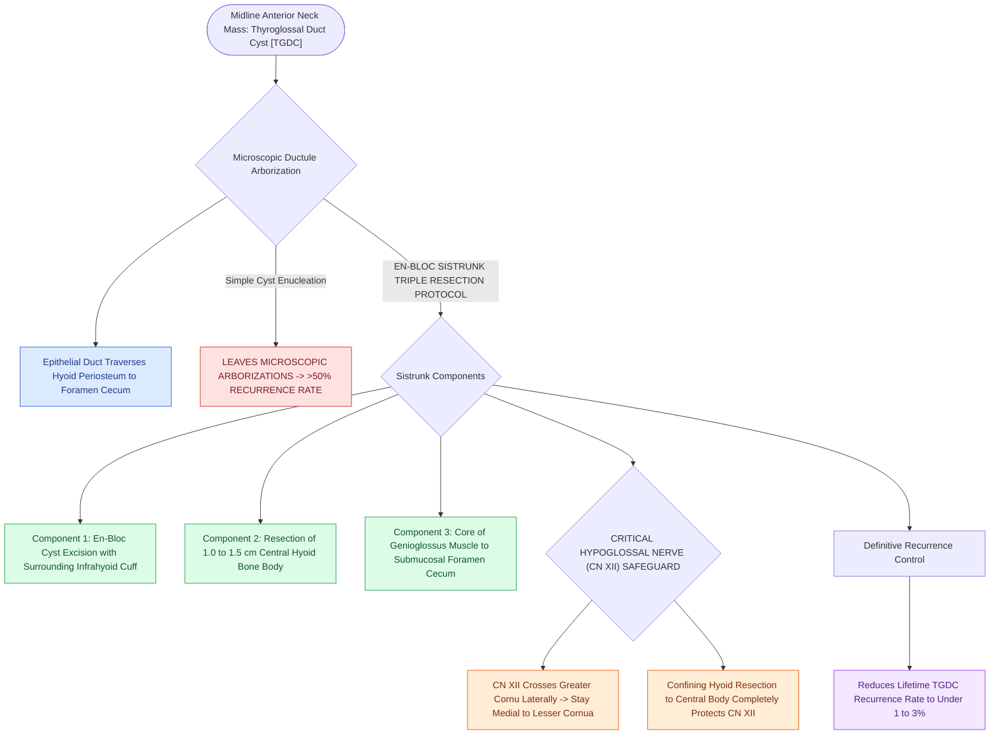

# Sistrunk procedure resects the thyroglossal duct cyst with the central body of the hyoid bone and foramen cecum core

## Active Recall

> [!question]- What are the three essential anatomical components resected en-bloc in a Sistrunk procedure?
> *Answer / Clinical Rationale*: The **cyst**, the **central body of the hyoid bone ($1.0\text{–}1.5\text{ cm}$)**, and a **core of tongue base musculature extending to the foramen cecum**.

> [!question]- What anatomical structure guides the lateral limits of hyoid bone resection to protect the hypoglossal nerves?
> *Answer / Clinical Rationale*: The **lesser cornua of the hyoid bone** (resecting only between the lesser cornua preserves CN XII laterally).

## Core Clinical & Mechanistic Principles
The **Sistrunk Procedure (Walter Sistrunk, 1920)** is the gold standard surgical operation for complete excision of a [[Thyroglossal duct cyst tract tracks from the foramen cecum through the hyoid bone to the anterior neck|thyroglossal duct cyst]] (TGDC), reducing recurrence from $>50\%$ down to **$<1\text{–}3\%$**:
- **Why Simple Enucleation Fails ($>50\%$ Recurrence)**:
  - During embryonic thyroid descent, microscopic accessory thyroglossal ductules arborize intimately through the periosteum and cartilage of the **hyoid bone body** and ascend through the **tongue base musculature to the foramen cecum**.
  - Simple cyst enucleation leaves these microscopic ductules behind, guaranteeing recurrent cyst formation and infection.
- **The Three Mandatory Components of the Sistrunk Procedure**:
  1. **En-Bloc Cyst Excision**: Resect the cyst with a generous cuff of surrounding pretracheal and infrahyoid strap muscles.
  2. **Central Hyoid Bone Body Resection**: Resect a **$1.0\text{–}1.5\text{-cm}$ central segment of the hyoid bone body** en-bloc with the tract (between the lesser cornua).
  3. **Core of Tongue Base Musculature to Foramen Cecum**: Core out a **$5\text{–}10\text{-mm}$ cylindrical cone of [[Geniohyoid and genioglossus muscles are primary upper airway dilators maintaining pharyngeal patency|genioglossus muscle]]** along the tract up to, but not through, the mucosa of the **foramen cecum** (placing an assistant's finger in the oral cavity to push the foramen cecum forward).

### Surgical Technique & Critical Safety Checks
- **Hypoglossal Nerve Safety**: The hypoglossal nerves (CN XII) cross the greater cornu of the hyoid bone laterally; keep hyoid bone resection strictly confined to the central body between the lesser cornua.

## Connected Concepts & Graph Traversal
- **TGDC Overview**: [[Thyroglossal duct cyst tract tracks from the foramen cecum through the hyoid bone to the anterior neck|TGDC Overview]]
- **Second Branchial Cleft**: [[Second branchial cleft anomalies represent the most common branchial anomaly situated anterior to the sternocleidomastoid|Second Branchial Cleft]]
- **First Branchial Parotid**: [[First branchial cleft Work Type I and Type II anomalies require superficial parotidectomy with facial nerve dissection|First Branchial Parotid]]
- **Embryological & Sleep Foundation**: [[Loop gain, arousal threshold, and muscle responsiveness represent the non-anatomical endotypes of obstructive sleep apnea]]
- **Sleep Endoscopy & Airway Dynamics**: [[Drug-induced sleep endoscopy DISE evaluates dynamic multi-level upper airway collapse under sedation|Drug-Induced Sleep Endoscopy (DISE)]] [[Coblation lingual tonsillectomy debulks tongue base lymphoid tissue while preserving the lingual neurovascular bundles]]
- **Congenital Airway Pathology**: [[Endoscopic balloon dilation with steroid injection manages early, soft, non-circumferential subglottic stenosis]]
- **Open Airway Reconstruction**: [[Slide tracheoplasty expands complete tracheal rings by oblique division and sliding longitudinal reconstruction]]
