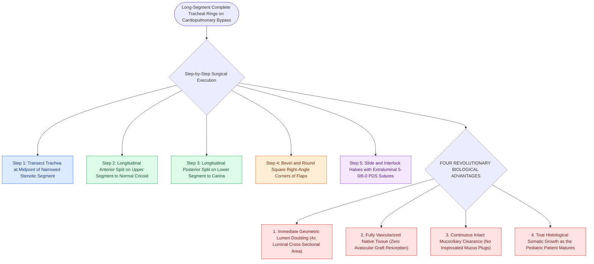

# Slide tracheoplasty achieves immediate vascularized mucosal lumen doubling with lowest restenosis rates

## Active Recall

> [!question]- Why does slide tracheoplasty demonstrate true long-term growth with the child compared to cartilage-grafted reconstructions?
> *Answer / Clinical Rationale*: Because it utilizes **native, vascularized tracheal tissue and mucosa**, allowing normal cellular proliferation and circumferential remodeling.

> [!question]- What surgical maneuver is performed on the square corners of the split tracheal segments before suturing?
> *Answer / Clinical Rationale*: The corners are **beveled and rounded** to prevent mucosal stepping and promote smooth laminar airflow.

## Core Clinical & Mechanistic Principles
**Slide Tracheoplasty** (pioneered by Peter Goldstraw and Martin Tsang in 1989) is the gold standard surgical procedure for long-segment congenital tracheal stenosis and **[[Complete tracheal rings present with generalized tracheal stenosis and stovepipe appearance on imaging|complete tracheal rings]]** (differentiated on diagnostic airway workup from congenital tracheal agenesis [Floyd Types I–III] and extrinsic [[Complete vascular rings and pulmonary artery slings cause tracheoesophageal compression requiring surgical division or arterial translocation|double aortic arch / vascular ring]] compression), reducing mortality from $>50\%$ to **$<5\text{–}8\%$** and achieving long-term decannulation and survival rates exceeding **$>90\text{–}95\%$**:
- **Biomechanical Principle**: Resecting $>30\text{–}50\%$ of tracheal length via primary end-to-end resection causes fatal anastomotic distraction tension. Sliding two opposing split halves over each other **doubles luminal diameter, quadruples ($4\times$) cross-sectional area ($A = \pi r^2$), and reduces airway resistance 16-fold** (Poiseuille's law, $R \propto 1/r^4$) with a $50\%$ tracheal length shortening accommodated tension-free.
- **Surgical Step-by-Step Execution**:
  1. **Median Sternotomy & Cardiopulmonary Bypass (CPB)**: Expose the entire anterior trachea from cricoid to carina (essential for extensive stenosis extending to the carina or concurrent pulmonary artery sling repair).
  2. **Tracheal Transection**: Transect the trachea obliquely at the midpoint of the stenotic segment.
  3. **Longitudinal Splits**: Make a vertical **anterior midline split in the upper segment** up to normal cricoid/trachea, and a vertical **posterior midline split in the lower segment** down to the carina or bronchi.
  4. **Beveling the Corners**: Trim the right-angle square corners of the tracheal flaps into gentle rounded bevels to prevent mucosal stepping and promote smooth laminar airflow.
  5. **Running / Interrupted Anastomosis**: Slide and interlock the halves using continuous or interrupted **5-0 or 6-0 PDS / Monocryl sutures**, placing knots extraluminally.
- **Why Slide Outperforms Cartilage-Grafted Reconstructions**:
  - **Zero Avascular Graft Resorption**: Uses 100% native, vascularized respiratory tissue without non-vascularized cartilage or prosthetic grafts.
  - **Immediate Mucociliary Clearance**: Preserved native ciliated epithelium clears mucus spontaneously.
  - **Somatic Growth Potential**: The vascularized anastomosis demonstrates true histological cellular growth as the child matures.

### Surgical Technique & Critical Safety Checks
- **Postoperative Care**: Extubation within 48–72 hours; early postoperative flexible bronchoscopy to clear secretions and confirm anastomotic integrity.

## Connected Concepts & Graph Traversal
- **Complete Tracheal Rings**: [[Complete tracheal rings present with generalized tracheal stenosis and stovepipe appearance on imaging|Complete Tracheal Rings]]
- **Chin-to-Chest Stitch**: [[Postoperative chin-to-chest flexion stitch prevents catastrophic neck extension and tracheal anastomotic dehiscence|Chin-to-Chest Stitch]]
- **CTR Resection**: [[Cricotracheal resection CTR achieves primary end-to-end anastomosis for severe Grade III and IV subglottic stenosis|CTR Resection]]
- **Concurrent Vascular Compression**: [[Complete vascular rings and pulmonary artery slings cause tracheoesophageal compression requiring surgical division or arterial translocation|Concurrent Sling Repair & Slide Tracheoplasty]]
