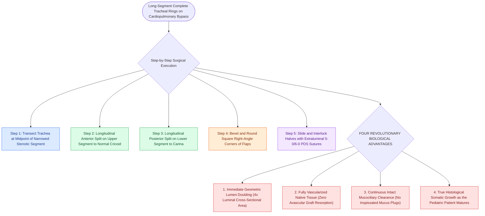

# Slide tracheoplasty achieves immediate vascularized mucosal lumen doubling with lowest restenosis rates

## Active Recall

> [!question]- Why does slide tracheoplasty demonstrate true long-term growth with the child compared to cartilage-grafted reconstructions?
> *Answer / Clinical Rationale*: Because it utilizes **native, vascularized tracheal tissue and mucosa**, allowing normal cellular proliferation and circumferential remodeling.

> [!question]- What surgical maneuver is performed on the square corners of the split tracheal segments before suturing?
> *Answer / Clinical Rationale*: The corners are **beveled and rounded** to prevent mucosal stepping and promote smooth laminar airflow.

## Core Clinical & Mechanistic Principles
[[Slide tracheoplasty expands complete tracheal rings by oblique division and sliding longitudinal reconstruction|Slide tracheoplasty]] has transformed congenital tracheal surgery, reducing mortality from $>50\%$ to **$<5\text{–}8\%$** and achieving long-term decannulation and survival rates exceeding **$>90\text{–}95\%$**:
- **Surgical Step-by-Step Execution**:
  1. **Median Sternotomy & CPB**: Expose the entire anterior trachea from cricoid to carina on cardiopulmonary bypass.
  2. **Tracheal Transection**: Transect the trachea at the midpoint of the stenotic segment.
  3. **Longitudinal Splits**:
     - Make a vertical **anterior midline split in the upper segment** up to normal cricoid/trachea.
     - Make a vertical **posterior midline split in the lower segment** down to the carina or bronchi.
  4. **Beveling the Corners**: Trim the right-angle square corners of the tracheal flaps into gentle rounded bevels to ensure smooth laminar airflow.
  5. **Running / Interrupted Anastomosis**: Suture the sliding segments with continuous or interrupted **5-0 or 6-0 PDS / Monocryl sutures**, placing knots extraluminally.
- **Why Slide Outperforms Other Reconstructions**:
  - **Zero Graft Resorption**: Does not rely on avascular cartilage grafts.
  - **Immediate Mucociliary Clearance**: Preserved native ciliated epithelium clears mucus spontaneously.
  - **Growth Potential**: The vascularized anastomosis demonstrates true histological growth as the child matures.

### Surgical Technique & Critical Safety Checks
- **Postoperative Care**: Extubation within 48–72 hours; early postoperative flexible bronchoscopy to clear secretions and confirm anastomotic integrity.

## Connected Concepts & Graph Traversal
- **Slide Tracheoplasty**: [[Slide tracheoplasty expands complete tracheal rings by oblique division and sliding longitudinal reconstruction|Slide Tracheoplasty]]
- **Complete Tracheal Rings**: [[Complete tracheal rings present with generalized tracheal stenosis and stovepipe appearance on imaging|Complete Tracheal Rings]]
- **Chin-to-Chest Stitch**: [[Postoperative chin-to-chest flexion stitch prevents catastrophic neck extension and tracheal anastomotic dehiscence|Chin-to-Chest Stitch]]
- **Embryological & Sleep Foundation**: [[First branchial cleft anomalies present as periauricular cysts or sinus tracts parallel to the external auditory canal]]
- **Sleep Endoscopy & Airway Dynamics**: [[Drug-induced sleep endoscopy DISE evaluates dynamic multi-level upper airway collapse under sedation|Drug-Induced Sleep Endoscopy (DISE)]] [[Rapid maxillary expansion widens the hard palate and nasal floor to improve pediatric nasal breathing and OSA]]
- **Congenital Airway Pathology**: [[Type I through Type IV laryngeal clefts represent congenital tracheoesophageal communication defects]]
- **Open Airway Reconstruction**: [[Double-stage LTR maintains a tracheostomy and utilizes an endolaryngeal LT-Mold or Montgomery T-tube stent]]
