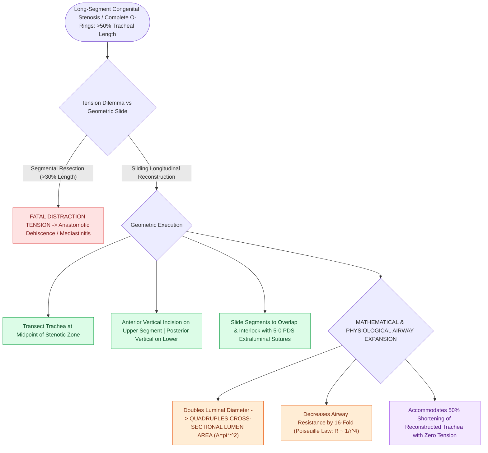

# Slide tracheoplasty expands complete tracheal rings by oblique division and sliding longitudinal reconstruction

## Active Recall

> [!question]- By what factor does a slide tracheoplasty increase the cross-sectional area of a stenotic trachea?
> *Answer / Clinical Rationale*: It **quadruples ($4\times$) the cross-sectional lumen area** (by doubling the diameter).

> [!question]- What tissue lines the reconstructed airway in a slide tracheoplasty?
> *Answer / Clinical Rationale*: **100% native, vascularized respiratory mucosa** (no non-vascularized cartilage grafts are used).

## Core Clinical & Mechanistic Principles
**Slide Tracheoplasty** (pioneered by Peter Goldstraw and Martin Tsang in 1989) is the gold standard surgical procedure for long-segment congenital tracheal stenosis and **[[Complete tracheal rings present with generalized tracheal stenosis and stovepipe appearance on imaging|complete tracheal rings]]**:
- **Biomechanical Principle of Sliding Reconstruction**:
  - Resecting long-segment tracheal stenosis ($>30\text{–}50\%$ of tracheal length) via end-to-end resection is impossible due to excessive anastomotic tension.
  - Slide tracheoplasty **transects the stenotic segment at its midpoint**, divides the upper segment anteriorly and lower segment posteriorly, and **slides the two halves over each other**, creating an anastomosis with:
    - **$4\times$ increase in cross-sectional area** ($A = \pi r^2$; doubling diameter quadruples area).
    - **$50\%$ reduction in overall tracheal length** (easily accommodated without tension).
- **Vascularized Mucosal Reconstruction**:
  - The entire neo-trachea is composed of **vascularized, native respiratory epithelium**, eliminating the need for avascular cartilage grafts or prosthetic materials.

### Surgical Technique & Critical Safety Checks
- **Cardiopulmonary Bypass (CPB)**: Extensive slide tracheoplasties extending to the carina or associated with pulmonary artery sling require median sternotomy and cardiopulmonary bypass.

## Connected Concepts & Graph Traversal
- **Complete Tracheal Rings**: [[Complete tracheal rings present with generalized tracheal stenosis and stovepipe appearance on imaging|Complete Tracheal Rings]]
- **Slide Tracheoplasty Craft**: [[Slide tracheoplasty achieves immediate vascularized mucosal lumen doubling with lowest restenosis rates|Slide Tracheoplasty Craft]]
- **CTR Resection**: [[Cricotracheal resection CTR achieves primary end-to-end anastomosis for severe Grade III and IV subglottic stenosis|CTR Resection]]
- **Surgical Technique**: [[Complete vascular rings and pulmonary artery slings cause tracheoesophageal compression requiring surgical division or arterial translocation|Concurrent Sling Repair & Slide Tracheoplasty]]
