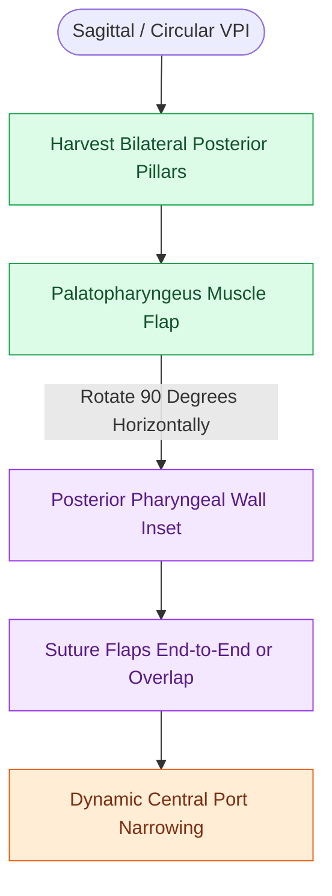

# Sphincter pharyngoplasties transpose bilateral palatopharyngeus flaps to narrow the lateral velopharyngeal port in sagittal insufficiency

## Active Recall

> [!question]- What muscle is mobilized and transposed during a Hynes or Orticochea sphincter pharyngoplasty?
> *Answer / Clinical Rationale*: The **palatopharyngeus muscle** (harvested within the posterior tonsillar pillars).

> [!question]- For which dynamic velopharyngeal closure pattern is sphincter pharyngoplasty preferred over a posterior pharyngeal flap?
> *Answer / Clinical Rationale*: **Sagittal closure pattern** (characterized by active velar elevation and posterior movement, but deficient lateral pharyngeal wall medialization) or a **circular closure pattern with deep lateral gaps**.

## Core Clinical & Mechanistic Principles
**Sphincter pharyngoplasty** (described by Hynes in 1950 and modified by Orticochea in 1968) treats [[Velopharyngeal insufficiency VPI causes hypernasal resonance and nasal air emission during speech|velopharyngeal insufficiency (VPI)]] by transposing bilateral muscular posterior tonsillar pillar flaps to dynamically narrow the transverse and lateral dimensions of the velopharyngeal sphincter.

### Surgical Technique & Execution
1. **Flap Harvest**:
   - Vertical incisions are made along the free borders of the posterior tonsillar pillars bilaterally to elevate the **palatopharyngeus muscle** and overlying mucosa.
   - Flaps are detached inferiorly near the lower pole of the tonsillar fossa while preserving superior neurovascular pedicles.
2. **Posterior Wall Inset**:
   - A transverse mucosal incision is created across the posterior pharyngeal wall at the level of the velopharyngeal contact point (at or above Passavant's ridge).
   - *Hynes Technique*: The two palatopharyngeus flaps are overlapped and inset into the transverse posterior pharyngeal wall defect.
   - *Orticochea Technique*: The flap tips are sutured end-to-end to each other and anchored to a small inferiorly based posterior pharyngeal mucosal flap.
3. **Dynamic Sphincteric Function**:
   - Transposition creates a raised muscular dynamic ridge on the posterior pharyngeal wall that narrows lateral air escape during speech while leaving a central airway port for nasal respiration.

## Critical Safety Checks & Complication Prevention
- **Height of Flap Inset**: Flaps inset too low on the posterior pharynx fail to contact the elevating velum, leaving persistent hypernasality and air emission. Flaps inset too high risk nasopharyngeal stenosis.
- **Airway Compromise**: Over-tightening of the sphincter causes postoperative sleep-disordered breathing and obstructive sleep apnea.

## Connected Concepts & Graph Traversal
- **Flap Counterpart (Coronal VPI)**: [[Superiorly based posterior pharyngeal flaps create a central tissue bridge for coronal velopharyngeal insufficiency|Posterior Pharyngeal Flap]]
- **Underlying Pathology**: [[Velopharyngeal insufficiency VPI causes hypernasal resonance and nasal air emission during speech|Velopharyngeal Insufficiency Overview]]
- **Adult Sleep Counterpart**: [[Expansion sphincter pharyngoplasty ESP rotates the palatopharyngeus muscle to stabilize lateral pharyngeal wall collapse|Expansion Sphincter Pharyngoplasty (ESP for OSA)]]
- **Primary Cleft Repair**: [[Two-flap palatoplasty and Furlow double-reversing Z-plasty reconstruct the hard and soft palate musculature|Palatoplasty Techniques]]
- **Postoperative Complication**: [[Velopharyngeal incompetence following sleep surgery causes transient or permanent hypernasality and nasal regurgitation|Post-Surgical Velopharyngeal Incompetence]]
