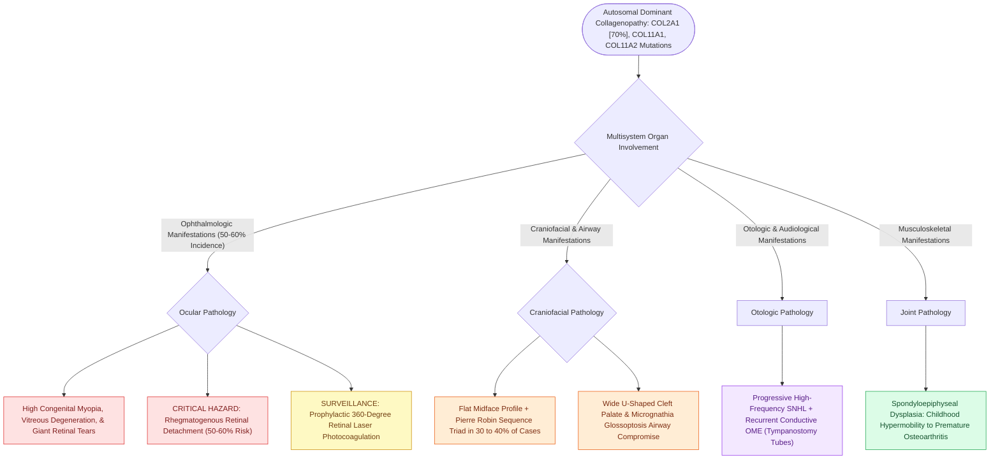

# Stickler syndrome combines progressive sensorineural hearing loss, spondyloepiphyseal dysplasia, and retinal detachment

## Active Recall

> [!question]- What is the molecular genetic defect underlying Stickler syndrome (hereditary progressive arthro-ophthalmopathy)?
> *Answer / Clinical Rationale*: Stickler syndrome is an autosomal dominant connective tissue disorder caused by mutations in collagen genes involved in type II, IX, and XI procollagen synthesis, predominantly **COL2A1** (Type I, $>70\%$), **COL11A1** (Type II), and **COL11A2** (Type III / non-ocular form).

> [!question]- What is the critical ophthalmologic hazard in patients with Stickler syndrome, and how does it relate to Pierre Robin sequence?
> *Answer / Clinical Rationale*: Severe vitreoretinal degeneration, **high congenital myopia, and giant retinal tears causing rhegmatogenous retinal detachment** in up to $50\text{–}60\%$ of patients. Stickler syndrome is the **most common syndromic etiology of Pierre Robin sequence** (accounting for $30\text{–}40\%$ of cases); any infant with PRS mandates urgent dilated ophthalmologic examination and prophylactic retinal laser photocoagulation / cryopexy.

> [!question]- What otologic and musculoskeletal manifestations are characteristic of Stickler syndrome?
> *Answer / Clinical Rationale*: **Progressive sensorineural or mixed hearing loss** (often high-frequency SNHL exacerbated by recurrent conductive loss from Eustachian tube dysfunction/cleft palate), **midface hypoplasia with a flat facial profile**, and **spondyloepiphyseal dysplasia** presenting with hypermobile joints in childhood progressing to premature severe osteoarthropathy.

## Core Clinical & Mechanistic Principles
Stickler syndrome is an autosomal dominant collagenopathy affecting approximately $1\text{ in }10,000$ individuals:

### Clinical Management & Multidisciplinary Protocol
1. **Ophthalmologic Surveillance**: Prophylactic 360-degree retinal laser photocoagulation has drastically reduced the incidence of blinding retinal detachment. Annual dilated indirect ophthalmoscopy is lifelong.
2. **Otologic Monitoring**: Regular audiograms with early placement of tympanostomy tubes for persistent middle ear effusion and fitting with conventional digital hearing aids as sensorineural thresholds decline.
3. **Airway & Palate**: Multidisciplinary cleft palate team management and aggressive neonatal airway stabilization for co-existing Pierre Robin sequence (see [[Pierre Robin sequence manifests with micrognathia, glossoptosis, and secondary U-shaped cleft palate|Pierre Robin Sequence & Stickler Association]]).

## Connected Concepts & Graph Traversal
- **Airway & Cleft Association**: [[Pierre Robin sequence manifests with micrognathia, glossoptosis, and secondary U-shaped cleft palate|Pierre Robin Sequence & Stickler Association]]
- **Pediatric Hearing Loss Overview**: [[Syndromic pediatric sensorineural hearing loss encompasses Pendred, Usher, Waardenburg, and Jervell and Lange-Nielsen syndromes|Syndromic SNHL Overview]]
- **Palatal Muscle Reconstruction**: [[Two-flap palatoplasty and Furlow double-reversing Z-plasty reconstruct the hard and soft palate musculature|Cleft Palate Repair in Stickler]]
- **Pediatric Middle Ear Effusion**: [[Tympanostomy tube placement follows guideline criteria for chronic effusion and recurrent acute otitis media|Tympanostomy Tubes in Craniofacial Clefts]]
- **Differential Craniofacial Dysostosis**: [[Treacher Collins syndrome results from TCOF1 mutations causing mandibulofacial dysostosis and conductive hearing loss|Treacher Collins Comparison]]
