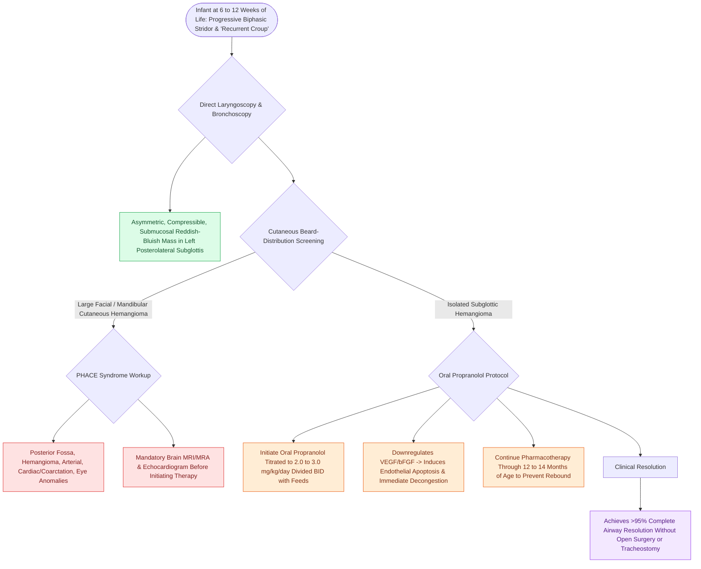

# Subglottic hemangiomas present as biphasic stridor in infants and respond to systemic oral propranolol

## Active Recall

> [!question]- What is the first-line medical therapy for proliferating subglottic hemangiomas?
> *Answer / Clinical Rationale*: **Oral propranolol ($2.0\text{ to }3.0\text{ mg/kg/day}$)**.

> [!question]- Why is propranolol therapy continued until 12 to 14 months of age?
> *Answer / Clinical Rationale*: To span the entire **infantile proliferative growth phase** and prevent rebound regrowth of the hemangioma.

## Core Clinical & Mechanistic Principles
**Subglottic hemangiomas** are benign vascular neoplasms (infantile hemangiomas) that develop in the submucosa of the subglottis, causing progressive infant airway compromise:
- **Clinical Presentation & Natural History**:
  - Infant is normal at birth; develops **progressive biphasic stridor, [[Viral laryngotracheobronchitis croup presents with a barking cough and subglottic steeple sign on radiography|barking cough]], and respiratory distress at $6\text{ to }12\text{ weeks}$ of life** (coinciding with the rapid proliferative growth phase).
  - Often misdiagnosed as "recurrent croup" or asthma unresponsive to steroids.
  - **Cutaneous Association**: $50\%$ of infants have concurrent **cutaneous hemangiomas**; large facial "beard distribution" hemangiomas carry a $>60\%$ risk of airway involvement (**PHACE syndrome screening mandatory**).
- **Endoscopic Appearance**:
  - Smooth, compressible, submucosal, reddish-pink or bluish mass typically located in the **left posterolateral subglottis** ($>80\%$).
- **Medical Treatment Standard of Care**:
  - **Oral Propranolol ($2.0\text{–}3.0\text{ mg/kg/day}$ divided BID/TID)**: Non-selective beta-blocker that causes immediate vasoconstriction, downregulates VEGF and bFGF, and triggers capillary endothelial apoptosis.
  - Achieves **$>95\%$ resolution**, completely replacing open surgical resection and tracheostomy.

### Surgical Technique & Critical Safety Checks
- **Treatment Duration**: Propranolol must be continued until **$12\text{–}14\text{ months}$ of age** (through the end of the proliferative phase) to prevent rebound regrowth upon discontinuation.

## Connected Concepts & Graph Traversal
- **Infantile Hemangiomas**: [[Infantile hemangiomas exhibit rapid neonatal proliferation followed by slow involution driven by GLUT-1 positivity|Infantile Hemangiomas]]
- **Propranolol Therapy**: [[Oral propranolol is the first-line pharmacotherapy for proliferating infantile hemangiomas|Propranolol Therapy]]
- **Stridor Localization**: [[Inspiratory, biphasic, and expiratory stridor localize pediatric airway obstruction to supraglottic, subglottic, and tracheobronchial subsites|Stridor Localization]]
- **Embryological & Sleep Foundation**: [[Third and fourth branchial pouch anomalies present as recurrent left thyroid bed abscesses and piriform sinus fistulas]]
- **Sleep Endoscopy & Airway Dynamics**: [[Drug-induced sleep endoscopy DISE evaluates dynamic multi-level upper airway collapse under sedation|Drug-Induced Sleep Endoscopy (DISE)]] [[Rapid maxillary expansion widens the hard palate and nasal floor to improve pediatric nasal breathing and OSA]]
- **Congenital Airway Pathology**: [[Congenital bilateral vocal fold paralysis presents with severe inspiratory stridor requiring airway protection]]
- **Open Airway Reconstruction**: [[Single-stage LTR utilizes an endotracheal tube as a temporary stent avoiding tracheostomy placement]]
