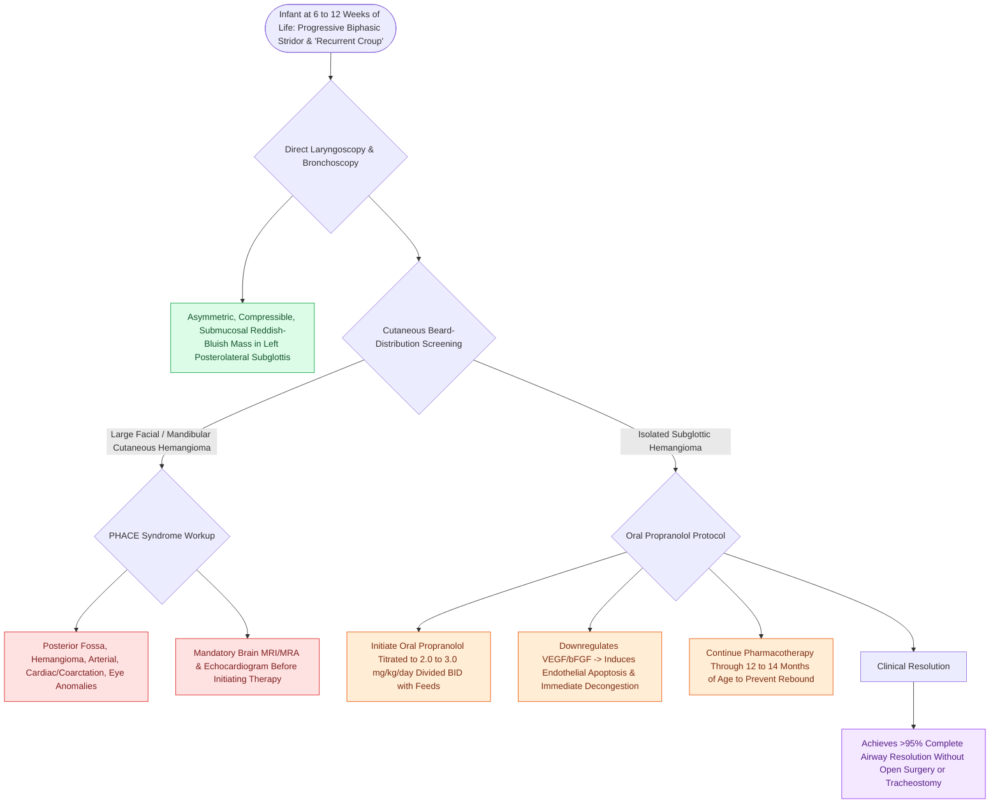

# Subglottic hemangiomas present as biphasic stridor in infants and respond to systemic oral propranolol

## Active Recall

> [!question]- What is the first-line medical therapy for proliferating subglottic hemangiomas?
> *Answer / Clinical Rationale*: **Oral propranolol ($2.0\text{ to }3.0\text{ mg/kg/day}$)**.

> [!question]- Why is propranolol therapy continued until 12 to 14 months of age?
> *Answer / Clinical Rationale*: To span the entire **infantile proliferative growth phase** and prevent rebound regrowth of the hemangioma.

## Core Clinical & Mechanistic Principles
**Subglottic hemangiomas** are benign vascular neoplasms (infantile hemangiomas) that develop in the submucosa of the subglottis, causing progressive infant airway compromise:
- **Clinical Presentation & Natural History**:
  - Infant is normal at birth; develops **progressive biphasic stridor, [[Viral laryngotracheobronchitis croup presents with a barking cough and subglottic steeple sign on radiography|barking cough]], and respiratory distress at $6\text{ to }12\text{ weeks}$ of life** (coinciding with the rapid proliferative growth phase).
  - Often misdiagnosed as "recurrent croup" or asthma unresponsive to steroids.
  - **Cutaneous "Beard Distribution" Association**: $50\%$ of infants have concurrent **cutaneous hemangiomas**; lesions across the **$V_3$ dermatomal "beard distribution"** (preauricular, mandibular body, chin, lower lip, anterior neck) carry a **$50\%\text{–}60\%$ risk** of synchronous symptomatic airway involvement (**PHACE syndrome screening mandatory** with brain MRI/MRA and echocardiogram).
- **Endoscopic Appearance & Biopsy Contraindication**:
  - Direct laryngoscopy and bronchoscopy (DLB) reveals a smooth, compressible, non-ulcerated submucosal reddish-pink or bluish mass typically located in the **left posterolateral subglottis** ($>80\%$). **Diagnostic biopsy is strictly contraindicated** due to high-flow capillary/venous channels risking fatal intraluminal airway hemorrhage and asphyxiation.
- **Medical Treatment Standard of Care (Oral Propranolol)**:
  - **Pre-Treatment Screening & Dosing**: Obtain baseline vitals and **ECG** (rule out heart block or prolonged QTc) and assess reactive airway history. Initiate on Day 1 at $1.0\text{ mg/kg/day}$ divided BID, escalating on Days 2–3 to **$2.0\text{–}3.0\text{ mg/kg/day}$ divided BID/TID administered with or immediately after feeds** (to prevent hypoglycemia; monitor for bradycardia/hypotension). Non-selective beta-blockade induces immediate vasoconstriction, downregulates VEGF/bFGF, and triggers capillary endothelial apoptosis, achieving **$>95\%$ resolution**.

### Surgical Technique & Critical Safety Checks
- **Treatment Duration & Weaning**: Maintain propranolol until **$12\text{–}14\text{ months}$ of age** (through the proliferative phase), then **wean gradually over 4–6 weeks** to prevent rebound regrowth.
- **Refractory Surgical Options**: Reserved for propranolol failure—conservative endoscopic $\text{CO}_2$/KTP laser ablation (avoid deep circumferential burns) or open excision with anterior/[[Posterior costal cartilage grafts with a carved flange split the posterior cricoid lamina to expand the glottic lumen|posterior cricoid split]] and cartilage grafting.

## Connected Concepts & Graph Traversal
- **Infantile Hemangiomas**: [[Infantile hemangiomas exhibit rapid neonatal proliferation followed by slow involution driven by GLUT-1 positivity|Infantile Hemangiomas]]
- **Propranolol Therapy**: [[Oral propranolol is the first-line pharmacotherapy for proliferating infantile hemangiomas|Propranolol Therapy]]
- **Stridor Localization**: [[Inspiratory, biphasic, and expiratory stridor localize pediatric airway obstruction to supraglottic, subglottic, and tracheobronchial subsites|Stridor Localization]]
- **Subglottic Stenosis Differential**: [[The Cotton-Myer classification grades subglottic stenosis by luminal reduction|Cotton-Myer Subglottic Stenosis]]
- **Croup Mimic**: [[Nebulized racemic epinephrine and oral dexamethasone provide rapid treatment for acute croup|Acute Croup & Subglottic Edema]]
