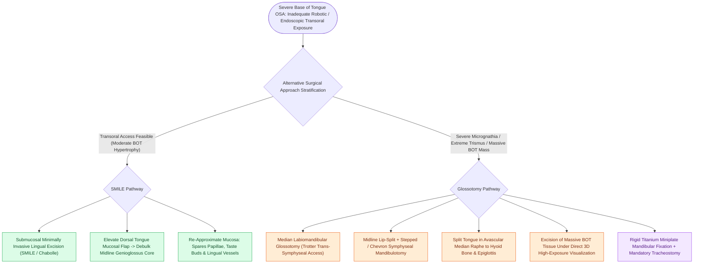

# Submucosal lingualplasty and median labiomandibular glossotomy provide alternative access for tongue base reduction

## Active Recall

> [!question]- What is the main advantage of the submucosal lingualplasty (SMILE) procedure over open mucosal resection?
> *Answer / Clinical Rationale*: It **preserves the dorsal tongue mucosa and taste buds**, reducing postoperative pain, bleeding, and long-term dysphagia.

> [!question]- When is a median labiomandibular glossotomy indicated for sleep apnea surgery?
> *Answer / Clinical Rationale*: In patients with **severe retrognathia or trismus where transoral robotic or endoscopic access is impossible**.

## Core Clinical & Mechanistic Principles
When robotic instrumentation is unavailable or when severe micrognathia/trismus prevents transoral robotic access, alternative surgical approaches provide access for tongue base reduction:
- **Submucosal Minimally Invasive Lingual Excision (SMILE / Chabolle Lingualplasty)**:
  - An anterior transoral approach through the dorsal tongue mucosa.
  - Elevates a mucosal flap, debulks the underlying midline genioglossus and hyoglossus muscle cores using ultrasound or radiofrequency, and resutures the intact mucosal flap.
  - *Advantage*: Preserves mucosal taste buds and sensory innervation, reducing postoperative bleeding and pain.
- **Median Labiomandibular Glossotomy (Trotter Approach)**:
  - Indicated for massive tongue base hypertrophy in severe retrognathic patients where transoral access is completely impossible.
  - **Surgical Execution**:
    1. Midline lip-split incision.
    2. Midline mandibular osteotomy (stepped or chevron osteotomy between central incisors).
    3. Split the tongue in the exact midline raphe back to the epiglottis.
    4. Resect massive bilateral tongue base cores under direct 3D visual control.
    5. Reconstruct tongue with layered sutures and fix the mandible with **rigid titanium miniplates**.

### Surgical Technique & Critical Safety Checks
- **Tracheostomy Requirement**: Mandibulotomy approaches mandate temporary protective tracheostomy until tongue swelling resolves (see [[Transoral robotic surgery TORS tongue base reduction debulks lingual tonsil and midline tongue musculature in OSA|TORS Tongue Base]]).

## Connected Concepts & Graph Traversal
- **TORS Tongue Base**: [[Transoral robotic surgery TORS tongue base reduction debulks lingual tonsil and midline tongue musculature in OSA|TORS Tongue Base]]
- **HGNS Stimulation**: [[Hypoglossal nerve stimulation HGNS activates the medial branch of CN XII to advance the tongue during inspiration|HGNS Stimulation]]
- **MMA Advancement**: [[Maxillomandibular advancement MMA advances the skeletal framework by ten to twelve millimeters to expand the upper airway|MMA Advancement]]
- **Embryological & Sleep Foundation**: [[High loop gain causes ventilatory instability and periodic breathing in sleep-disordered breathing]]
- **Adenotonsillar & Endoscopic DISE**: [[Drug-induced sleep endoscopy DISE evaluates dynamic multi-level upper airway collapse under sedation]]
- **Congenital Airway Pathology**: [[Endoscopic balloon dilation with steroid injection manages early, soft, non-circumferential subglottic stenosis]]
- **Open Airway Reconstruction**: [[Slide tracheoplasty expands complete tracheal rings by oblique division and sliding longitudinal reconstruction]]
