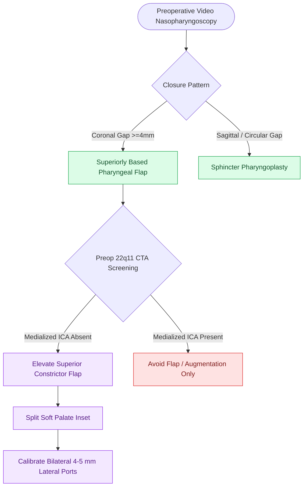

# Superiorly based posterior pharyngeal flaps create a central tissue bridge for coronal velopharyngeal insufficiency

## Active Recall

> [!question]- What dynamic velopharyngeal closure pattern is the primary indication for a superiorly based posterior pharyngeal flap?
> *Answer / Clinical Rationale*: **Coronal closure pattern** (characterized by robust lateral pharyngeal wall adduction with deficient velar elevation, leaving a wide transverse central gap).

> [!question]- Why is preoperative vascular imaging (CTA or MRA) mandatory prior to posterior pharyngeal flap elevation in patients with 22q11.2 deletion syndrome?
> *Answer / Clinical Rationale*: Patients with 22q11.2 deletion syndrome (velocardiofacial syndrome) frequently have **medialized, tortuous internal carotid arteries** running immediately beneath the posterior pharyngeal mucosa, creating an extreme risk of fatal arterial laceration during flap elevation.

## Core Clinical & Mechanistic Principles
The **superiorly based posterior pharyngeal flap** is the workhorse surgical procedure for persistent [[Velopharyngeal insufficiency VPI causes hypernasal resonance and nasal air emission during speech|velopharyngeal insufficiency (VPI)]] characterized by a **coronal closure pattern** on preoperative multiplanar video nasopharyngoscopy.

### Surgical Technique & Craft Nuances
1. **Flap Elevation & Plane**:
   - The flap is outlined on the posterior pharyngeal wall, incorporating mucosa, submucosa, and the **superior pharyngeal constrictor muscle**, elevated in the loose prevertebral avascular space.
   - Flap base is positioned superiorly at the level of the adenoid pad / arch of C1 to ensure high horizontal inset without downward tethering.
2. **Palatal Splitting & Inset**:
   - The soft palate is split in the midline or elevated via nasal mucosal reflection.
   - The flap is lined with mucosal turnover flaps (or lined upon itself) to prevent postoperative raw surface scarring and tubed contracture.
3. **Lateral Port Calibration**:
   - Lateral breathing ports are calibrated to **$4\text{–}5\text{ mm}$** (or sized over a #12–14 French catheter) bilaterally to prevent postoperative [[Velopharyngeal incompetence following sleep surgery causes transient or permanent hypernasality and nasal regurgitation|iatrogenic obstructive sleep apnea]] while ensuring complete phonetic seal during lateral wall contraction.

## Critical Safety Checks & Danger Zones
- **22q11.2 Carotid Anomaly Screen**: Preoperative CTA neck or MR angiography is mandatory in syndromic children to rule out medialized internal carotid arteries before incising the posterior pharynx.
- **Obstructive Sleep Apnea Risk**: Over-wide flaps or small lateral ports cause persistent nasal obstruction, snoring, and severe pediatric OSA, requiring revision port dilation or sleep endoscopy.

## Connected Concepts & Graph Traversal
- **Sphincter Counterpart (Sagittal VPI)**: [[Sphincter pharyngoplasties transpose bilateral palatopharyngeus flaps to narrow the lateral velopharyngeal port in sagittal insufficiency|Sphincter Pharyngoplasty]]
- **Underlying Pathology**: [[Velopharyngeal insufficiency VPI causes hypernasal resonance and nasal air emission during speech|Velopharyngeal Insufficiency Overview]]
- **Cleft Palate Reconstruction**: [[Two-flap palatoplasty and Furlow double-reversing Z-plasty reconstruct the hard and soft palate musculature|Palatoplasty Techniques]]
- **Syndromic Cleft Association**: [[Pierre Robin sequence manifests with micrognathia, glossoptosis, and secondary U-shaped cleft palate|Pierre Robin Sequence & Cleft Palate]]
- **Postoperative Complication**: [[Velopharyngeal incompetence following sleep surgery causes transient or permanent hypernasality and nasal regurgitation|Post-Surgical Velopharyngeal Dysfunction]]
