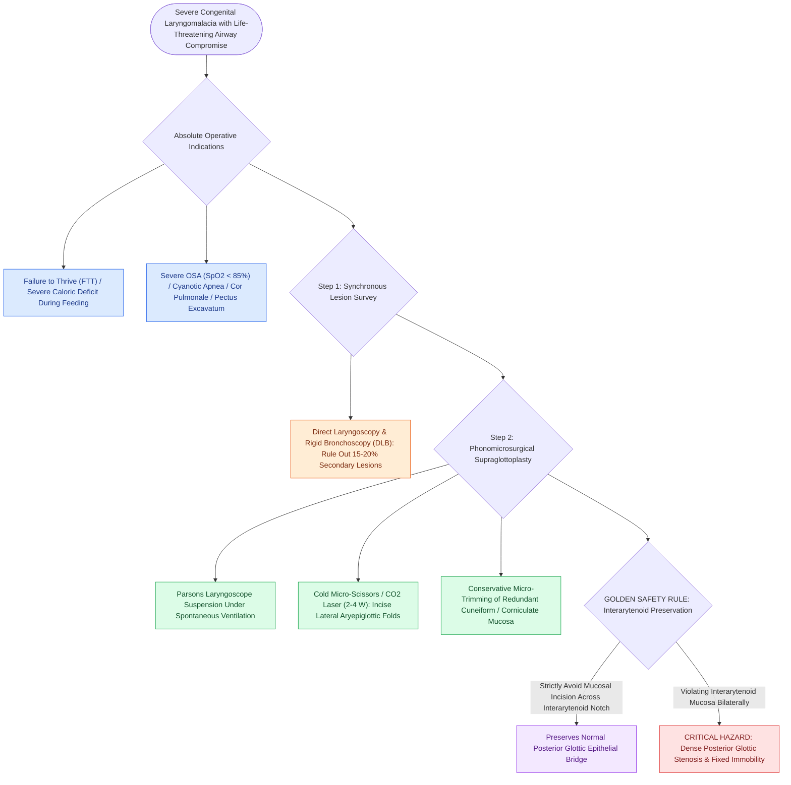

# Supraglottoplasty corrects severe laryngomalacia with failure to thrive, apnea, or cor pulmonale by dividing shortened aryepiglottic folds

## Active Recall

> [!question]- Why must surgeons strictly avoid incising or laser-abrading the interarytenoid mucosa during supraglottoplasty?
> *Answer / Clinical Rationale*: Opposing raw, denuded mucosal surfaces across the interarytenoid notch form a dense fibroblastic scar band as they heal, precipitating permanent **posterior glottic stenosis** and severe vocal fold fixation requiring major reconstructive laryngeal split and grafting.

> [!question]- What preoperative endoscopic examination must be performed in all infants prior to supraglottoplasty?
> *Answer / Clinical Rationale*: A complete **direct laryngoscopy and rigid tracheobronchoscopy** must be performed to evaluate the entire subglottis, trachea, and mainstem bronchi, ruling out secondary synchronous airway lesions (e.g., subglottic stenosis, vascular ring, tracheomalacia) that occur in up to 15% to 20% of patients.

## Core Clinical & Mechanistic Principles
[[Laryngomalacia is the most common cause of congenital pediatric stridor characterized by dynamic supraglottic collapse|Laryngomalacia]] is the most common congenital laryngeal anomaly, accounting for $60\text{ to }75\%$ of all cases of infant [[Pediatric stertor and stridor differentiate upper supraglottic airway obstruction from intrathoracic tracheobronchial disease|inspiratory stridor]]. Dynamic collapse of redundant supraglottic structures into the laryngeal inlet during inspiration is driven by Bernoulli forces acting upon immature, hypotonic cartilaginous framework. While $>80\text{ to }90\%$ of cases are mild-to-moderate and self-resolve spontaneously by 18 to 24 months with conservative antireflux therapy (H2 blockers or PPIs), approximately **$10\text{ to }15\%$ present with severe, life-threatening airway compromise** mandating operative correction via **[[Endoscopic supraglottoplasty cold-steel and laser division of aryepiglottic folds relieves severe laryngomalacia|supraglottoplasty]]**.

### Indications, Technique & Critical Complication Avoidance
1. **Absolute Indications for Supraglottoplasty**:
   - Severe failure to thrive (FTT) from increased caloric expenditure of respiration during feeds.
   - Recurrent obstructive sleep apnea (OSA) with prolonged desaturations ($\text{SpO}_2 < 85\%$) or cyanotic episodes.
   - Severe resting pectus excavatum or subcostal/sternal retractions.
   - Cor pulmonale or secondary pulmonary hypertension.
   - Brief Resolved Unexplained Events (BRUE) or feeding-induced aspiration.
2. **Surgical Technique (Cold Instrument / $\text{CO}_2$ Laser)**:
   - Perform direct laryngoscopy and [[Airway foreign body aspiration mandates rigid bronchoscopy despite normal radiographs|rigid bronchoscopy]] under spontaneous ventilation to rule out secondary synchronous airway lesions (present in up to $15\text{ to }20\%$ of infants, such as [[The Cotton-Myer classification grades subglottic stenosis by luminal reduction|subglottic stenosis]] or [[Tracheomalacia causes dynamic expiratory tracheal collapse and is managed with posterior tracheobronchopexy|tracheomalacia]]).
   - Suspend the larynx with a Parsons or Lindholm laryngoscope.
   - Using cold micro-laryngeal scissors or low-wattage $\text{CO}_2$ laser ($2\text{--}4\text{ W}$, superpulse), incise the shortened **aryepiglottic fold** at its lateral-most edge, detethering the epiglottis and allowing it to spring anteriorly.
   - Gently resect redundant cuneiform and corniculate mucosa prolapsing over the arytenoid apices.
3. **The Golden Safety Rule (Interarytenoid Mucosal Preservation)**:
   - **Never incise or abrade the interarytenoid mucosa** between the two arytenoids.
   - Denuding mucosal surfaces bilaterally across the posterior interarytenoid commissure provokes circumferential cicatricial scar contracture, resulting in catastrophic **posterior glottic stenosis (PGS)** and fixed vocal fold immobility.

## Connected Concepts & Graph Traversal
- **Physiological Basis**: [[Laryngomalacia is the most common cause of congenital pediatric stridor characterized by dynamic supraglottic collapse|Laryngomalacia Pathophysiology]]
- **Differential Pathology**: [[Pediatric stertor and stridor differentiate upper supraglottic airway obstruction from intrathoracic tracheobronchial disease|Pediatric Stridor & Stertor]]
- **Airway Stridor Timing**: [[Inspiratory, biphasic, and expiratory stridor localize pediatric airway obstruction to supraglottic, subglottic, and tracheobronchial subsites|Stridor Phase Localization]]
- **Synchronous Lesion**: [[The Cotton-Myer classification grades subglottic stenosis by luminal reduction|Cotton-Myer Subglottic Stenosis]]
- **Endoscopic Technique**: [[Rigid bronchoscopy technique for pediatric airway foreign body removal requires systematic distal-to-proximal examination|Pediatric Endoscopy Protocol]]
