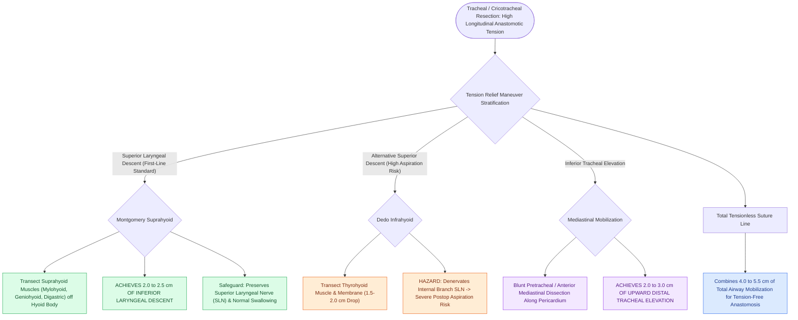

# Suprahyoid and infrahyoid laryngeal release maneuvers reduce anastomotic tension in tracheal surgery

## Active Recall

> [!question]- How much downward laryngeal descent is achieved by a Montgomery suprahyoid laryngeal release?
> *Answer / Clinical Rationale*: Approximately **$2.0\text{ to }2.5\text{ cm}$** of inferior mobilization.

> [!question]- Why is a suprahyoid release preferred over an infrahyoid release in pediatric airway surgery?
> *Answer / Clinical Rationale*: Because it **preserves the superior laryngeal nerves and thyrohyoid membrane**, minimizing postoperative aspiration and swallowing dysfunction.

## Core Clinical & Mechanistic Principles
Excessive tension on a tracheal or [[Cricotracheal resection CTR achieves primary end-to-end anastomosis for severe Grade III and IV subglottic stenosis|cricotracheal anastomosis]] leads to **ischemia, mucosal necrosis, suture pull-through, restenosis, and catastrophic dehiscence**. Laryngeal release maneuvers provide substantial downward mobilization of the larynx:
- **Suprahyoid Laryngeal Release (Montgomery Release)**:
  - **Execution**: The muscles inserting into the **superior border of the hyoid bone body (mylohyoid, geniohyoid, genioglossus, digastric sling)** are completely transected off the hyoid bone.
  - The central body of the hyoid is transected on each side lateral to the lesser cornu.
  - **Laryngeal Drop Achieved**: Provides **$2.0\text{ to }2.5\text{ cm}$ of inferior laryngeal descent**.
  - *Advantages*: Preserves superior thyroid neurovascular bundle and superior laryngeal nerve (SLN); lowest risk of postoperative aspiration.
- **Infrahyoid Laryngeal Release (Dedo Release)**:
  - Transects the thyrohyoid membrane and sternothyroid/thyrohyoid muscles; provides $1.5\text{–}2.0\text{ cm}$ of drop but carries a higher risk of **superior laryngeal nerve injury and severe postoperative swallowing dysfunction**.

### Surgical Technique & Critical Safety Checks
- **Distal Tracheal Mobilization**: Transhiatal / anterior mediastinal blunt mobilization of the pretracheal fascia provides an additional **$2.0\text{–}3.0\text{ cm}$ of upward tracheal mobilization** from below.

## Connected Concepts & Graph Traversal
- **CTR Resection**: [[Cricotracheal resection CTR achieves primary end-to-end anastomosis for severe Grade III and IV subglottic stenosis|CTR Resection]]
- **Chin-to-Chest Stitch**: [[Postoperative chin-to-chest flexion stitch prevents catastrophic neck extension and tracheal anastomotic dehiscence|Chin-to-Chest Stitch]]
- **Slide Tracheoplasty**: [[Slide tracheoplasty expands complete tracheal rings by oblique division and sliding longitudinal reconstruction|Slide Tracheoplasty]]
- **Embryological & Sleep Foundation**: [[Pediatric polysomnography criteria define obstructive sleep apnea with an obstructive apnea-hypopnea index exceeding one]]
- **Adenotonsillar & Endoscopic DISE**: [[Drug-induced sleep endoscopy DISE evaluates dynamic multi-level upper airway collapse under sedation]]
- **Congenital Airway Pathology**: [[Myer-Cotton grading system stratifies subglottic stenosis from Grade I less than fifty percent to Grade IV no lumen]]
- **Open Airway Reconstruction**: [[Innominate artery compression syndrome causes dynamic anterior tracheal pulsatile collapse]]
