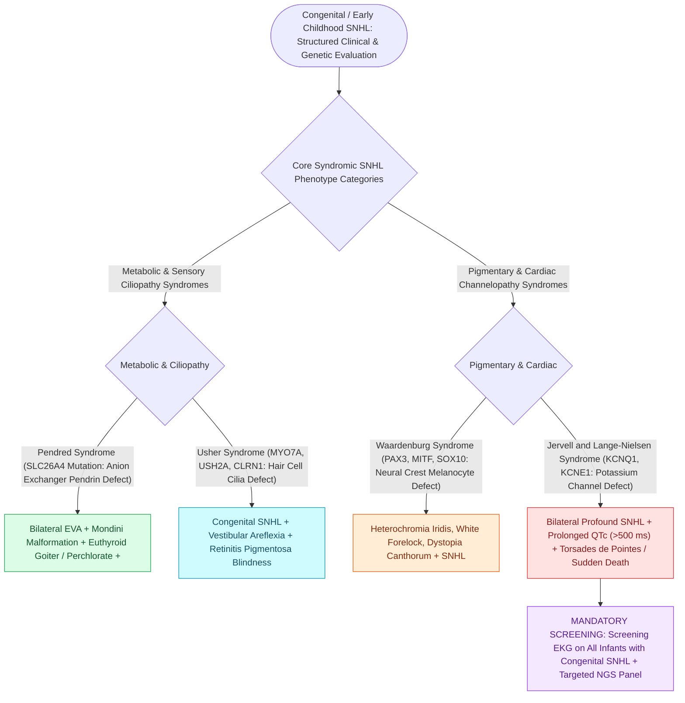

# Syndromic pediatric sensorineural hearing loss encompasses Pendred, Usher, Waardenburg, and Jervell and Lange-Nielsen syndromes

## Active Recall

> [!question]- Why is an electrocardiogram (ECG) mandatory in the evaluation of a child with unexplained congenital bilateral sensorineural hearing loss?
> *Answer / Clinical Rationale*: To rule out **Jervell and Lange-Nielsen syndrome**, which causes a **prolonged QT interval and life-threatening ventricular arrhythmias (Torsades de Pointes / sudden cardiac death)**.

> [!question]- What syndromic diagnosis must be suspected in an infant presenting with preauricular pits, bilateral second branchial cleft fistulas, and mixed hearing loss?
> *Answer / Clinical Rationale*: **Branchio-Oto-Renal (BOR) syndrome** (*EYA1/SIX1* mutation); mandates an immediate **renal ultrasound** to evaluate for occult renal dysplasia or agenesis.

> [!question]- What phenotypic physical findings characterize Rubinstein-Taybi syndrome, and what is the primary anesthetic/airway concern?
> *Answer / Clinical Rationale*: **Broad thumbs/great toes and a beaked nose with prominent columella**; micrognathia and retroglossal narrowing cause high rates of **severe OSA and difficult endotracheal intubation**.

## Core Clinical & Mechanistic Principles
Genetic etiologies account for $>50\%$ of congenital sensorineural hearing loss (SNHL), of which **$30\%$ are syndromic** (associated with systemic clinical features) and **$70\%$ are non-syndromic**:
- **The Core Genetic Hearing Syndromes**:
  1. **[[Pendred syndrome causes sensorineural hearing loss and euthyroid goiter due to SLC26A4 mutations with enlarged vestibular aqueducts|Pendred Syndrome (Autosomal Recessive)]]**:
     - *Gene*: *SLC26A4* (encodes pendrin, an anion exchanger).
     - *Hallmarks*: Bilateral sensorineural hearing loss, **euthyroid/hypothyroid multinodular goiter** (positive perchlorate discharge test), and **Enlarged Vestibular Aqueduct (EVA $>1.5\text{ mm}$)** with Mondini cochlear dysplasia.
  2. **[[Usher syndrome combines congenital sensorineural hearing loss with progressive retinitis pigmentosa and vestibular dysfunction|Usher Syndrome (Autosomal Recessive)]]**:
     - *Hallmarks*: Congenital SNHL + **Retinitis Pigmentosa** (progressive night blindness and peripheral visual field loss / tunnel vision). (Most common cause of congenital deaf-blindness).
     - *Subtypes*: Type I (profound SNHL + absent vestibular function + prepubertal RP); Type II (moderate-to-severe SNHL + normal vestibular + postpubertal RP); Type III (progressive SNHL).
  3. **[[Waardenburg syndrome causes sensorineural hearing loss with pigmentary abnormalities and dystopia canthorum|Waardenburg Syndrome (Autosomal Dominant)]]**:
     - *Gene*: *PAX3*, *MITF*, *SOX10*.
     - *Hallmarks*: SNHL + pigmentary anomalies (**white forelock / poliosis, heterochromia iridis, dystopia canthorum** [lateral displacement of inner canthi], synophrys).
  4. **[[Jervell and Lange-Nielsen syndrome combines congenital profound sensorineural hearing loss with a prolonged QT interval|Jervell and Lange-Nielsen Syndrome (Autosomal Recessive)]]**:
     - *Gene*: *KCNQ1*, *KCNE1* (potassium channel mutations).
     - *Hallmarks*: Congenital profound bilateral SNHL + **prolonged QT interval on ECG ($>440\text{ ms}$)**.
     - *Critical Safety*: High risk of syncopal episodes, polymorphic ventricular tachycardia (**Torsades de Pointes**), and sudden cardiac death; mandatory to screen all deaf infants with an **electrocardiogram (ECG)**; treated with beta-blockers and implantable cardioverter-defibrillators (ICDs).
  5. **[[Branchio-oto-renal syndrome pairs branchial fistulas, preauricular pits, structural renal dysplasia, and mixed hearing loss|Branchio-Oto-Renal (BOR) Syndrome (Autosomal Dominant)]]**:
     - *Gene*: *EYA1*, *SIX1*, *SIX5*.
     - *Hallmarks*: Mixed or SNHL + **preauricular pits/tags** + **branchial cleft fistulas/cysts** + **renal dysplasia/agenesis**. (Mandates screening **renal ultrasound** in all diagnosed infants).
  6. **Rubinstein-Taybi Syndrome (Autosomal Dominant / De Novo)**:
     - *Gene*: *CREBBP* (chromosome 16p13.3) or *EP300*.
     - *Hallmarks*: **Broad thumbs and broad great toes (halluces)**, distinctive facial dysmorphism (**beaked nose with columella extending below the alae**, antimongoloid palpebral slant), micrognathia, high-arched narrow palate, and intellectual disability.
     - *Airway & Otolaryngologic Nuances*: High risk of **severe pediatric obstructive sleep apnea (OSA)** and difficult endotracheal intubation due to micrognathia and retroglossal crowding; recurrent conductive/SNHL otitis media.
  7. **[[CHARGE syndrome is diagnosed by coloboma, heart defects, choanal atresia, growth retardation, genital anomalies, and ear abnormalities|CHARGE Syndrome (Autosomal Dominant)]]**:
     - *Gene*: *CHD7* (chromodomain helicase DNA-binding protein 7).
     - *Hallmarks*: **C**oloboma, **H**eart defects, **A**tresia choanae, **R**etardation of growth/development, **G**enital hypoplasia, **E**ar anomalies (characteristic **semicircular canal aplasia/hypoplasia** on CT and profound SNHL).
  8. **[[Alport syndrome manifests with progressive sensorineural hearing loss, anterior lenticonus, and progressive glomerulonephritis|Alport Syndrome (X-Linked Dominant)]]**:
     - *Gene*: *COL4A5* (Type IV collagen network defect).
     - *Hallmarks*: Progressive high-frequency SNHL starting in late childhood + anterior lenticonus + progressive hematuric glomerulonephritis advancing to ESRD.

### Surgical Technique & Critical Safety Checks
- **Universal Newborn Hearing Screening (UNHS)**: Early identification via OAE and automated ABR allows intervention before 6 months of age (Joint Committee on Infant Hearing 1-3-6 benchmark).

## Connected Concepts & Graph Traversal
- **Pendred Syndrome**: [[Pendred syndrome causes sensorineural hearing loss and euthyroid goiter due to SLC26A4 mutations with enlarged vestibular aqueducts|Pendred EVA & Goiter]]
- **Usher Syndrome**: [[Usher syndrome combines congenital sensorineural hearing loss with progressive retinitis pigmentosa and vestibular dysfunction|Usher Deaf-Blindness Subtypes]]
- **Waardenburg Syndrome**: [[Waardenburg syndrome causes sensorineural hearing loss with pigmentary abnormalities and dystopia canthorum|Waardenburg Pigmentary Subtypes]]
- **Jervell & Lange-Nielsen**: [[Jervell and Lange-Nielsen syndrome combines congenital profound sensorineural hearing loss with a prolonged QT interval|JLN Cardiac Channelopathy & ECG Screening]]
- **Branchio-Oto-Renal**: [[Branchio-oto-renal syndrome pairs branchial fistulas, preauricular pits, structural renal dysplasia, and mixed hearing loss|BOR Syndrome & Renal Screening]]
- **CHARGE Syndrome**: [[CHARGE syndrome is diagnosed by coloboma, heart defects, choanal atresia, growth retardation, genital anomalies, and ear abnormalities|CHARGE Diagnostic Criteria]]
- **Alport Syndrome**: [[Alport syndrome manifests with progressive sensorineural hearing loss, anterior lenticonus, and progressive glomerulonephritis|Alport Nephropathy & Hearing Loss]]
- **Craniofacial Syndromes**: [[Treacher Collins syndrome results from TCOF1 mutations causing mandibulofacial dysostosis and conductive hearing loss|Treacher Collins & Craniofacial Overview]]
