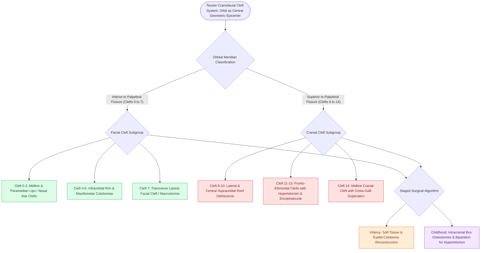

# Tessier classification organizes craniofacial clefts from zero to fourteen based on orbital and facial anatomical axes radiating from the palpebral fissure

## Active Recall

> [!question]- What anatomical landmark serves as the central reference coordinate for the Tessier craniofacial cleft classification?
> *Answer / Clinical Rationale*: The **orbit and palpebral fissure** serve as the organizing epicenter; clefts numbered **0 through 7** are facial clefts situated inferior to the palpebral fissure, whereas clefts **8 through 14** are cranial/cranial-vault clefts situated superior to the palpebral fissure.

> [!question]- Which specific Tessier cleft corresponds to lateral macrostomia, and which cleft numbers constitute Treacher Collins syndrome?
> *Answer / Clinical Rationale*: **Tessier Cleft 7** represents a transverse lateral facial cleft extending from the oral commissure toward the ear (macrostomia, seen in hemifacial microsomia), while **Tessier Clefts 6, 7, and 8** form the combined orbitomaxillary clefting complex characteristic of Treacher Collins syndrome.

## Core Clinical & Mechanistic Principles

Craniofacial clefts are rare congenital anomalies occurring in approximately 1.4 to 4.9 per 100,000 live births, arising from failure of mesodermal penetration and differentiation through bilaminar ectodermal seams during embryonic weeks 4 to 8. In 1976, Paul Tessier established the canonical anatomical classification system that maps cleft vectors circumferentially like spokes of a wheel around the **orbit**:

### The Tessier Clockface Matrix
1. **Facial Clefts (0 to 7 — Inferior to Palpebral Fissure)**:
   - **Cleft 0**: Midline facial cleft; involves the upper lip vermilion, maxilla, columella, and nasal septum; associated with bifid nose, median lip cleft, or secondary primary palate clefting.
   - **Cleft 1**: Paramedian cleft through the nasal dome and alar notch, passing lateral to the columella.
   - **Cleft 2**: Paramedian cleft lateral to the nasal tip through the middle third of the nasal ala with maxillary hypoplasia.
   - **Cleft 3 (Medial Orbitomaxillary Cleft)**: Passes through the philtral column, alveolus, lacrimal groove, and medial canthus, producing severe tear duct disruption and microphthalmia.
   - **Cleft 4 (Central Orbitomaxillary Cleft)**: Begins on the upper lip between the philtrum and oral commissure, traverses the medial infraorbital rim and orbital floor, sparing the nasal cavity.
   - **Cleft 5 (Lateral Orbitomaxillary Cleft)**: Starts lateral to the oral commissure, ascends across the canine fossa and lateral infraorbital rim into the mid-lower eyelid.
   - **Cleft 6 (Zygomaticomaxillary Cleft)**: Lies along the maxillozygomatic suture; features lower eyelid coloboma and hypoplasia of the zygoma.
   - **Cleft 7 (Temporozygomatic Transverse Cleft)**: Extends horizontally from the oral commissure toward the tragus; results in macrostomia, masseter disruption, and preauricular tags.

2. **Cranial Clefts (8 to 14 — Superior to Palpebral Fissure)**:
   - **Cleft 8**: Lateral orbital cleft at the frontozygomatic suture; lower and lateral canthal dystopia.
   - **Cleft 9**: Superolateral orbital cleft through the lateral upper eyelid and superolateral orbital rim.
   - **Cleft 10**: Central superior orbital cleft through the middle upper eyelid and frontal bone.
   - **Cleft 11**: Superomedial orbital cleft through the medial upper eyelid and frontal sinus.
   - **Cleft 12**: Paramedian cranial cleft lateral to the olfactory groove; hypertelorism with intact ethmoid.
   - **Cleft 13**: Paramedian fronto-ethmoidal cleft between the ethmoid and frontal bone; associated with orbital hypertelorism and fronto-ethmoidal encephaloceles.
   - **Cleft 14**: Midline cranial cleft through the crista galli and frontal bone, producing frontonasal dysplasia and severe hypertelorism.

### "North-South" Trajectory Lines
Tessier clefts frequently present as continuous cleft lines extending across both the facial and cranial zones along constant anatomical meridians:
- **Cleft 0 / 14 Meridian**: Midline axis (median facial cleft paired with midline frontonasal dysplasia / crista galli duplication).
- **Cleft 1 / 13 Meridian**: Paramedian nasal dome paired with fronto-ethmoidal encephalocele.
- **Cleft 2 / 12 Meridian**: Paramedian lateral nasal ala paired with lateral ethmoidal clefting.
- **Cleft 3 / 11 Meridian**: Medial orbitomaxillary cleft paired with superomedial frontal cleft.
- **Cleft 4 / 10 Meridian**: Central infraorbital cleft paired with central supraorbital roof cleft.

### Surgical Reconstruction Algorithm
- **Early Infancy (3 to 9 Months)**: Soft-tissue approximation of oral commissures (Z-plasty closure of Cleft 7 macrostomia), eyelid coloboma repair to prevent corneal drying, and primary cleft lip closure utilizing techniques such as [[The Millard rotation-advancement and Fisher anatomical subunit repairs correct unilateral cleft lip deformities]].
- **Early Childhood (4 to 7 Years)**: Craniofacial skeletal reconstruction, including intracranial orbital osteotomies (box osteotomies or facial bipartition) to correct hypertelorism along Clefts 0/14 and 1/13, combined with autologous cranial bone grafting.
- **Adolescence**: Final orthognathic alignment, rhinoplasty, and microvascular soft-tissue augmentation.

## Connected Concepts & Graph Traversal

- **Embryonic Clefting**: [[Unilateral and bilateral cleft lip and palate result from failure of fusion of the maxillary and medial nasal prominences]]
- **Palate Reconstruction**: [[Two-flap palatoplasty and Furlow double-reversing Z-plasty reconstruct the hard and soft palate musculature]]
- **Oculoauriculovertebral Dysplasia**: [[Goldenhar syndrome exhibits hemifacial microsomia, epibulbar dermoids, preauricular appendages, and vertebral anomalies]]
- **Mandibulofacial Dysostosis**: [[Treacher Collins syndrome results from TCOF1 mutations causing mandibulofacial dysostosis and conductive hearing loss]]
- **Pierre Robin Sequence**: [[Pierre Robin sequence manifests with micrognathia, glossoptosis, and secondary U-shaped cleft palate]]
