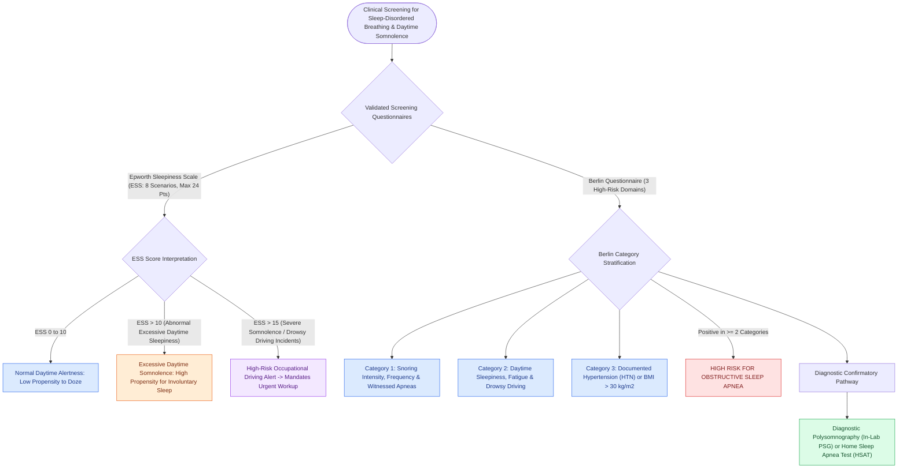

# The Epworth Sleepiness Scale and Berlin Questionnaire screen for daytime somnolence and obstructive sleep apnea risk

## Active Recall

> [!question]- What score threshold on the Epworth Sleepiness Scale (ESS) defines excessive daytime sleepiness requiring formal diagnostic evaluation?
> *Answer / Clinical Rationale*: An ESS score **$>10$ (out of a maximum 24 points)** signifies clinically abnormal daytime sleepiness. The scale rates the chance of dozing (0 = never, 1 = slight, 2 = moderate, 3 = high) across 8 daily situations (reading, watching TV, sitting inactive in public, passenger in a car for 1 hour, lying down in afternoon, sitting and talking, sitting quietly after alcohol-free lunch, stopped in traffic).

> [!question]- How does the Berlin Questionnaire stratify high risk for obstructive sleep apnea across its three scoring categories?
> *Answer / Clinical Rationale*: The Berlin Questionnaire evaluates 3 distinct categories: **Category 1 (Snoring severity and witnessed apneas)**, **Category 2 (Daytime sleepiness and fatigue while driving)**, and **Category 3 (History of hypertension OR BMI $>30\text{ kg/m}^2$)**. A patient is categorized as **High Risk for OSA** if they score positive in **$\ge 2$ out of the 3 categories**.

> [!question]- What is the clinical distinction between daytime sleepiness (somnolence) and fatigue, and why does this matter in sleep clinic triage?
> *Answer / Clinical Rationale*: **Sleepiness** is the subjective propensity to fall asleep or doze off in passive situations (measured by ESS; hallmark of OSA, narcolepsy, and sleep deprivation). **Fatigue** is a lack of physical or mental energy/stamina without an overwhelming sleep drive (hallmark of depression, hypothyroidism, fibromyalgia, and chronic illness).

## Core Clinical & Mechanistic Principles
Screening instruments provide rapid, standardized risk stratification and triage for diagnostic [[Adult polysomnography criteria define obstructive sleep apnea severity by apnea-hypopnea index thresholds of five, fifteen, and thirty|polysomnography]] and sleep surgical evaluation:

### Anthropometric Screening Metrics (Neck Circumference & STOP-Bang)
In addition to subjective questionnaires, objective physical examination metrics strongly correlate with nocturnal pharyngeal collapsibility:
- **Neck Circumference Thresholds (High OSA Probability)**:
  - **Men**: Neck circumference **$>17\text{ inches}$ ($>43\text{ cm}$)**.
  - **Women**: Neck circumference **$>16\text{ inches}$ ($>40.5\text{ cm}$)**.
  - *Biomechanics*: Cervical soft tissue fat deposition directly increases extrinsic tissue pressure on the lateral pharyngeal walls, narrowing the passive pharyngeal lumen and elevating the critical closing pressure ($P_{crit}$) during sleep.
- **Integration into STOP-Bang Screening**:
  - Incorporates Snoring, Tiredness, Observed apnea, high blood Pressure, BMI $>35\text{ kg/m}^2$, Age $>50$, **Neck circumference $>17/16\text{ inches}$**, and male Gender (score $\ge 3$ indicates intermediate-to-high OSA risk, score $\ge 5$ indicates high risk of moderate-to-severe OSA).

### Medicolegal & Occupational Implications
- **Commercial Drivers & Heavy Machinery Operators**: Severe daytime somnolence ($ESS >15$ or drowsy driving incidents) carries mandatory reporting obligations in many jurisdictions to transportation safety authorities pending CPAP compliance verification.

## Connected Concepts & Graph Traversal
- **Adult PSG Diagnostics**: [[Adult polysomnography criteria define obstructive sleep apnea severity by apnea-hypopnea index thresholds of five, fifteen, and thirty|Adult Polysomnography Thresholds]]
- **Pediatric Sleep SDB**: [[Pediatric polysomnography criteria define obstructive sleep apnea with an obstructive apnea-hypopnea index exceeding one|Pediatric PSG & Oximetry]]
- **Anatomical Staging**: [[The Friedman staging system correlates tonsil size and palate position with uvulopalatopharyngoplasty success|Friedman Staging System]]
- **Sleep Endoscopy**: [[Drug-induced sleep endoscopy DISE evaluates dynamic multi-level upper airway collapse under sedation|DISE Indications]]
- **Palatal Reconstruction**: [[Modified uvulopalatopharyngoplasty UPPP resects redundant palatal tissue while preserving muscular function|Modified UPPP Surgery]]
- **Diagnostic Evaluation**: [[Mandibular advancement oral appliances enlarge the retroglossal airway through anterior mandibular translation for mild-to-moderate obstructive sleep apnea|MAD Candidacy Screening]]
- **Differential Diagnosis**: [[Restless legs syndrome presents with nocturnal dysesthesias driven by central iron deficiency and dopamine dysregulation treated with dopamine agonists|RLS as Non-Apneic Cause of Daytime Fatigue]]
