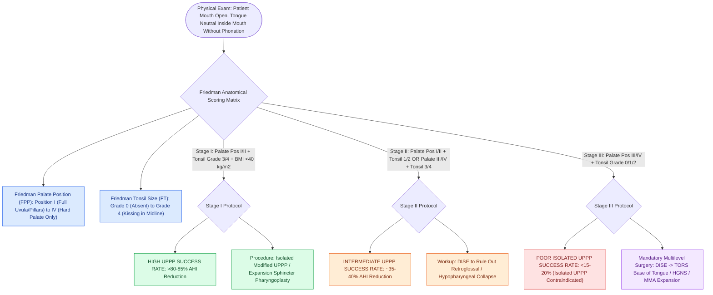

# The Friedman staging system correlates tonsil size and palate position with uvulopalatopharyngoplasty success

## Active Recall

> [!question]- How does the patient positioning and instruction for Friedman palate position grading fundamentally differ from the anesthesiology Mallampati classification?
> *Answer / Clinical Rationale*: In the **Friedman palate position** assessment, the patient is instructed to **open the mouth widely while keeping the tongue in a neutral, relaxed position inside the oral cavity (WITHOUT protruding the tongue or phonating)**. In contrast, the Mallampati classification requires maximal active tongue protrusion with phonation. The neutral Friedman position accurately reflects true dynamic resting upper airway caliber during sleep.

> [!question]- What anatomical findings define Friedman palate positions I through IV and tonsil grades 0 through 4?
> *Answer / Clinical Rationale*: - **Palate Positions**: **Position I**: entire uvula and tonsillar pillars visible; **Position II**: uvula visible, but pillars hidden; **Position III**: soft palate visible, but uvula obscured; **Position IV**: hard palate only visible (soft palate completely hidden). - **Tonsil Grades**: **0**: surgically absent (prior tonsillectomy); **1**: hidden within tonsillar pillars; **2**: extends to the edge of posterior pillars; **3**: extends beyond pillars into oropharynx; **4**: touching in the midline ("kissing tonsils").

> [!question]- How does Friedman clinical staging predict surgical success for isolated uvulopalatopharyngoplasty (UPPP)?
> *Answer / Clinical Rationale*: - **Friedman Stage I (Palate Position I/II + Tonsil Grade 3/4 + BMI $<40\text{ kg/m}^2$)**: High success rate of **$>80\text{–}85\%$** for isolated UPPP. - **Friedman Stage II (Palate I/II with Tonsils 1/2, OR Palate III/IV with Tonsils 3/4)**: Intermediate success rate of **$35\text{–}40\%$**. - **Friedman Stage III (Palate Position III/IV + Tonsil Grade 0/1/2)**: Poor success rate of **$<15\text{–}20\%$** for standard UPPP; indicates predominant hypopharyngeal / retroglossal collapse mandating multilevel sleep surgery.

## Core Clinical & Mechanistic Principles
The **Friedman Clinical Staging System** (Friedman et al., 2002) is the benchmark physical examination paradigm for stratifying anatomical collapse and predicting operative success in adult obstructive sleep apnea:

### Clinical Decision Tree for Upper Airway Surgery
- **Stage I Patients**: Ideal candidates for isolated oropharyngeal surgery (**Modified UPPP, [[Expansion sphincter pharyngoplasty ESP rotates the palatopharyngeus muscle to stabilize lateral pharyngeal wall collapse|Expansion Sphincter Pharyngoplasty]], or Z-palatoplasty**).
- **Stage II and III Patients**: Isolated UPPP is contraindicated; patients require **Drug-Induced Sleep Endoscopy (DISE)** to evaluate retroglossal and lateral pharyngeal wall dynamics, followed by multilevel procedures (TORS lingual tonsillectomy, hypoglossal nerve stimulation [HGNS], or maxillomandibular advancement [MMA]).

## Connected Concepts & Graph Traversal
- **Palatal Sleep Surgery**: [[Modified uvulopalatopharyngoplasty UPPP resects redundant palatal tissue while preserving muscular function|Modified UPPP Surgical Craft]]
- **Lateral Wall Splinting**: [[Relocating the palatopharyngeus anterolaterally splints the lateral pharyngeal walls in expansion pharyngoplasty|Expansion Sphincter Pharyngoplasty]]
- **DISE Evaluation**: [[VOTE classification standardizes drug-induced sleep endoscopy findings across velum, oropharynx, tongue base, and epiglottis|VOTE Classification System]]
- **Adult PSG Criteria**: [[Adult polysomnography criteria define obstructive sleep apnea severity by apnea-hypopnea index thresholds of five, fifteen, and thirty|Adult PSG Criteria]]
- **Hypoglossal Stimulation**: [[Inclusion criteria for hypoglossal nerve stimulation include BMI less than thirty-five and absence of complete concentric collapse|HGNS Inclusion & Selection]]
- **Staging System**: [[Adult obstructive sleep apnea surgical staging synthesizes anatomical Fujita levels of collapse with the Friedman clinical staging system to predict surgical response|Fujita-Friedman Integrated Staging]]
