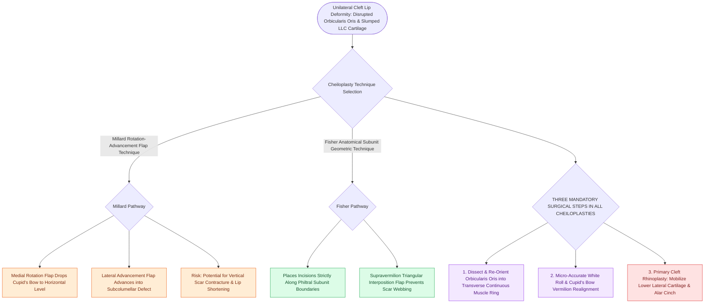

# The Millard rotation-advancement and Fisher anatomical subunit repairs correct unilateral cleft lip deformities

## Active Recall

> [!question]- What are the two primary components of the Millard cleft lip repair?
> *Answer / Clinical Rationale*: A **medial rotation flap** (downward rotation of cupid's bow) and a **lateral advancement flap** (filling the subalar defect).

> [!question]- Why is complete mobilization and reorientation of the orbicularis oris muscle essential during cheiloplasty?
> *Answer / Clinical Rationale*: To restore **circumferential oral sphincter competence, dynamic lip animation, and normal philtral aesthetics**.

## Core Clinical & Mechanistic Principles
Surgical repair of unilateral cleft lip (**Cheiloplasty**) aims to reconstruct symmetrical lip height, restore the continuous orbicularis oris muscle ring, and correct the cleft nasal deformity:
- **The Unilateral Cleft Lip Nasal Deformity (Anatomical Hallmarks)**:
  - *Columella, Caudal Septum & Nasal Tip*: Characteristically deviated towards the **non-cleft side** due to unopposed traction from the intact contralateral facial and perioral musculature.
  - *Posterior Bony Septum*: Paradoxically deviates towards the **cleft side**, obstructing the cleft-side nasal airway.
  - *Cleft-Side Lower Lateral Cartilage (Alar Base)*: Slumped, flattened, and laterally, posteriorly, and **inferiorly displaced**, with widening of the alar base.
  - *Nostril Orientation*: The cleft-side nostril is **horizontally oriented** (in contrast to the normal vertical/oblique orientation on the non-cleft side).
  - *Columella Length*: Markedly **shorter on the cleft side** than the non-cleft side, necessitating primary cleft rhinoplasty with suspension of the slumped lower lateral cartilage to the ipsilateral upper lateral cartilage and contralateral dome.

- **Millard Rotation-Advancement Technique (Classic Standard)**:
  - **Medial Element (Rotation Flap)**: Rotates the displaced cupid's bow and philtrum downward into the horizontal position via a curved subalar incision.
  - **Lateral Element (Advancement Flap)**: Advances a lateral lip flap into the superior rotation gap beneath the columella.
  - *Advantages*: Places scars along natural philtral column lines; highly flexible.
  - *Disadvantages*: Tendency for vertical scar contracture producing a shortened lip or peaked cupid's bow.
- **Fisher Anatomical Subunit Technique (Modern Standard)**:
  - Based on precise anatomical subunit principles.
  - Uses geometric line measurements to place all scar lines precisely along the **vermilion border, philtral column, and nasal sill subunit boundaries**.
  - Incorporates a small triangular interposition flap above the vermilion to prevent straight-line scar contracture.
- **Three Essential Surgical Steps**:
  1. Complete release and **re-orientation of the orbicularis oris muscle** into a transverse sling.
  2. Reconstruction of the **cupid's bow and vermilion border (white roll)**.
  3. **Primary Rhinoplasty**: Mobilization of the slumping lower lateral cartilage, suspension to upper lateral cartilage, and alar cinch.

### Surgical Technique & Critical Safety Checks
- **Timing**: Electively performed at **$3\text{ to }6\text{ months}$ of age** following the Rule of Tens (see [[The Rule of Tens establishes pediatric surgical safety thresholds for elective cleft lip repair|Rule of Tens]]).

## Connected Concepts & Graph Traversal
- **Rule of Tens**: [[The Rule of Tens establishes pediatric surgical safety thresholds for elective cleft lip repair|Rule of Tens]]
- **Cleft Embryology**: [[Unilateral and bilateral cleft lip and palate result from failure of fusion of the maxillary and medial nasal prominences|Cleft Embryology]]
- **Palatoplasty Techniques**: [[Two-flap palatoplasty and Furlow double-reversing Z-plasty reconstruct the hard and soft palate musculature|Palatoplasty Techniques]]
- **Embryological & Sleep Foundation**: [[Each branchial arch packages one nerve, one artery, one cartilage bar, and one muscle group]]
- **Sleep Endoscopy & Airway Dynamics**: [[Drug-induced sleep endoscopy DISE evaluates dynamic multi-level upper airway collapse under sedation|Drug-Induced Sleep Endoscopy (DISE)]] [[Paradise criteria define evidence-based indications for pediatric tonsillectomy in recurrent throat infections]]
- **Congenital Airway Pathology**: [[Congenital bilateral vocal fold paralysis presents with severe inspiratory stridor requiring airway protection]]
- **Open Airway Reconstruction**: [[Anterior costal cartilage grafts expand the thyroid and cricoid cartilage framework]]
