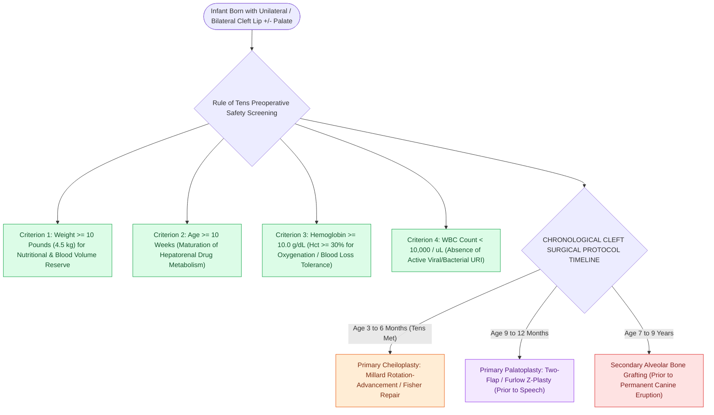

# The Rule of Tens establishes pediatric surgical safety thresholds for elective cleft lip repair

## Active Recall

> [!question]- What are the four components of the classic Rule of Tens for cleft lip repair?
> *Answer / Clinical Rationale*: **Weight $\ge 10\text{ lbs}$**, **Age $\ge 10\text{ weeks}$**, **Hemoglobin $\ge 10\text{ g/dL}$**, and **WBC $<10,000/\mu\text{L}$**.

> [!question]- At what age is elective cleft palate repair (palatoplasty) typically performed?
> *Answer / Clinical Rationale*: At **$9\text{ to }12\text{ months}$ of age** (prior to speech development).

## Core Clinical & Mechanistic Principles
The **Rule of Tens (Wilhelmsen and Musgrave, 1969)** establishes the traditional clinical safety criteria for performing elective unilateral or bilateral cleft lip repair under general anesthesia:
- **The Four "Tens" Criteria**:
  1. **Weight $\ge 10\text{ Pounds}$ ($4.5\text{ kg}$)**: Ensures adequate physiological nutritional reserve and blood volume.
  2. **Age $\ge 10\text{ Weeks}$ ($\approx 3\text{ Months}$)**: Maturation of hepatic and renal drug metabolism; transition from fetal to adult hemoglobin.
  3. **Hemoglobin $\ge 10\text{ g/dL}$** (or Hematocrit $\ge 30\%$): Ensures adequate oxygen-carrying capacity and tolerance of minor blood loss.
  4. **White Blood Cell (WBC) Count $<10,000/\mu\text{L}$**: Absence of active acute viral or bacterial respiratory infections.
- **Clinical Significance in Modern Practice**:
  - While modern pediatric anesthesia allows earlier surgery, the Rule of Tens remains the universal benchmark for **optimizing anesthetic safety, tissue thickness for precise micro-suturing, and airway management**.

### Surgical Technique & Critical Safety Checks
- **Cleft Palate Repair Timing**: Palatoplasty is performed later, at **$9\text{ to }12\text{ months}$ of age** (before complex speech acquisition begins, balancing maxillary midface growth against speech development) (see [[The Millard rotation-advancement and Fisher anatomical subunit repairs correct unilateral cleft lip deformities|Cleft Lip Repair]]).

## Connected Concepts & Graph Traversal
- **Cleft Lip Repair**: [[The Millard rotation-advancement and Fisher anatomical subunit repairs correct unilateral cleft lip deformities|Cleft Lip Repair]]
- **Palatoplasty Techniques**: [[Two-flap palatoplasty and Furlow double-reversing Z-plasty reconstruct the hard and soft palate musculature|Palatoplasty Techniques]]
- **Cleft Embryology**: [[Unilateral and bilateral cleft lip and palate result from failure of fusion of the maxillary and medial nasal prominences|Cleft Embryology]]
- **Embryological & Sleep Foundation**: [[Pediatric polysomnography criteria define obstructive sleep apnea with an obstructive apnea-hypopnea index exceeding one]]
- **Sleep Endoscopy & Airway Dynamics**: [[Drug-induced sleep endoscopy DISE evaluates dynamic multi-level upper airway collapse under sedation|Drug-Induced Sleep Endoscopy (DISE)]] [[Coblation lingual tonsillectomy debulks tongue base lymphoid tissue while preserving the lingual neurovascular bundles]]
- **Congenital Airway Pathology**: [[Laryngomalacia is the most common cause of congenital pediatric stridor characterized by dynamic supraglottic collapse]]
- **Open Airway Reconstruction**: [[Aortopexy suspends the aorta to the sternum to relieve anterior vascular tracheal compression]]
