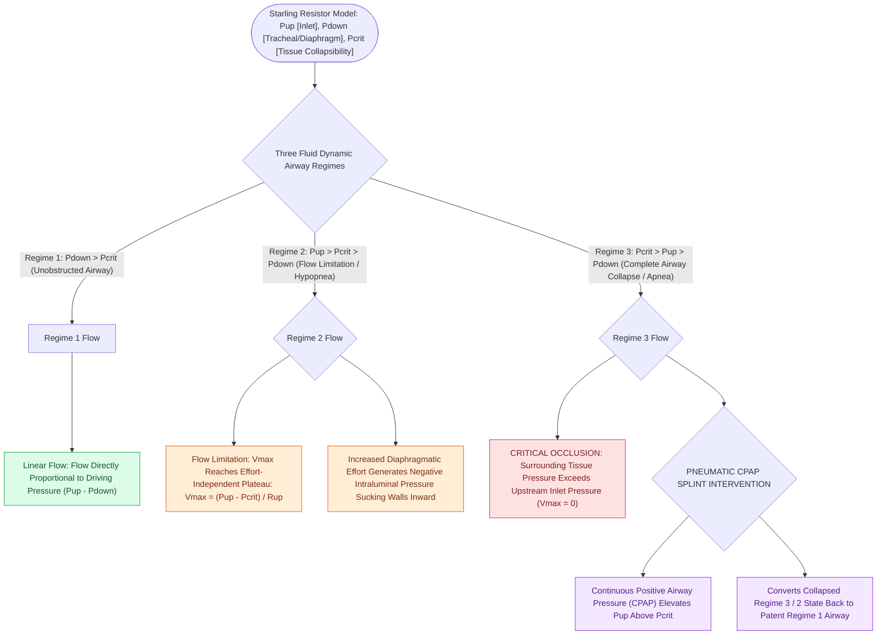

# The Starling resistor model explains upper airway collapsibility and critical closing pressure Pcrit

## Active Recall

> [!question]- What is the mathematical equation governing maximal inspiratory airflow ($V_{\max}$) during flow limitation in the Starling resistor model?
> *Answer / Clinical Rationale*: $$V_{\max} = \frac{P_{\text{up}} - P_{\text{crit}}}{R_{\text{upstream}}}$$

> [!question]- How does Continuous Positive Airway Pressure (CPAP) mechanically eliminate upper airway collapse according to the Starling model?
> *Answer / Clinical Rationale*: CPAP **elevates upstream pressure ($P_{\text{up}}$) above the critical closing pressure ($P_{\text{crit}}$)**, pneumatically stenting the airway open.

## Core Clinical & Mechanistic Principles
The human upper airway during sleep functions as a **collapsible Starling resistor**, where airflow is governed by upstream pressure, downstream pressure, and surrounding tissue pressure:
- **The Starling Resistor Components**:
  - **Upstream Pressure ($P_{\text{up}}$)**: Atmospheric / nasal pressure at the airway inlet.
  - **Downstream Pressure ($P_{\text{down}}$)**: Tracheal / alveolar pressure generated by diaphragmatic inspiratory effort.
  - **Surrounding Tissue Pressure ($P_{\text{crit}}$ / Critical Closing Pressure)**: The external tissue pressure exerted by pharyngeal fat pads, lateral pharyngeal walls, tongue volume, and bony craniofacial boundaries.
- **Three Fluid Dynamic Regimes**:
  1. **Regime 1 ($P_{\text{down}} > P_{\text{crit}}$ - No Flow Limitation)**: Airway remains widely patent; flow is proportional to driving pressure gradient ($P_{\text{up}} - P_{\text{down}}$).
  2. **Regime 2 ($P_{\text{up}} > P_{\text{crit}} > P_{\text{down}}$ - Flow Limitation / Hypopnea)**: The airway partially collapses; maximum airflow ($V_{\max}$) reaches a plateau independent of downstream effort:
     $$V_{\max} = \frac{P_{\text{up}} - P_{\text{crit}}}{R_{\text{upstream}}}$$
  3. **Regime 3 ($P_{\text{crit}} > P_{\text{up}} > P_{\text{down}}$ - Complete Airway Occlusion / Apnea)**: Surrounding tissue pressure exceeds upstream inlet pressure; airflow ceases completely ($V_{\max} = 0$).

### Surgical Technique & Critical Safety Checks
- **Mechanism of CPAP**: Positive Airway Pressure (CPAP) increases $P_{\text{up}}$ above $P_{\text{crit}}$, acting as a pneumatic splint to prevent pharyngeal collapse (see [[Critical closing pressure Pcrit stratifies upper airway collapsibility from snorers to severe obstructive sleep apnea|Pcrit Stratification]]).

## Connected Concepts & Graph Traversal
- **Pcrit Stratification**: [[Critical closing pressure Pcrit stratifies upper airway collapsibility from snorers to severe obstructive sleep apnea|Pcrit Stratification]]
- **Upper Airway Dilators**: [[Geniohyoid and genioglossus muscles are primary upper airway dilators maintaining pharyngeal patency|Airway Dilators]]
- **DISE Endoscopy**: [[Drug-induced sleep endoscopy DISE evaluates dynamic multi-level upper airway collapse under sedation|DISE Endoscopy]]
- **Embryological & Sleep Foundation**: [[First branchial cleft anomalies present as periauricular cysts or sinus tracts parallel to the external auditory canal]]
- **Adenotonsillar & Endoscopic DISE**: [[Rapid maxillary expansion widens the hard palate and nasal floor to improve pediatric nasal breathing and OSA]]
- **Congenital Airway Pathology**: [[Myer-Cotton grading system stratifies subglottic stenosis from Grade I less than fifty percent to Grade IV no lumen]]
- **Open Airway Reconstruction**: [[Double-stage LTR maintains a tracheostomy and utilizes an endolaryngeal LT-Mold or Montgomery T-tube stent]]
