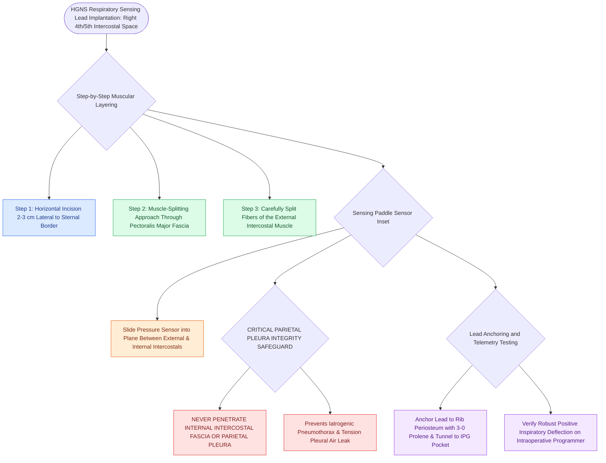

# The respiratory sensing lead is placed between the internal and external intercostal muscles to detect inspiratory effort

## Active Recall

> [!question]- Between which two muscle layers is the HGNS respiratory sensing lead placed?
> *Answer / Clinical Rationale*: Between the **external intercostal muscle** and the **internal intercostal muscle** (in the 4th or 5th intercostal space).

> [!question]- What intraoperative complication must be avoided during placement of the sensing lead, and how?
> *Answer / Clinical Rationale*: A **pneumothorax** (avoided by staying within the intercostal muscle plane without breaching the deep internal intercostal fascia or parietal pleura).

## Core Clinical & Mechanistic Principles
The **respiratory sensing lead** in hypoglossal nerve stimulation synchronizes tongue protrusion with the patient's spontaneous respiratory cycle:
- **Anatomical Placement Site**:
  - Inserted through a separate $3.0\text{-cm}$ horizontal skin incision in the **right 4th or 5th intercostal space**, approximately $2.0\text{–}3.0\text{ cm}$ lateral to the sternal border.
- **Surgical Step-by-Step Inset Protocol**:
  1. Incise skin and subcutaneous tissue; expose the fascia of the **pectoralis major muscle**.
  2. Split the pectoralis major and **external intercostal muscle fibers** along their natural orientation.
  3. Identify the plane between the **external intercostal muscle and the internal intercostal muscle**.
  4. **Submuscular Lead Inset**: Slide the flat, paddle-shaped pressure sensor into the intermuscular pocket between the internal and external intercostal layers.
  5. **The Pleural Integrity Rule**: Dissect strictly between the muscular layers; **NEVER violate the internal intercostal fascia or parietal pleura** (which causes a **pneumothorax**).
  6. Anchor the lead with non-absorbable 3-0 Prolene sutures to the rib periosteum / intercostal fascia; tunnel the lead subcutaneously to the infraclavicular IPG pocket.

### Surgical Technique & Critical Safety Checks
- **Waveform Verification**: Connect the sensing lead to the telemetry programmer in the OR to confirm a robust, positive-deflection inspiratory pressure waveform with zero cardiac motion artifact (see [[Hypoglossal nerve stimulation HGNS activates the medial branch of CN XII to advance the tongue during inspiration|HGNS Overview]]).

## Connected Concepts & Graph Traversal
- **HGNS Overview**: [[Hypoglossal nerve stimulation HGNS activates the medial branch of CN XII to advance the tongue during inspiration|HGNS Overview]]
- **HGNS Cuff Placement**: [[The stimulation cuff is placed selectively around the medial branch of the hypoglossal nerve to exclude retractor fibers|HGNS Cuff Placement]]
- **MMA Advancement**: [[Maxillomandibular advancement MMA advances the skeletal framework by ten to twelve millimeters to expand the upper airway|MMA Advancement]]
- **Embryological & Sleep Foundation**: [[Nocturnal pulse oximetry McGill score stratifies pediatric obstructive sleep apnea severity]]
- **Sleep Endoscopy & Airway Dynamics**: [[Drug-induced sleep endoscopy DISE evaluates dynamic multi-level upper airway collapse under sedation|Drug-Induced Sleep Endoscopy (DISE)]] [[Adenotonsillectomy is the first-line surgical treatment for pediatric obstructive sleep apnea]]
- **Congenital Airway Pathology**: [[Endoscopic balloon dilation with steroid injection manages early, soft, non-circumferential subglottic stenosis]]
- **Open Airway Reconstruction**: [[Preserving the recurrent laryngeal nerves at the cricothyroid articulation is essential during cricotracheal resection]]
