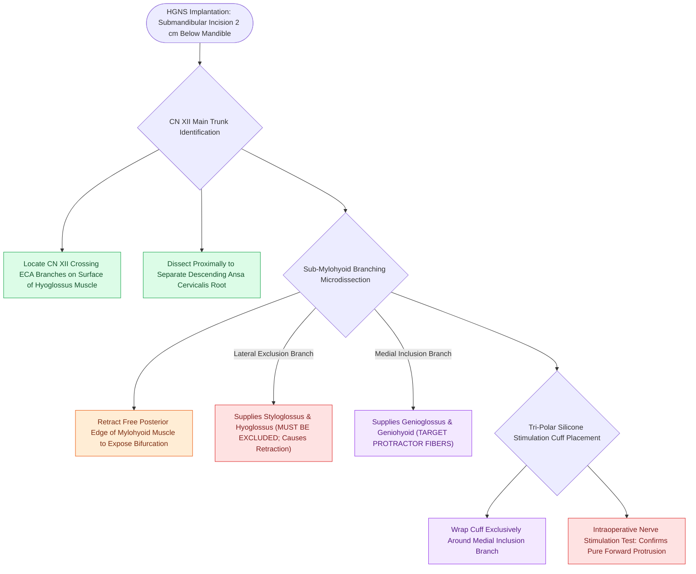

# The stimulation cuff is placed selectively around the medial branch of the hypoglossal nerve to exclude retractor fibers

## Active Recall

> [!question]- Around which specific branch of the hypoglossal nerve is the HGNS stimulation cuff placed?
> *Answer / Clinical Rationale*: Around the **medial branch (inclusion branch)** of the hypoglossal nerve.

> [!question]- What motor response must be observed on the operating table upon stimulating the cuff electrode?
> *Answer / Clinical Rationale*: **Pure, symmetrical tongue protrusion and depression** without any tongue retraction.

## Core Clinical & Mechanistic Principles
Surgical implantation of the hypoglossal nerve stimulation cuff requires precise micro-dissection of the hypoglossal nerve branches in the submandibular neck:
- **Surgical Step-by-Step Execution**:
  1. **Incision & Exposure**: Horizontal skin incision $2.0\text{ cm}$ below the right inferior border of the mandible (incorporating submandibular crease); incise platysma; retract submandibular gland superiorly.
  2. **Identify CN XII Main Trunk**: Locate the hypoglossal nerve as it crosses the external carotid artery branches and runs deep to the digastric tendon over the **hyoglossus muscle**.
  3. **Dissect Nerve Branching (Inclusion vs. Exclusion Branches)**:
     - Trace CN XII anteriorly beneath the posterior border of the **mylohyoid muscle** (partially retracting or dividing a small edge of mylohyoid).
     - Identify the point where CN XII bifurcates into the **lateral branch** (supplying retractor muscles: hyoglossus and styloglossus) and the **medial branch** (supplying protractor muscles: genioglossus and geniohyoid).
  4. **Cuff Placement**:
     - Wrap the tri-polar silicone cuff exclusively around the **medial (inclusion) branch** of the hypoglossal nerve.
     - Verify with intraoperative nerve stimulation: stimulation must produce **pure symmetrical tongue protrusion and depression** with **zero tongue retraction or lateral curling**.

### Surgical Technique & Critical Safety Checks
- **C2/C3 Ansa Cervicalis Separation**: Descending fibers to the ansa cervicalis must be carefully dissected off the hypoglossal trunk proximally (see [[Excluding the branch to the hyoglossus and styloglossus prevents tongue retraction during hypoglossal nerve stimulation|Excluding Retractors]]).

## Connected Concepts & Graph Traversal
- **Excluding Retractors**: [[Excluding the branch to the hyoglossus and styloglossus prevents tongue retraction during hypoglossal nerve stimulation|Excluding Retractors]]
- **HGNS Overview**: [[Hypoglossal nerve stimulation HGNS activates the medial branch of CN XII to advance the tongue during inspiration|HGNS Overview]]
- **HGNS Sensing Lead**: [[The respiratory sensing lead is placed between the internal and external intercostal muscles to detect inspiratory effort|HGNS Sensing Lead]]
- **Embryological & Sleep Foundation**: [[Non-rapid eye movement and rapid eye movement sleep architecture dictate pharyngeal muscle tone]]
- **Sleep Endoscopy & Airway Dynamics**: [[Drug-induced sleep endoscopy DISE evaluates dynamic multi-level upper airway collapse under sedation|Drug-Induced Sleep Endoscopy (DISE)]] [[Concentric velopharyngeal collapse on DISE is a contraindication to hypoglossal nerve stimulation]]
- **Congenital Airway Pathology**: [[Subglottic hemangiomas present as biphasic stridor in infants and respond to systemic oral propranolol]]
- **Open Airway Reconstruction**: [[Single-stage and double-stage laryngotracheal reconstruction LTR repair mature high-grade subglottic stenosis]]
