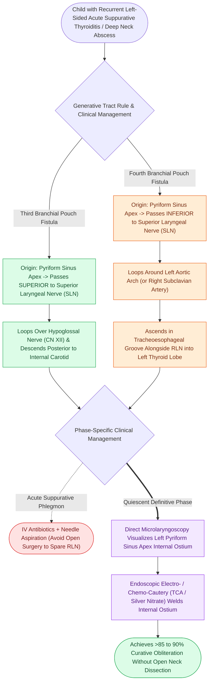

# Third and fourth branchial pouch anomalies present as recurrent left thyroid bed abscesses and piriform sinus fistulas

## Active Recall

> [!question]- Why do third and fourth branchial pouch anomalies present as recurrent left-sided neck or thyroid abscesses?
> *Answer / Clinical Rationale*: The fistula tract originates in the **left pyriform sinus apex** and descends into the left thyroid bed/lobe; swallowing forces oral bacteria into the tract, creating recurrent suppurative thyroiditis or perithyroid cellulitis.

> [!question]- How does the generative tract rule distinguish the anatomical course of a 3rd versus 4th branchial pouch fistula?
> *Answer / Clinical Rationale*: A 3rd pouch tract passes **cranial (superior) to the superior laryngeal nerve** (Arch 4 derivative) and posterior to the ICA, whereas a 4th pouch tract passes **caudal (inferior) to the superior laryngeal nerve**, hooks the subclavian/aortic arch, and climbs the tracheoesophageal groove like the RLN.

> [!question]- What is the first-line definitive treatment for a pediatric pyriform sinus fistula?
> *Answer / Clinical Rationale*: **Endoscopic cauterization (electrocautery, coblation, or TCA chemo-cautery)** of the internal pyriform sinus apex opening under direct microlaryngoscopy.

## Core Clinical & Mechanistic Principles
**Third and fourth branchial pouch (cleft) anomalies** account for $<2\text{–}3\%$ of branchial anomalies, characteristically presenting as **recurrent left-sided deep neck infections or suppurative acute thyroiditis**:

- **The Generative Tract Rule Applied to 3rd & 4th Anomalies**:
  - *Generative Tract Rule*: A tract of arch/pouch $n$ descends **caudal to the derivatives of its own arch and cranial to those of the arch below**.
  - **Third Pouch Fistula (The Cranial Nerve Clamp)**:
    - *Origin*: Internal opening at the **pyriform sinus fundus / apex**.
    - *Course*: Passes **posterior to the internal carotid artery (ICA) and deep to the external carotid artery (ECA)**, looping **under CN IX (glossopharyngeal nerve) and over CN X (vagus nerve / superior to internal branch of the SLN)**. Pierces the **thyrohyoid membrane** above the internal branch of the SLN to enter the upper neck.
  - **Fourth Pouch Fistula**:
    - *Origin*: Internal opening at the **pyriform sinus apex or upper cervical esophagus**.
    - *Course*: Passes **caudal (inferior) to the superior laryngeal nerve (SLN)**, loops around the **subclavian artery on the right** or the **aortic arch on the left** (Arch 4 vessels), and ascends along the tracheoesophageal groove alongside the recurrent laryngeal nerve (Arch 6 nerve) through the left thyroid lobe.

- **Practical Clinical Collapse & Left-Sided Dominance ($>90\%$)**:
  - Due to asymmetric embryonic vascular remodeling of the 4th and 6th arches, these anomalies are **overwhelmingly left-sided**.
  - In practice, 3rd and 4th pouch anomalies are indistinguishable on physical examination: **a child with recurrent left acute suppurative thyroiditis or recurrent left perithyroid/deep neck abscess has a pyriform sinus fistula until endoscopy proves otherwise**.
  - **First-Line Endoscopic Management**: Direct microlaryngoscopy with a rigid anterior commissure scope or hypopharyngoscope visualizes the tiny internal opening at the apex of the left pyriform sinus. Endoscopic obliteration using **electrocautery, coblation, or trichloroacetic acid (TCA / silver nitrate)** chemically welds the internal ostium with a $>85\text{–}90\%$ cure rate, avoiding morbid open exploration around the carotid and RLN.

### Surgical Technique & Critical Safety Checks
- **Avoid Open Dissection in Acute Infection**: Open fistulectomy during acute phlegmon risks catastrophic RLN injury; treat acutely with IV antibiotics $\pm$ percutaneous needle drainage, followed by definitive endoscopic internal cauterization once quiescent (see [[Each branchial arch packages one nerve, one artery, one cartilage bar, and one muscle group|Branchial Apparatus]]).

## Connected Concepts & Graph Traversal
- **Branchial Apparatus**: [[Each branchial arch packages one nerve, one artery, one cartilage bar, and one muscle group|Branchial Apparatus]]
- **Second Branchial Cleft**: [[Second branchial cleft anomalies represent the most common branchial anomaly situated anterior to the sternocleidomastoid|Second Branchial Cleft]]
- **Sistrunk Procedure**: [[Sistrunk procedure resects the thyroglossal duct cyst with the central body of the hyoid bone and foramen cecum core|Sistrunk Procedure]]
- **Embryological & Sleep Foundation**: [[Adult polysomnography criteria define obstructive sleep apnea severity by apnea-hypopnea index thresholds of five, fifteen, and thirty]]
- **Sleep Endoscopy & Airway Dynamics**: [[Drug-induced sleep endoscopy DISE evaluates dynamic multi-level upper airway collapse under sedation|Drug-Induced Sleep Endoscopy (DISE)]] [[Coblation lingual tonsillectomy debulks tongue base lymphoid tissue while preserving the lingual neurovascular bundles]]
- **Congenital Airway Pathology**: [[Microdebrider debulking and intralesional cidofovir provide surgical and adjuvant control of RRP]]
- **Open Airway Reconstruction**: [[Double-stage LTR maintains a tracheostomy and utilizes an endolaryngeal LT-Mold or Montgomery T-tube stent]]
