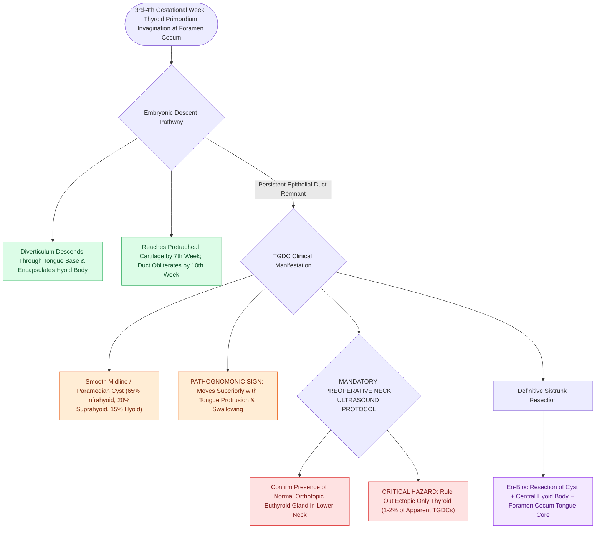

# Thyroglossal duct cyst tract tracks from the foramen cecum through the hyoid bone to the anterior neck

## Active Recall

> [!question]- Why does a thyroglossal duct cyst move vertically upward during tongue protrusion and swallowing?
> *Answer / Clinical Rationale*: Because the cyst tract is **anatomically connected to the hyoid bone and the lingual muscles of the tongue base**.

> [!question]- What essential diagnostic imaging study must be performed prior to TGDC excision, and why?
> *Answer / Clinical Rationale*: A **neck ultrasound**, to verify the presence of a **normal orthotopic thyroid gland** and prevent inadvertent removal of an ectopic only thyroid.

## Core Clinical & Mechanistic Principles
**Thyroglossal Duct Cysts (TGDCs)** are the most common congenital neck mass ($70\%$ of congenital neck anomalies), arising from persistent epithelial remnants of the descending thyroid gland:
- **Embryological Thyroid Migration Pathway**:
  - The thyroid primordium originates at the **foramen cecum** at the junction of the anterior 2/3 and posterior 1/3 of the tongue during the 3rd–4th week.
  - The diverticulum descends through the midline tongue base, passes **intimately through or anterior to the developing hyoid bone body**, and reaches its final pretracheal position by the 7th week.
  - The connecting thyroglossal duct normally obliterates by the 8th–10th gestational week.
- **Clinical Presentation**:
  - Midline (or slightly paramedian) smooth, cystic, non-tender anterior neck mass (most commonly **infrahyoid in $65\%$**, suprahyoid in $20\%$, at hyoid level in $15\%$).
  - **Pathognomonic Physical Sign**: The mass **elevates with tongue protrusion and swallowing** (due to muscular attachment to the hyoid bone and tongue base).
- **Mandatory Preoperative Assessment**:
  - **Ultrasound of Neck**: Must definitively confirm the presence of a **normal, functioning, orthotopic thyroid gland in the lower neck** to rule out an **ectopic thyroid gland** (which represents the patient's only functioning thyroid tissue in $1\text{–}2\%$ of apparent TGDCs).

### Surgical Technique & Critical Safety Checks
- **Malignancy Risk**: Papillary thyroid carcinoma occurs in $1\%$ of TGDCs, originating from ectopic follicular cells within the cyst wall (see [[Sistrunk procedure resects the thyroglossal duct cyst with the central body of the hyoid bone and foramen cecum core|Sistrunk Procedure]]).

## Connected Concepts & Graph Traversal
- **Sistrunk Procedure**: [[Sistrunk procedure resects the thyroglossal duct cyst with the central body of the hyoid bone and foramen cecum core|Sistrunk Procedure]]
- **Branchial Apparatus**: [[Each branchial arch packages one nerve, one artery, one cartilage bar, and one muscle group|Branchial Apparatus]]
- **Base of Tongue Differential**: [[Lingual tonsil hypertrophy causes persistent pediatric obstructive sleep apnea and base of tongue collapse|Lingual Tonsil Hypertrophy Differential]]
- **Foramen Cecum Midline Differential**: [[Congenital nasal dermoid sinus cysts require preoperative MRI and CT to detect intracranial extension through the foramen cecum or bifid crista galli|Congenital Nasal Dermoid Sinus Cysts]]
- **Lateral Neck Differential**: [[Second branchial cleft anomalies represent the most common branchial anomaly situated anterior to the sternocleidomastoid|Second Branchial Cleft Anomalies]]
