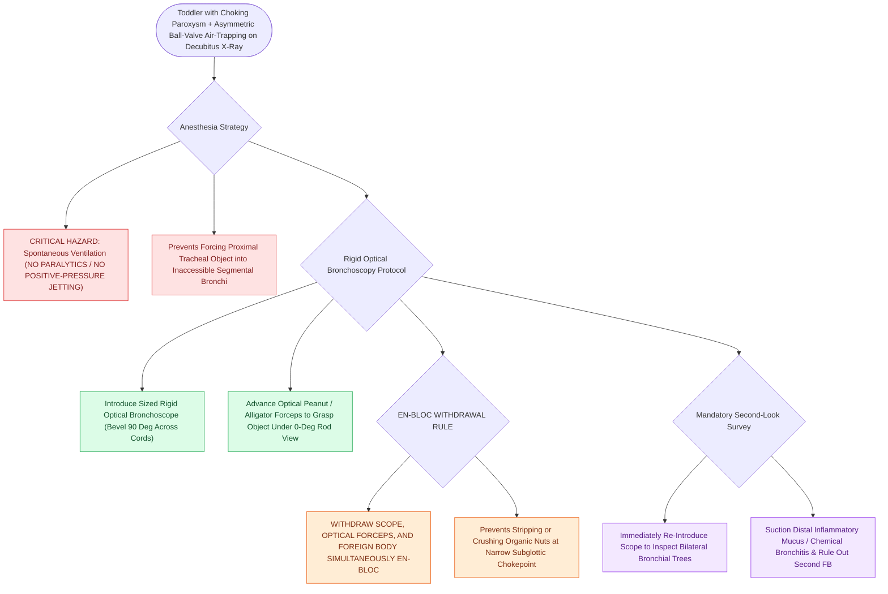

# Tracheobronchial foreign body aspiration presents with choking and air trapping requiring rigid bronchoscopy

## Active Recall

> [!question]- Why must optical forceps, the foreign body, and the rigid bronchoscope be withdrawn together as a single cohesive unit during airway extraction?
> *Answer / Clinical Rationale*: Foreign bodies (particularly organic nuts or seeds) are typically larger than the inner lumen of the pediatric bronchoscope sheath. Attempting to pull the object inside the sheath crushes the object or strips it off at the distal tip. Withdrawing the scope and forceps *en bloc* ensures continuous direct visualization and secure hold across the narrow subglottis and glottic aperture.

> [!question]- What radiographic findings on inspiratory/expiratory or lateral decubitus chest films indicate unilateral bronchial foreign body obstruction?
> *Answer / Clinical Rationale*: **Asymmetric hyperinflation and air-trapping** on the affected side due to a "ball-valve" mechanism, with the affected lung remaining hyperlucent and failing to collapse during expiration or when placed in the dependent decubitus position, accompanied by **mediastinal shift away from the affected side**.

> [!question]- Why is positive-pressure jet ventilation or neuromuscular blockade strictly avoided during foreign body extraction?
> *Answer / Clinical Rationale*: Positive pressure can push a mobile tracheal or mainstem foreign body deeper into distal segmental bronchi, converting a manageable proximal retrieval into an inaccessible peripheral impaction or causing total bilateral bronchial obstruction.

## Core Clinical & Mechanistic Principles
**Tracheobronchial foreign body (FB) aspiration** represents a critical pediatric emergency, with peak incidence in children aged **$6\text{ months to }3\text{ years}$** (due to developing molar dentition and active oral exploratory behaviors).

- **Pathophysiology of Organic Matter**:
  - Most aspirated objects are **radiolucent organic materials** (e.g., peanuts, carrots, popcorn, sunflower seeds).
  - Organic matter absorbs moisture, swells over hours, and releases irritating free fatty acids that incite intense chemical bronchitis, circumferential mucosal edema, and friable granulation tissue.
- **Classic Triad (<60% sensitivity)**:
  1. Sudden-onset coughing / choking paroxysm.
  2. Unilateral or localized wheezing refractory to bronchodilators.
  3. Diminished breath sounds over the affected hemithorax.
- **Anatomical Predilection**: In older children and adults, the **right mainstem bronchus** is favored due to its wider diameter, more vertical take-off angle, and greater airflow volume. In infants and toddlers $<2\text{ years}$, the angles of bifurcation are more symmetrical ($55^\circ$ right vs $40^\circ$ left).

### Surgical Technique & Craft Nuance: Rigid Bronchoscopy
1. **Anesthesia Doctrine**:
   - Maintain **spontaneous inhalational ventilation** (sevoflurane in 100% $\text{O}_2$) without paralytics or positive-pressure bagging.
2. **Direct Laryngoscopy & Bronchoscope Entry**:
   - Introduce a Parsons or Dedo laryngoscope to visualize the glottis.
   - Introduce a sized **ventilating rigid optical bronchoscope** (e.g., size $2.5\text{–}3.5\text{ mm}$ for toddlers) with bevel rotated $90^\circ$ to glide atraumatically through the vocal folds.
3. **Extraction & Secondary Survey**:
   - Pass optical peanut or alligator forceps through the sheath.
   - Grasp the foreign body securely under direct rod-lens magnification.
   - **Withdraw scope, forceps, and object en bloc** through the subglottis.
   - **Mandatory Second Look**: Immediately re-introduce the bronchoscope to survey the entire tracheobronchial tree, suction distal pus/mucus plugs, and confirm absence of second foreign bodies or fragmented seeds (see [[Pediatric esophageal button battery impaction causes liquefaction necrosis within two hours and mandates emergent endoscopic extraction|Esophageal Button Battery]]).

## Connected Concepts & Graph Traversal
- **Esophageal Battery Emergency**: [[Pediatric esophageal button battery impaction causes liquefaction necrosis within two hours and mandates emergent endoscopic extraction|Esophageal Button Battery]]
- **Diagnostic Differential**: [[Pediatric stertor and stridor differentiate upper supraglottic airway obstruction from intrathoracic tracheobronchial disease|Pediatric Stridor Evaluation]]
- **Nasal Foreign Bodies**: [[Nasal foreign bodies presenting with unilateral foul-smelling rhinorrhea mandate urgent removal with particular vigilance for button batteries|Nasal Foreign Bodies]]
- **Subglottic Sizing**: [[The Cotton-Myer classification grades subglottic stenosis by luminal reduction|Subglottic Stenosis]]
- **Aural Foreign Body Extraction**: [[External auditory canal foreign bodies require atraumatic extraction under microscopic guidance to protect the tympanic membrane|EAC Foreign Body]]
