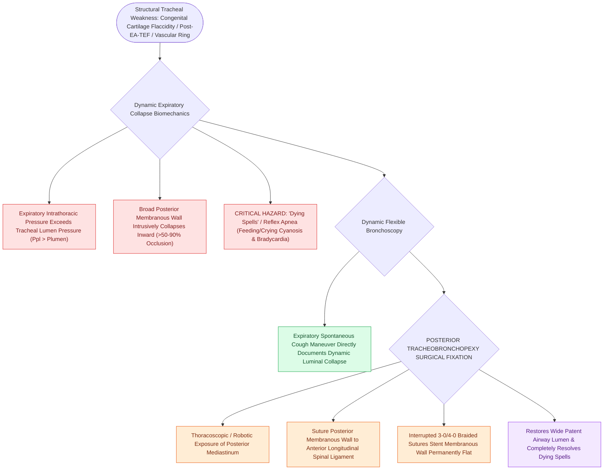

# Tracheomalacia causes dynamic expiratory tracheal collapse and is managed with posterior tracheobronchopexy

## Active Recall

> [!question]- What is a 'dying spell' (reflex apnea) in severe pediatric tracheomalacia?
> *Answer / Clinical Rationale*: A sudden episode of **complete tracheal collapse during feeding or crying**, producing severe hypoxemic cyanosis, loss of consciousness, and bradycardia.

> [!question]- What surgical procedure anchors the flaccid posterior tracheal membrane to the anterior spinal ligament?
> *Answer / Clinical Rationale*: **Posterior tracheobronchopexy**.

## Core Clinical & Mechanistic Principles
**Tracheomalacia (TM)** is characterized by structural weakness and excessive compliance of the tracheal wall, resulting in **dynamic collapse of the tracheal lumen during expiration**:
- **Pathophysiological Types**:
  1. **Primary (Congenital) Tracheomalacia**: Immature development of cartilaginous rings; cartilage is soft and wide, and the posterior membranous wall is broad. Typically improves spontaneously by age 2 years.
  2. **Secondary (Extrinsic / Acquired) Tracheomalacia**: Caused by extrinsic vascular compression (innominate artery, double aortic arch), chronic tracheostomy, or following **esophageal atresia / tracheoesophageal fistula (EA/TEF) repair** ($>50\%$ of EA/TEF children have severe TM).
- **The "Barking / Dying Spells" Presentation**:
  - Monophonic expiratory wheeze, "seal-bark" cough, recurrent pneumonia, and **"reflex apnea / dying spells"** (feeding or crying causes intrathoracic pressure to exceed intraluminal pressure, completely collapsing the trachea and causing severe hypoxemic cyanosis and bradycardia).
- **Modern Surgical Standard: Posterior Tracheobronchopexy**:
  - Thoracoscopic or robotic approach to the posterior mediastinum.
  - Suture the excessively flaccid **posterior membranous tracheal wall directly to the anterior longitudinal ligament of the spine** using interrupted 3-0/4-0 braided non-absorbable sutures.
  - Stents the posterior wall flat against the spine, **preventing expiratory intrusion into the lumen**.

### Surgical Technique & Critical Safety Checks
- **Dynamic Airway Evaluation**: Dynamic flexible bronchoscopy during spontaneous breathing and coughing is the definitive diagnostic gold standard (see [[Innominate artery compression syndrome causes dynamic anterior tracheal pulsatile collapse|Innominate Compression]]).

## Connected Concepts & Graph Traversal
- **Innominate Compression**: [[Innominate artery compression syndrome causes dynamic anterior tracheal pulsatile collapse|Innominate Compression]]
- **Aortopexy**: [[Aortopexy suspends the aorta to the sternum to relieve anterior vascular tracheal compression|Aortopexy]]
- **Complete Tracheal Rings**: [[Complete tracheal rings present with generalized tracheal stenosis and stovepipe appearance on imaging|Complete Tracheal Rings]]
- **Embryological & Sleep Foundation**: [[Third and fourth branchial pouch anomalies present as recurrent left thyroid bed abscesses and piriform sinus fistulas]]
- **Adenotonsillar & Endoscopic DISE**: [[Drug-induced sleep endoscopy DISE evaluates dynamic multi-level upper airway collapse under sedation]]
- **Congenital Airway Pathology**: [[Viral laryngotracheobronchitis croup presents with a barking cough and subglottic steeple sign on radiography]]
- **Open Airway Reconstruction**: [[Anterior costal cartilage grafts expand the thyroid and cricoid cartilage framework]]
