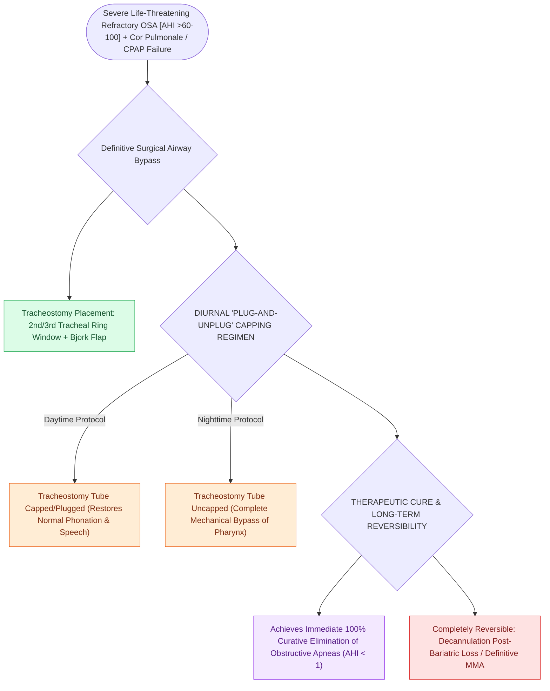

# Tracheostomy provides immediate definitive relief for severe life-threatening refractory obstructive sleep apnea

## Active Recall

> [!question]- What is the clinical role of tracheostomy in modern sleep apnea surgery?
> *Answer / Clinical Rationale*: As a **definitive, life-saving bypass for severe refractory OSA** complicated by pulmonary hypertension, cor pulmonale, or failure of all other medical and surgical therapies.

> [!question]- How is a tracheostomy tube managed in an OSA patient to maintain normal daytime speech and breathing?
> *Answer / Clinical Rationale*: The tube is **capped (plugged) during the day** and **opened (uncapped) only during sleep**.

## Core Clinical & Mechanistic Principles
**Tracheostomy** is the historic gold standard and only $100\%$ curative surgical intervention for severe, life-threatening obstructive sleep apnea, directly bypassing all pharyngeal sites of collapse:
- **Indications for Tracheostomy in OSA**:
  1. Severe, refractory OSA ($\text{AHI} > 60\text{–}100$) in patients who **fail or refuse all forms of positive airway pressure (CPAP/BiPAP), oral appliances, and multi-level surgeries**.
  2. Life-threatening sleep apnea complicated by **severe cor pulmonale, pulmonary hypertension, intractable cardiac arrhythmias, or severe hypercapnic respiratory failure (Obesity Hypoventilation Syndrome / Pickwickian syndrome)**.
  3. Severe morbid obesity ($\text{BMI} > 50\text{–}60\text{ kg/m}^2$) unfit for prolonged skeletal surgery.
  4. Craniofacial anomalies (e.g., severe Treacher Collins, syndromic craniosynostosis) with uncorrectable multi-level obstruction.
- **Surgical Execution & Management**:
  - Horizontal cervical incision; create an inferiorly based Björk flap or circular tracheal window in the 2nd/3rd tracheal rings.
  - **The "Plug-and-Unplug" Protocol**:
    - The tracheostomy tube is **plugged (capped) during the day**, allowing normal vocalization, phonation, and nasal breathing.
    - The tube is **uncapped (opened) only at bedtime**, providing an unobstructed bypass of the pharynx during sleep.

### Surgical Technique & Critical Safety Checks
- **Reversibility**: Tracheostomy is completely reversible; if the patient achieves massive weight loss (e.g., post-bariatric surgery) or undergoes definitive [[Maxillomandibular advancement MMA advances the skeletal framework by ten to twelve millimeters to expand the upper airway|maxillomandibular advancement (MMA)]], the tracheostomy can be decannulated.

## Connected Concepts & Graph Traversal
- **MMA Advancement**: [[Maxillomandibular advancement MMA advances the skeletal framework by ten to twelve millimeters to expand the upper airway|MMA Advancement]]
- **HGNS Overview**: [[Hypoglossal nerve stimulation HGNS activates the medial branch of CN XII to advance the tongue during inspiration|HGNS Overview]]
- **Postoperative Airway**: [[Postoperative airway management in sleep surgery requires continuous pulse oximetry and avoidance of oversedation|Postoperative Airway]]
- **Sleep Endoscopy & Airway Dynamics**: [[Drug-induced sleep endoscopy DISE evaluates dynamic multi-level upper airway collapse under sedation|Drug-Induced Sleep Endoscopy (DISE)]]
- **Emergency Airway Protocol**: [[High-stakes pediatric and adult sleep airway complications require rapid structured algorithmic emergency rescue|Sleep Airway Emergency Rescue]]
