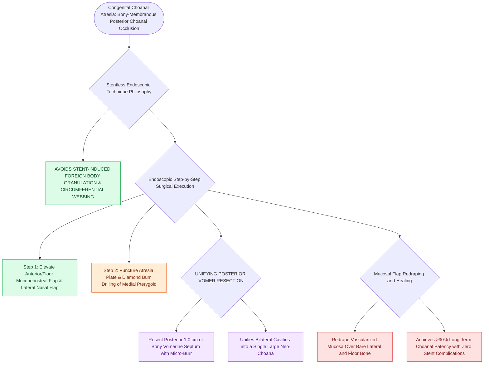

# Transnasal endoscopic resection of the atretic plate and posterior vomer establishes choanal patency without stents

## Active Recall

> [!question]- Why has the modern 'stentless' technique replaced routine stenting in endoscopic choanal atresia repair?
> *Answer / Clinical Rationale*: Because prolonged stenting causes **foreign body granulation tissue and circumferential scar contracture**, leading to higher restenosis rates.

> [!question]- What specific bony structure is resected to unify both sides into a single large neo-choana?
> *Answer / Clinical Rationale*: The **posterior vomer (posterior bony nasal septum)**.

## Core Clinical & Mechanistic Principles
**Transnasal Endoscopic Choanoplasty (Atresioplasty)** is the international standard of care for repairing congenital [[Congenital bilateral choanal atresia causes cyclical cyanosis relieved by crying and requires urgent oral airway placement|choanal atresia]]:
- **The Modern "Stentless" Surgical Philosophy**:
  - Historically, prolonged stenting with endotracheal tube segments was used; however, stents cause foreign body reaction, circumferential granulation tissue, circumferential scarring, and restenosis.
  - **Modern stentless repair with mucosal flap coverage** achieves higher primary success rates ($>90\%$) and eliminates stent complications.
- **Surgical Step-by-Step Execution**:
  1. **Visualization**: Use a $0^\circ$ and $120^\circ$ rigid pediatric endoscope.
  2. **Mucosal Flap Elevation**: Elevate an anteriorly based mucoperiosteal flap from the nasal floor and atretic plate, and a laterally based flap from the lateral nasal wall.
  3. **Puncture & Bony Resection**: Puncture the atresia plate under direct view; use a diamond burr or micro-curettes to **drill down the thick posterior vomer** and **medialized pterygoid plates**.
  4. **Unify the Choanae**: Resect the posterior $1.0\text{ cm}$ of the bony nasal septum (posterior vomer), creating a **single large unified neo-choana**.
  5. **Flap Redraping**: Redrape the mucosal flaps over the bare lateral and inferior bone to prevent circumferential granulation.

### Surgical Technique & Critical Safety Checks
- **Postoperative Care**: Saline nasal drops/suctioning; topical mometasone spray; revision endoscopy if restenosis occurs.

## Connected Concepts & Graph Traversal
- **Choanal Atresia Overview**: [[Congenital bilateral choanal atresia causes cyclical cyanosis relieved by crying and requires urgent oral airway placement|Choanal Atresia Overview]]
- **Pyriform Aperture Stenosis**: [[Congenital pyriform aperture stenosis causes neonatal nasal obstruction and presents with a solitary central incisor|Pyriform Aperture Stenosis]]
- **VPI Overview**: [[Velopharyngeal insufficiency VPI causes hypernasal resonance and nasal air emission during speech|VPI Overview]]
- **Embryological & Sleep Foundation**: [[Third and fourth branchial pouch anomalies present as recurrent left thyroid bed abscesses and piriform sinus fistulas]]
- **Sleep Endoscopy & Airway Dynamics**: [[Drug-induced sleep endoscopy DISE evaluates dynamic multi-level upper airway collapse under sedation|Drug-Induced Sleep Endoscopy (DISE)]] [[Concentric velopharyngeal collapse on DISE is a contraindication to hypoglossal nerve stimulation]]
- **Congenital Airway Pathology**: [[Congenital bilateral vocal fold paralysis presents with severe inspiratory stridor requiring airway protection]]
- **Open Airway Reconstruction**: [[Slide tracheoplasty achieves immediate vascularized mucosal lumen doubling with lowest restenosis rates]]
