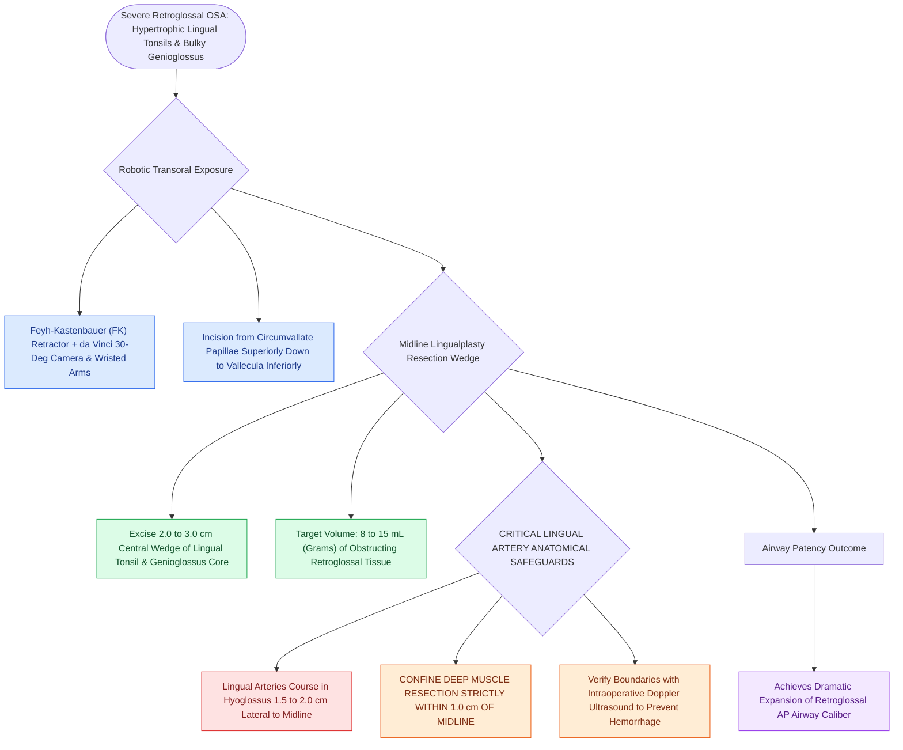

# Transoral robotic surgery TORS tongue base reduction debulks lingual tonsil and midline tongue musculature in OSA

## Active Recall

> [!question]- What volume of tongue base tissue is typically resected during a TORS tongue base reduction for OSA?
> *Answer / Clinical Rationale*: Approximately **$8\text{ to }15\text{ mL}$ (or grams)** of midline lingual tonsil and [[Geniohyoid and genioglossus muscles are primary upper airway dilators maintaining pharyngeal patency|genioglossus muscle]] tissue.

> [!question]- How far from the midline do the lingual arteries course in the base of the tongue?
> *Answer / Clinical Rationale*: Approximately **$1.5\text{ to }2.0\text{ cm}$ lateral to the midline** (mandating that deep resection be kept within $1.0\text{ cm}$ of midline).

## Core Clinical & Mechanistic Principles
**Transoral Robotic Surgery (TORS) Tongue Base Reduction** (introduced by Vicini and Weinstein) utilizes the da Vinci surgical system to resect hypertrophic lingual tonsils and midline tongue base musculature in severe retroglossal OSA:
- **Surgical Rationale**:
  - The base of the tongue is the primary site of obstruction in $>50\text{–}60\%$ of adult OSA patients.
  - Traditional transoral visualization of the deep tongue base is constrained by the teeth and mandible; TORS provides **3D high-definition magnification, multi-articulated instrument wristing, and tremor filtration**.
- **Surgical Step-by-Step Execution**:
  1. **Exposure**: Place Feyh-Kastenbauer (FK) or Crow-Davis retractor; dock robotic camera ($30^\circ$ up) and two instrument arms (monopolar cautery spatula and Maryland bipolar forceps).
  2. **Midline Mucosal & Tonsillar Incision**: Incise lingual tonsil in the midline from the circumvallate papillae down to the vallecula.
  3. **Muscular Debulking (Midline Lingualplasty)**:
     - Resect a **$2.0\text{ to }3.0\text{-cm wide}$ central wedge of genioglossus and intrinsic tongue muscle**, removing **$8\text{ to }15\text{ mL}$ of tongue volume**.
  4. **The Lingual Artery Safety Boundary**:
     - The **lingual arteries** run within the hyoglossus muscle **$1.5\text{–}2.0\text{ cm}$ lateral to the midline** and $1.0\text{–}1.5\text{ cm}$ deep.
     - Keep lateral resection strictly within **$1.0\text{ cm}$ of the midline** and confirm with intraoperative Doppler ultrasound.

### Surgical Technique & Critical Safety Checks
- **Complications**: Secondary hemorrhage ($3\text{–}5\%$, potentially life-threatening from lingual artery erosion), temporary hypoglossal neuropraxia, and severe tongue edema requiring overnight intubation or elective tracheostomy in high-risk patients (see [[Coblation lingual tonsillectomy debulks tongue base lymphoid tissue while preserving the lingual neurovascular bundles|Coblation Lingual Tonsils]]).

## Connected Concepts & Graph Traversal
- **Coblation Lingual Tonsils**: [[Coblation lingual tonsillectomy debulks tongue base lymphoid tissue while preserving the lingual neurovascular bundles|Coblation Lingual Tonsils]]
- **Submucosal Lingualplasty**: [[Submucosal lingualplasty and median labiomandibular glossotomy provide alternative access for tongue base reduction|Submucosal Lingualplasty]]
- **HGNS Stimulation**: [[Hypoglossal nerve stimulation HGNS activates the medial branch of CN XII to advance the tongue during inspiration|HGNS Stimulation]]
- **Embryological & Sleep Foundation**: [[Nocturnal pulse oximetry McGill score stratifies pediatric obstructive sleep apnea severity]]
- **Sleep Endoscopy & Airway Dynamics**: [[Drug-induced sleep endoscopy DISE evaluates dynamic multi-level upper airway collapse under sedation|Drug-Induced Sleep Endoscopy (DISE)]] [[Nasal steroid sprays and montelukast provide medical therapy for mild pediatric sleep-disordered breathing]]
- **Congenital Airway Pathology**: [[Subglottic hemangiomas present as biphasic stridor in infants and respond to systemic oral propranolol]]
- **Open Airway Reconstruction**: [[Slide tracheoplasty expands complete tracheal rings by oblique division and sliding longitudinal reconstruction]]
