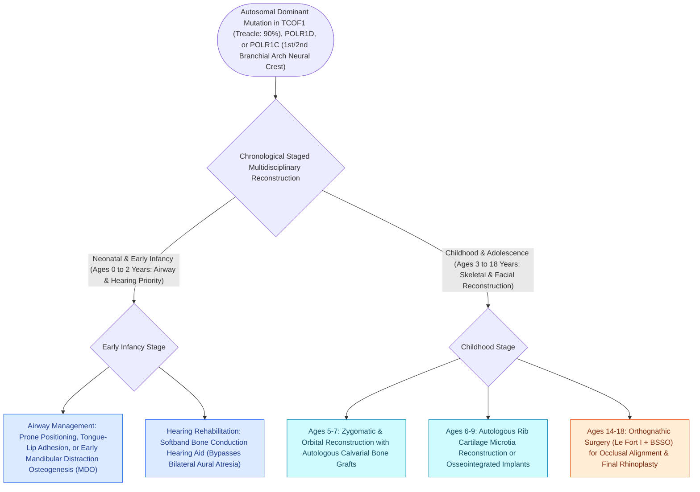

# Treacher Collins syndrome results from TCOF1 mutations causing mandibulofacial dysostosis and conductive hearing loss

## Active Recall

> [!question]- What is the genetic mutation and embryological basis of Treacher Collins syndrome (mandibulofacial dysostosis)?
> *Answer / Clinical Rationale*: Treacher Collins is an autosomal dominant disorder caused by mutations in the **TCOF1** gene (encoding the nucleolar phosphoprotein **Treacle** on chromosome 5q32–q33.1, or less commonly *POLR1C* / *POLR1D*), resulting in defective neural crest cell migration and extensive hypoplasia of structures derived from the **first and second branchial arches**.

> [!question]- What are the classic craniofacial and ocular physical findings that distinguish Treacher Collins syndrome?
> *Answer / Clinical Rationale*: **Downward-slanting (antimongoloid) palpebral fissures**, **coloboma of the lateral third of the lower eyelid with absent lower eyelashes (cilia)**, hypoplasia of the zygomatic arches and malar bones, and severe micrognathia/retrognathia with a high-arched or cleft palate. Intelligence is typically completely normal.

> [!question]- What otologic abnormalities are present, and what is the primary auditory rehabilitation strategy?
> *Answer / Clinical Rationale*: Severe bilateral **microtia, external auditory canal (EAC) atresia or stenosis, and ossicular chain dysmorphisms/ankylosis (malleus-incus fusion)** causing a maximal $50\text{–}60\text{ dB}$ conductive hearing loss. Sensorineural architecture is generally preserved. Primary rehabilitation in infants and young children is **bone-conduction hearing amplification (BAHA softband)**, transitioning to osseointegrated bone-anchored implants at age $\ge 5\text{ years}$.

## Core Clinical & Mechanistic Principles
Treacher Collins syndrome (mandibulofacial dysostosis / Franceschetti-Zwahlen-Klein syndrome) is a congenital pan-craniofacial disorder occurring in $1\text{ in }50,000$ live births:

### Airway Management & Surgical Timeline
1. **Neonatal Airway Compromise**: Micrognathia and glossoptosis frequently cause severe life-threatening neonatal airway obstruction:
   - *Non-surgical*: Prone positioning, nasopharyngeal airways.
   - *Surgical*: Tongue-lip adhesion, bilateral **mandibular distraction osteogenesis (MDO)** to advance the tongue base, or elective tracheostomy if MDO is not feasible.
2. **Hearing Rehabilitation**:
   - Immediate newborn fitting with **bone-anchored hearing aid (BAHA) on a softband** preserves normal language development despite bilateral canal atresia.
   - At age $\ge 5\text{ years}$, surgical implantation of osseointegrated bone conduction processors.
3. **Cleft Palate Repair**: Palatoplasty performed at $9\text{–}12\text{ months}$ with careful airway monitoring.
4. **Staged Craniofacial & Auricular Reconstruction**:
   - Microtia reconstruction (autologous rib cartilage vs Porus polyethylene) at age $6\text{–}10\text{ years}$.
   - Zygomatic/orbital rim bone grafting and orthognathic surgery (Le Fort I and bilateral sagittal split osteotomy) performed after skeletal maturity (see [[Each branchial arch packages one nerve, one artery, one cartilage bar, and one muscle group|First and Second Branchial Arch Derivations]]).

## Connected Concepts & Graph Traversal
- **Branchial Arch Embryology**: [[Each branchial arch packages one nerve, one artery, one cartilage bar, and one muscle group|First and Second Branchial Arch Derivations]]
- **Microtia Reconstruction**: [[Microtia reconstruction spans staged autologous costal cartilage frameworks and porous polyethylene implants|Microtia Repair Protocols]]
- **Bone-Anchored Implants**: [[Bone-anchored hearing implants BAHA stimulate the cochlea directly via bone conduction pathways|BAHA Auditory Rehabilitation]]
- **Differential Craniofacial Dysostosis**: [[Crouzon syndrome exhibits FGFR2-mediated craniosynostosis with ocular proptosis, midface hypoplasia, and normal extremities|Crouzon Syndrome Comparison]]
- **Neonatal Airway Obstruction**: [[Pierre Robin sequence manifests with micrognathia, glossoptosis, and secondary U-shaped cleft palate|Pierre Robin Sequence Airway Ladder]]
- **Canal Reconstruction Technique**: [[Congenital aural atresiaplasty utilizes an anterior surgical approach along the glenoid fossa with split-thickness skin grafting to reconstruct the external auditory canal|Congenital Aural Atresiaplasty]]
