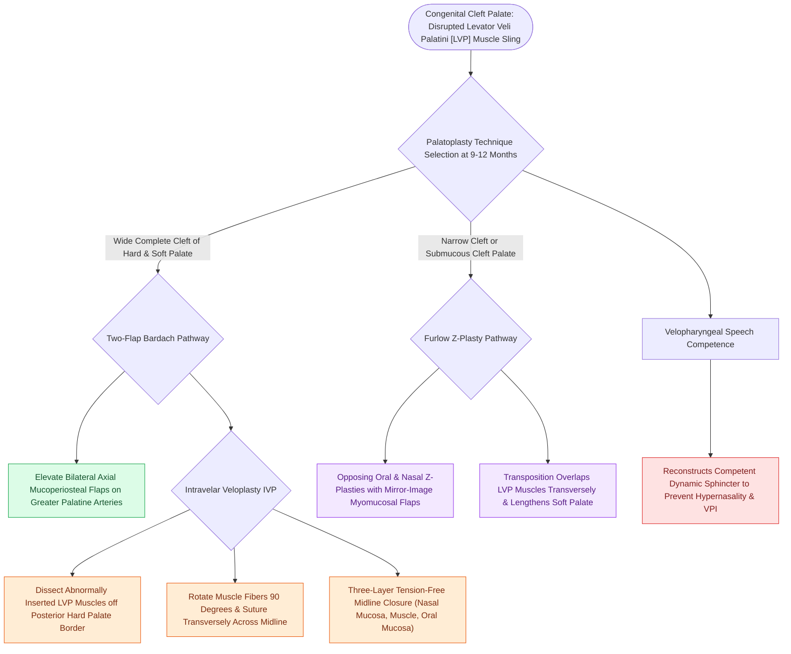

# Two-flap palatoplasty and Furlow double-reversing Z-plasty reconstruct the hard and soft palate musculature

## Active Recall

> [!question]- What major artery supplies the axial mucoperiosteal flaps in a two-flap palatoplasty?
> *Answer / Clinical Rationale*: The **greater palatine artery** (emerging from the greater palatine foramen).

> [!question]- What are the two primary mechanical benefits of a Furlow double-reversing Z-plasty?
> *Answer / Clinical Rationale*: It **lengthens the soft palate** and **reorients the levator veli palatini muscle fibers transversely** into a functional sling.

> [!question]- What is the ideal surgical timing for primary palatoplasty in cleft palate infants?
> *Answer / Clinical Rationale*: Between **$9\text{ and }12\text{ months of age}$** to reconstruct the velopharyngeal sphincter prior to speech development while minimizing midface growth restriction.

## Core Clinical & Mechanistic Principles
Surgical repair of cleft palate (**Palatoplasty**) aims to close the oral-nasal communication and reconstruct a functioning **levator veli palatini muscular sling** to achieve normal speech resonance:
- **Two-Flap Palatoplasty (Bardach) + Intravelar Veloplasty (IVP)**:
  - Axial mucoperiosteal flaps based on the **greater palatine arteries** are elevated from the hard palate.
  - **Intravelar Veloplasty (Sommerlad / Kriens)**: Dissects the abnormally inserted levator veli palatini muscles off the posterior border of the hard palate, reorients them $90^\circ$, and sutures them transversely in the midline to form an active velar sling.
  - Flaps are mobilized medially and closed in three layers (nasal mucosa, muscle, oral mucosa).
- **Furlow Double-Reversing Z-Plasty**:
  - Opposing Z-plasties on the oral and nasal surfaces of the soft palate:
    - *Oral Z-plasty*: Left-based mucosal flap, right-based myomucosal flap (containing levator muscle).
    - *Nasal Z-plasty*: Reversed orientation (right-based mucosal, left-based myomucosal).
  - Transposition of flaps **lengthens the soft palate** and **reorients the levator muscles transversely** without requiring hard palate relaxing incisions.
  - Excellent for narrow or submucous clefts; lowest rate of [[Velopharyngeal insufficiency VPI causes hypernasal resonance and nasal air emission during speech|velopharyngeal insufficiency]].

### Surgical Technique & Critical Safety Checks
- **Timing of Palatoplasty**: Typically performed between **$9\text{ and }12\text{ months of age}$** before the onset of significant expressive phonation to optimize speech outcomes while minimizing maxillary hypoplasia.
- **Fistula Prevention**: Tension-free multi-layer closure; lateral relaxing incisions if needed; preserve the neurovascular bundle at the greater palatine foramen; avoid excessive bipolar electrocautery to prevent mucosal flap margin ischemia at the junction of the hard and soft palate (the most common site of oronasal fistula).

## Connected Concepts & Graph Traversal
- **Cleft Lip Repair**: [[The Millard rotation-advancement and Fisher anatomical subunit repairs correct unilateral cleft lip deformities|Millard & Fisher Cleft Lip Repairs]]
- **Rule of Tens**: [[The Rule of Tens establishes pediatric surgical safety thresholds for elective cleft lip repair|Safety Thresholds for Cleft Surgery]]
- **VPI Pathophysiology**: [[Velopharyngeal insufficiency VPI causes hypernasal resonance and nasal air emission during speech|Velopharyngeal Insufficiency & Resonance]]
- **VPI Posterior Pharyngeal Flap**: [[Superiorly based posterior pharyngeal flaps create a central tissue bridge for coronal velopharyngeal insufficiency|Posterior Pharyngeal Flap]]
- **VPI Sphincter Pharyngoplasty**: [[Sphincter pharyngoplasties transpose bilateral palatopharyngeus flaps to narrow the lateral velopharyngeal port in sagittal insufficiency|Sphincter Pharyngoplasty]]
- **Cleft Embryology**: [[Unilateral and bilateral cleft lip and palate result from failure of fusion of the maxillary and medial nasal prominences|Cleft Lip & Palate Embryology]]
- **Adenoidectomy Cautions**: [[Paradise criteria define evidence-based indications for pediatric tonsillectomy in recurrent throat infections|Adenoidectomy Risks in Submucous Clefts]]
