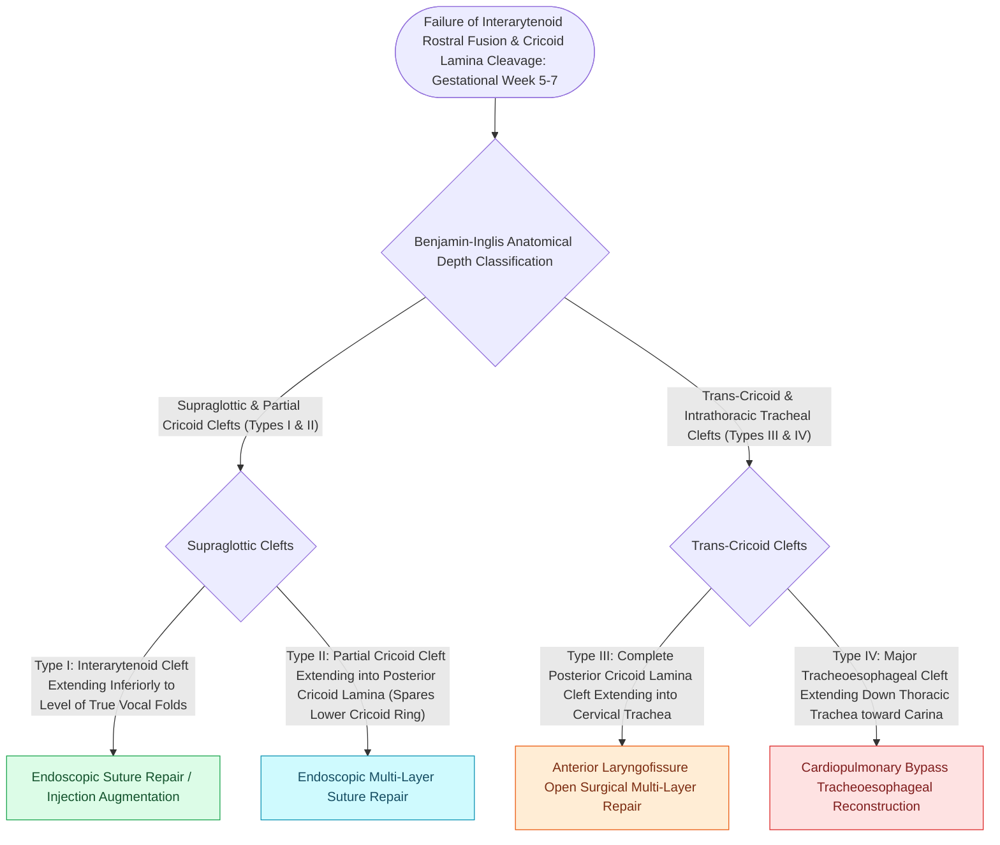

# Type I through Type IV laryngeal clefts represent congenital tracheoesophageal communication defects

## Active Recall

> [!question]- What anatomical boundary defines a Type I vs. Type II laryngeal cleft under the Benjamin-Inglis system?
> *Answer / Clinical Rationale*: **Type I is confined above the cricoid cartilage** (interarytenoid space); **Type II extends partially into the posterior cricoid lamina**.

> [!question]- What diagnostic maneuver during microlaryngoscopy is necessary to identify an occult Type I laryngeal cleft?
> *Answer / Clinical Rationale*: **Interarytenoid probing / palpation with a right-angle probe** to demonstrate splaying of the arytenoids.

## Core Clinical & Mechanistic Principles
**Laryngeal and Laryngotracheoesophageal Clefts (LTECs)** are rare congenital anomalies ($<0.5\%$ of congenital laryngeal malformations) resulting from failure of the tracheoesophageal septum to fuse rostrally and divide the foregut:
- **Benjamin-Inglis Classification System (1989)**:
  - **Type I (Interarytenoid Cleft)**: Extends through the interarytenoid musculature and mucosa down to, but **NOT into, the cricoid cartilage**. (Presents with feeding coughing, recurrent aspiration pneumonia, or mild stridor).
  - **Type II (Partial Cricoid Cleft)**: Extends **partially into the posterior lamina of the cricoid cartilage**, sparing the lower cricoid ring.
  - **Type III (Total Cricoid / Cervical Tracheal Cleft)**: Extends **completely through the posterior cricoid lamina** and into the cervical trachea (sparing thoracic trachea).
  - **Type IV (Thoracic Tracheoesophageal Cleft)**: Extends extensively down the **thoracic trachea, often to the carina or mainstem bronchi**. (Severe life-threatening aspiration, massive air leak, high mortality).
- **Endoscopic Diagnostic Technique**:
  - Type I/II clefts are easily missed on routine laryngoscopy; requires **interarytenoid palpation with a right-angle probe** during direct laryngoscopy under general anesthesia.

### Surgical Technique & Critical Safety Checks
- **Surgical Repair**:
  - *Type I/II*: Endoscopic repair using CO2 laser mucosal de-epithelialization and layered endoscopic suturing or injection laryngoplasty.
  - *Type III/IV*: Open anterior/lateral laryngotracheoplasty with multi-layered interposition muscle/fascia flaps (see [[Inspiratory, biphasic, and expiratory stridor localize pediatric airway obstruction to supraglottic, subglottic, and tracheobronchial subsites|Stridor Localization]]).

## Connected Concepts & Graph Traversal
- **Stridor Localization**: [[Inspiratory, biphasic, and expiratory stridor localize pediatric airway obstruction to supraglottic, subglottic, and tracheobronchial subsites|Stridor Localization]]
- **Subglottic Stenosis**: [[Congenital subglottic stenosis results from incomplete recanalization of the laryngeal lumen during embryogenesis|Subglottic Stenosis]]
- **LTR Reconstruction**: [[Single-stage and double-stage laryngotracheal reconstruction LTR repair mature high-grade subglottic stenosis|LTR Reconstruction]]
- **Embryological & Sleep Foundation**: [[Low arousal threshold causes premature awakening before airway stabilization in obstructive sleep apnea]]
- **Sleep Endoscopy & Airway Dynamics**: [[Drug-induced sleep endoscopy DISE evaluates dynamic multi-level upper airway collapse under sedation|Drug-Induced Sleep Endoscopy (DISE)]] [[Pediatric DISE identifies persistent multi-level airway collapse following adenotonsillectomy]]
- **Congenital Airway Pathology**: [[Endoscopic supraglottoplasty cold-steel and laser division of aryepiglottic folds relieves severe laryngomalacia]]
- **Open Airway Reconstruction**: [[Slide tracheoplasty achieves immediate vascularized mucosal lumen doubling with lowest restenosis rates]]
