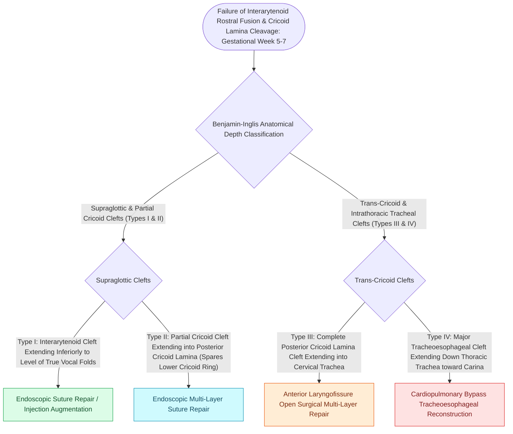

# Type I through Type IV laryngeal clefts represent congenital tracheoesophageal communication defects

## Active Recall

> [!question]- What anatomical boundary defines a Type I vs. Type II laryngeal cleft under the Benjamin-Inglis system?
> *Answer / Clinical Rationale*: **Type I is confined above the cricoid cartilage** (interarytenoid space); **Type II extends partially into the posterior cricoid lamina**.

> [!question]- What diagnostic maneuver during microlaryngoscopy is necessary to identify an occult Type I laryngeal cleft?
> *Answer / Clinical Rationale*: **Interarytenoid probing / palpation with a right-angle probe** to demonstrate splaying of the arytenoids.

## Core Clinical & Mechanistic Principles
**Laryngeal and Laryngotracheoesophageal Clefts (LTECs)** are rare congenital anomalies ($<0.5\%$ of congenital laryngeal malformations) resulting from failure of the tracheoesophageal septum to fuse rostrally and divide the foregut:
- **Benjamin-Inglis Classification System (1989)**:
  - **Type I (Interarytenoid Cleft)**: Extends through the interarytenoid musculature and mucosa down to, but **NOT into, the cricoid cartilage**. (Presents with feeding coughing, recurrent aspiration pneumonia, or mild stridor).
  - **Type II (Partial Cricoid Cleft)**: Extends **partially into the posterior lamina of the cricoid cartilage**, sparing the lower cricoid ring.
  - **Type III (Total Cricoid / Cervical Tracheal Cleft)**: Extends **completely through the posterior cricoid lamina** and into the cervical trachea (sparing thoracic trachea).
  - **Type IV (Thoracic Tracheoesophageal Cleft)**: Extends extensively down the **thoracic trachea, often to the carina or mainstem bronchi**. (Severe life-threatening aspiration, massive air leak, high mortality).
- **Endoscopic Diagnostic Technique & Associations**:
  - Type I/II clefts are easily missed on flexible laryngoscopy or casual rigid inspection because redundant interarytenoid mucosa apposes at rest; diagnosis requires **interarytenoid palpation/probing with a right-angle probe** during direct laryngoscopy under general anesthesia.
  - Type I often mimics chronic cough with feeds, recurrent "reflux" pneumonias, and thin-liquid aspiration on VFSS; Types III–IV present as neonatal respiratory crisis. Associated with tracheoesophageal fistula, **Opitz G/BBB** and **CHARGE** syndromes, and co-existing [[Laryngomalacia is the most common cause of congenital pediatric stridor characterized by dynamic supraglottic collapse|laryngomalacia]].

### Surgical Technique & Critical Safety Checks
- **Surgical & Feeding Repair**:
  - *Type I*: Trial feeding therapy/thickening first; **interarytenoid injection laryngoplasty augmentation** serves as a temporary bulk trial (if aspiration stops, definitive endoscopic repair is justified); endoscopic CO2 laser mucosal de-epithelialization + layered suture repair for persistent aspiration.
  - *Type II*: Endoscopic multi-layer suture repair.
  - *Type III/IV*: Open anterior/lateral laryngotracheoplasty (or combined cervico-thoracic CPB repair for Type IV) with multi-layered interposition muscle/fascia/cartilage flaps (see [[Inspiratory, biphasic, and expiratory stridor localize pediatric airway obstruction to supraglottic, subglottic, and tracheobronchial subsites|Stridor Localization]]). Instrumental swallow studies (VFSS) gate diet before and after every intervention.

## Connected Concepts & Graph Traversal
- **Stridor Localization**: [[Inspiratory, biphasic, and expiratory stridor localize pediatric airway obstruction to supraglottic, subglottic, and tracheobronchial subsites|Stridor Localization]]
- **Subglottic Stenosis**: [[Congenital subglottic stenosis results from incomplete recanalization of the laryngeal lumen during embryogenesis|Subglottic Stenosis]]
- **LTR Reconstruction**: [[Single-stage and double-stage laryngotracheal reconstruction LTR repair mature high-grade subglottic stenosis|LTR Reconstruction]]
- **Laryngomalacia Supraglottoplasty**: [[Endoscopic supraglottoplasty cold-steel and laser division of aryepiglottic folds relieves severe laryngomalacia|Supraglottoplasty]]
- **Slide Tracheoplasty**: [[Slide tracheoplasty achieves immediate vascularized mucosal lumen doubling with lowest restenosis rates|Slide Tracheoplasty]]
- **Tracheomalacia Tracheobronchopexy**: [[Tracheomalacia causes dynamic expiratory tracheal collapse and is managed with posterior tracheobronchopexy|Tracheomalacia Tracheobronchopexy]]
- **Congenital Glottic Differential**: [[Congenital laryngeal webs are classified by the Cohen system based on glottic luminal occlusion and anterior cartilaginous subglottic extension|Congenital Laryngeal Webs (Cohen Classification)]]
