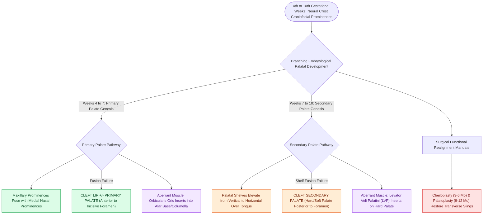

# Unilateral and bilateral cleft lip and palate result from failure of fusion of the maxillary and medial nasal prominences

## Active Recall

> [!question]- Failure of fusion between which embryonic facial prominences causes a cleft lip?
> *Answer / Clinical Rationale*: The **maxillary prominence** and the **medial nasal prominence**.

> [!question]- How is the levator veli palatini muscle abnormally oriented in a cleft palate?
> *Answer / Clinical Rationale*: Its muscle fibers run longitudinally and **insert abnormally onto the posterior border of the hard palate** instead of forming a transverse midline muscular sling.

## Core Clinical & Mechanistic Principles
Cleft lip and palate are the most common congenital craniofacial anomalies ($1\text{ in }700$ live births), arising from failed embryonic facial prominence fusion during the 4th to 10th gestational weeks:
- **Primary Palate & Cleft Lip Embryogenesis (Weeks 4–7)**:
  - The upper lip and primary palate (anterior to the incisive foramen) form from the fusion of the **Maxillary Prominences** with the **Medial Nasal Prominences**.
  - **Failure of fusion between the maxillary and medial nasal prominences** results in **Cleft Lip $\pm$ Cleft Primary Palate** (unilateral or bilateral).
- **Secondary Palate Embryogenesis (Weeks 7–10)**:
  - The secondary palate (hard palate posterior to incisive foramen and soft palate) forms from the **Palatal Shelves** of the maxillary prominences.
  - The palatal shelves elevate from a vertical position beside the tongue to a horizontal position above the tongue and fuse in the midline with each other and the nasal septum.
  - **Failure of palatal shelf fusion** results in **Cleft Secondary Palate**.
- **Anatomical Muscle Disruption (Orbicularis Oris & Levator Veli Palatini)**:
  - *Cleft Lip*: **Orbicularis oris** muscle fibers run aberrantly parallel to the cleft margin and insert abnormally into the alar base and columella.
  - *Cleft Palate*: **Levator veli palatini** muscle fibers insert abnormally into the posterior edge of the hard palate (**Laimer's cleft**) rather than forming a transverse midline sling.

### Surgical Technique & Critical Safety Checks
- **Epidemiology**: Cleft lip with or without palate is more common in males ($2:1$); isolated cleft palate is more common in females; left-sided clefts are twice as common as right-sided (see [[The Millard rotation-advancement and Fisher anatomical subunit repairs correct unilateral cleft lip deformities|Cleft Lip Repair]]).

## Connected Concepts & Graph Traversal
- **Cleft Lip Repair**: [[The Millard rotation-advancement and Fisher anatomical subunit repairs correct unilateral cleft lip deformities|Cleft Lip Repair]]
- **Rule of Tens**: [[The Rule of Tens establishes pediatric surgical safety thresholds for elective cleft lip repair|Rule of Tens]]
- **Palatoplasty Techniques**: [[Two-flap palatoplasty and Furlow double-reversing Z-plasty reconstruct the hard and soft palate musculature|Palatoplasty Techniques]]
- **Broader Craniofacial Cleft Spectrum**: [[Tessier classification organizes craniofacial clefts from zero to fourteen based on orbital and facial anatomical axes radiating from the palpebral fissure|Tessier Craniofacial Cleft Classification]]
