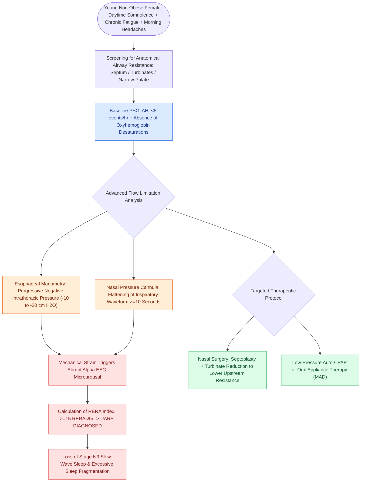

# Upper airway resistance syndrome causes excessive daytime somnolence from repetitive respiratory effort-related arousals without overt desaturations

## Active Recall

> [!question]- What diagnostic criteria on polysomnography differentiate Upper Airway Resistance Syndrome (UARS) from classic Obstructive Sleep Apnea (OSA)?
> *Answer / Clinical Rationale*: UARS is diagnosed when a patient exhibits **excessive daytime somnolence** accompanied by **$\ge 15\text{ respiratory effort-related arousals (RERAs) per hour}$** on polysomnography, in the setting of a normal or near-normal **apnea-hypopnea index (AHI $<5\text{ events/hr}$)** and **ABSENCE of significant oxyhemoglobin desaturations** ($<4\%\text{ desaturations}$). In classic OSA, repetitive discrete apneas and hypopneas with cyclical arterial hypoxemia predominate.

> [!question]- What is the characteristic demographic and clinical phenotype of a patient presenting with UARS, and why does this contrast with classic OSA?
> *Answer / Clinical Rationale*: While classic OSA predominantly affects middle-aged, obese males with increased neck circumference, UARS classically manifests in **younger, non-obese, female patients** with chronic **nasal obstruction** (septal deviation, turbinate hypertrophy, or nasal valve collapse). Patients present with debilitating chronic fatigue, unrefreshing sleep, morning headaches, low blood pressure / postural hypotension, and gastroesophageal reflux, frequently misdiagnosed with chronic fatigue syndrome or fibromyalgia.

> [!question]- How does the pathophysiology of inspiratory flow limitation in UARS lead to cortical arousal and sleep fragmentation?
> *Answer / Clinical Rationale*: During sleep, partial anatomical narrowing of the upper airway (nasal resistance or velopharyngeal laxity) increases airway resistance. To maintain tidal volume, the patient generates progressively more negative intrathoracic inspiratory pressure swings (reaching **$-10\text{ to }-20\text{ cm H}_2\text{O}$ or more** on esophageal manometry). This elevated negative pressure acts on mechanoreceptors and triggers a **cortical EEG microarousal** to terminate the respiratory strain. The microarousal restores pharyngeal muscle tone but fragments sleep architecture, abolishing deep slow-wave (N3) sleep without causing overt blood gas abnormalities.

## Core Clinical & Mechanistic Principles

Upper Airway Resistance Syndrome (UARS), originally described by Guilleminault and colleagues, occupies a distinct clinical niche within the spectrum of sleep-disordered breathing. Unlike obstructive sleep apnea, where cyclic hypoxemia and hypercapnia drive end-organ cardiovascular morbidity, UARS morbidity stems entirely from **neurophysiologic sleep fragmentation** induced by repetitive high-effort breathing.

### Diagnostic Criteria Ledger: UARS vs. OSA vs. Primary Snoring

| Diagnostic Parameter | Primary Snoring | Upper Airway Resistance Syndrome (UARS) | Obstructive Sleep Apnea (OSAS) |
| :--- | :--- | :--- | :--- |
| **Apnea-Hypopnea Index (AHI)** | $<5\text{ events/hr}$ | $<5\text{ events/hr}$ | $\ge 5\text{ events/hr}$ (with symptoms) or $\ge 15\text{ events/hr}$ |
| **RERA Index** | $<5\text{ events/hr}$ | **$\ge 15\text{ events/hr}$** | Variable (often obscured by apneas/hypopneas) |
| **Oxyhemoglobin Desaturations** | **Absent** | **Absent** (normal $\text{SaO}_2 \ge 95\%$) | **Present** (intermittent desaturations $\ge 3\%\text{ to }4\%$) |
| **Esophageal Pressure Swings** | Normal ($-3\text{ to }-7\text{ cm H}_2\text{O}$) | **Progressively negative** ($<-10\text{ to }-25\text{ cm H}_2\text{O}$) | Variable; absent airflow during obstruction |
| **Sleep Architecture** | Normal preservation of N3/REM | Severe fragmentation; loss of slow-wave sleep | Severe fragmentation; marked sleep state loss |
| **Daytime Somnolence** | Absent | **Severe** (elevated Epworth Sleepiness Scale) | **Severe**; high cardiovascular risk |
| **Typical Habitus** | Overweight or normal | **Young, non-obese, female** | **Middle-aged, obese, male** |

### Pathophysiological Cascade & Clinical Features

1. **Inspiratory Flow Limitation (IFL)**:
   - According to the Starling resistor model, when downstream suction pressure exceeds the collapse threshold of the compliant pharynx, flow reaches a fixed plateau despite increasing muscular effort.
   - On nasal pressure transducer tracings, this produces characteristic **flattening of the round inspiratory contour** into an asymmetrical, scooped or square waveform.
2. **Esophageal Manometry (Gold Standard)**:
   - A miniaturized water-perfused or solid-state catheter placed in the mid-esophagus measures intrathoracic pleural pressure swings.
   - Shows progressive, breath-by-breath increase in negative pressure ($<-10\text{ to }-20\text{ cm H}_2\text{O}$), terminating in a sudden return to baseline immediately following an EEG arousal.
3. **Autonomic & Functional Morbidity**:
   - Repetitive sympathetic activation during microarousals causes autonomic dysregulation, alpha-adrenergic hyperactivity, cold extremities, orthostatic intolerance, and tension headaches.
4. **Treatment Hierarchy**:
   - **Nasal Airway Optimization**: First-line surgical management; septoplasty, inferior turbinate reduction, and nasal valve repair lower critical upstream resistance ($P_u$), preventing downstream pharyngeal suction collapse.
   - **Mandibular Advancement Devices (MAD)**: Splints the tongue base forward and expands the lateral pharyngeal walls.
   - **Continuous Positive Airway Pressure (CPAP)**: Highly effective but often poorly tolerated at high pressures; typically requires low, carefully titrated pressures ($4\text{--}8\text{ cm H}_2\text{O}$) with heated humidification.

Comprehensive anatomical and therapeutic integration links these principles directly to [[Radiofrequency ablation of the inferior turbinates and soft palate stiffens tissue through submucosal fibrosis|Turbinate Reduction]].

## Connected Concepts & Graph Traversal
- **Physiological Resistor**: [[The Starling resistor model explains upper airway collapsibility and critical closing pressure Pcrit|Starling Resistor Model]]
- **Arousal Threshold Mechanics**: [[Low arousal threshold causes premature awakening before airway stabilization in obstructive sleep apnea|Arousal Threshold Dynamics]]
- **Somnolence Screening**: [[The Epworth Sleepiness Scale and Berlin Questionnaire screen for daytime somnolence and obstructive sleep apnea risk|Epworth Sleepiness Scale]]
- **Adult PSG Standards**: [[Adult polysomnography criteria define obstructive sleep apnea severity by apnea-hypopnea index thresholds of five, fifteen, and thirty|Adult PSG Metrics]]
- **Nonsurgical Appliance**: [[Mandibular advancement oral appliances enlarge the retroglossal airway through anterior mandibular translation for mild-to-moderate obstructive sleep apnea|Mandibular Advancement Devices]]
