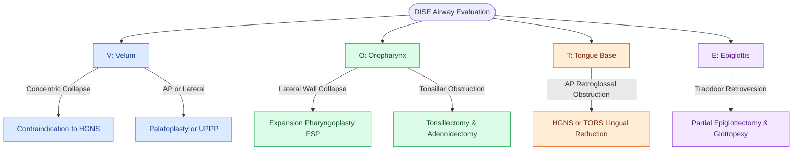

# VOTE classification standardizes drug-induced sleep endoscopy findings across velum, oropharynx, tongue base, and epiglottis

## Active Recall

> [!question]- What degree of airway narrowing corresponds to a score of 2 in the VOTE classification?
> *Answer / Clinical Rationale*: **Complete obstruction ($>75\%$ to $100\%$ reduction in lumen width)**.

> [!question]- What are the three possible spatial configurations of collapse at the Velum (V) level?
> *Answer / Clinical Rationale*: **Anteroposterior (AP)**, **Lateral**, and **Complete Concentric Collapse (CCC)**.

## Core Clinical & Mechanistic Principles
The **VOTE Classification System (Kezirian et al., 2011)** is the universally accepted standard for scoring and reporting DISE findings:
- **The Four Anatomical Levels (V-O-T-E)**:
  1. **V - Velum (Soft Palate & Nasopharynx)**:
     - *Configurations*: Anteroposterior (AP), Lateral, or **[[Concentric velopharyngeal collapse on DISE is a contraindication to hypoglossal nerve stimulation|Complete Concentric Collapse]] (CCC)**.
  2. **O - Oropharynx (Palatine Tonsils & Lateral Pharyngeal Walls)**:
     - *Configurations*: Lateral wall collapse (dominant) or AP collapse.
  3. **T - Tongue Base (Retroglossal Airway)**:
     - *Configurations*: Anteroposterior (posterior tongue displacement).
  4. **E - Epiglottis**:
     - *Configurations*: Anteroposterior ("trapdoor" collapse over glottis) or Lateral ("omega-shaped" curling).
- **Standardized Degree of Obstruction Scoring**:
  - **0**: No obstruction ($<50\%$ reduction in lumen).
  - **1**: Partial obstruction ($50\text{–}75\%$ reduction in lumen; vibrational snoring).
  - **2**: Complete obstruction ($>75\%$ reduction / complete occlusion).
  - **X**: Not visualized.

### Surgical Technique & Critical Safety Checks
- **Surgical Tailoring**: VOTE scoring directly dictates surgical selection (e.g., [[Expansion sphincter pharyngoplasty ESP rotates the palatopharyngeus muscle to stabilize lateral pharyngeal wall collapse|Expansion Pharyngoplasty]] for lateral wall 'O' collapse, [[Hypoglossal nerve stimulation HGNS activates the medial branch of CN XII to advance the tongue during inspiration|HGNS]]/TORS for 'T' collapse, [[Partial epiglottectomy and epiglottopexy correct dynamic epiglottic retroversion during inspiration|Epiglottopexy]] for 'E' collapse).

## Connected Concepts & Graph Traversal
- **Dynamic Endoscopic Assessment**: [[Drug-induced sleep endoscopy DISE evaluates dynamic multi-level upper airway collapse under sedation|DISE Endoscopy Protocol]]
- **Surgical Safety Contraindication**: [[Concentric velopharyngeal collapse on DISE is a contraindication to hypoglossal nerve stimulation|Velar Complete Concentric Collapse]]
- **Lateral Wall Surgical Craft**: [[Expansion sphincter pharyngoplasty ESP rotates the palatopharyngeus muscle to stabilize lateral pharyngeal wall collapse|Expansion Sphincter Pharyngoplasty (ESP)]]
- **Tongue Base Reanimation**: [[Hypoglossal nerve stimulation HGNS activates the medial branch of CN XII to advance the tongue during inspiration|Hypoglossal Nerve Stimulation (HGNS)]]
- **Epiglottic Surgical Craft**: [[Partial epiglottectomy and epiglottopexy correct dynamic epiglottic retroversion during inspiration|Partial Epiglottectomy & Epiglottopexy]]
- **Physiological Basis**: [[Critical closing pressure Pcrit stratifies upper airway collapsibility from snorers to severe obstructive sleep apnea|Critical Closing Pressure (Pcrit)]]
