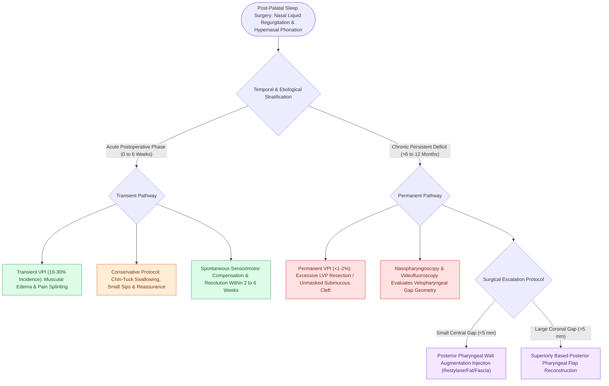

# Velopharyngeal incompetence following sleep surgery causes transient or permanent hypernasality and nasal regurgitation

## Active Recall

> [!question]- How long does transient velopharyngeal incompetence typically last following soft tissue palatal sleep surgery?
> *Answer / Clinical Rationale*: It typically resolves spontaneously within **$2\text{ to }6\text{ weeks}$** as edema subsides.

> [!question]- What preoperative anatomical anomaly should be ruled out to prevent permanent VPI following palatal surgery?
> *Answer / Clinical Rationale*: An **occult submucous cleft palate** (or short palate).

## Core Clinical & Mechanistic Principles
**Velopharyngeal Incompetence (VPI)** is a recognized functional complication of palatal sleep surgery (UPPP, [[Z-palatoplasty expands the anteroposterior velopharyngeal dimensions through geometric transposition|Z-palatoplasty]], expansion pharyngoplasty):
- **Clinical Presentation**:
  - **Nasal Regurgitation of Liquids**: Fluid escapes into the nasal cavity during swallowing (especially with rapid drinking or swallowing against resistance).
  - **Hypernasal Speech Resonance**: Muffled vowels and loss of oral pressure consonants (/p/, /b/, /s/).
  - Inability to generate suction or blow against resistance (whistling, playing wind instruments).
- **Transient vs. Permanent VPI**:
  - **Transient VPI (Common, $10\text{–}30\%$)**: Caused by acute postoperative muscular edema, local neuropraxia, and pain splinting; spontaneously resolves within **$2\text{ to }6\text{ weeks}$** as muscle healing and sensorimotor compensation occur.
  - **Permanent VPI (Rare, $<1\text{–}2\%$ in modern modified UPPP)**: Caused by excessive surgical resection of the soft palate musculature (amputation of levator/tensor veli palatini), severe cicatricial contracture, or unmasked occult [[Velopharyngeal insufficiency VPI causes hypernasal resonance and nasal air emission during speech|submucous cleft]].
- **Management Protocol**:
  - Reassurance and swallowing modifications (small sips, chin-tuck posture) during the first 6–12 weeks.
  - Speech therapy for persistent hypernasality.
  - If permanent ($>6\text{–}12\text{ months}$): Surgical repair with **posterior pharyngeal wall injection augmentation** or a **superiorly based [[Superiorly based posterior pharyngeal flaps create a central tissue bridge for coronal velopharyngeal insufficiency|pharyngeal flap]]**.

### Surgical Technique & Critical Safety Checks
- **Preoperative Screening**: Palpate the hard palate in all sleep surgery candidates to rule out an occult submucous cleft prior to any palatal resection.

## Connected Concepts & Graph Traversal
- **Modified UPPP**: [[Modified uvulopalatopharyngoplasty UPPP resects redundant palatal tissue while preserving muscular function|Modified UPPP]]
- **Palatopharyngeal Stenosis**: [[Postoperative palatopharyngeal stenosis is a severe complication of over-resection managed with local flaps|Palatopharyngeal Stenosis]]
- **VPI Overview**: [[Velopharyngeal insufficiency VPI causes hypernasal resonance and nasal air emission during speech|VPI Overview]]
- **Embryological & Sleep Foundation**: [[High loop gain causes ventilatory instability and periodic breathing in sleep-disordered breathing]]
- **Sleep Endoscopy & Airway Dynamics**: [[Drug-induced sleep endoscopy DISE evaluates dynamic multi-level upper airway collapse under sedation|Drug-Induced Sleep Endoscopy (DISE)]] [[Lingual tonsil hypertrophy causes persistent pediatric obstructive sleep apnea and base of tongue collapse]]
- **Congenital Airway Pathology**: [[Acute epiglottitis causes rapid supraglottic swelling with thumbprint sign and mandates controlled operating room intubation]]
- **Open Airway Reconstruction**: [[Slide tracheoplasty achieves immediate vascularized mucosal lumen doubling with lowest restenosis rates]]
