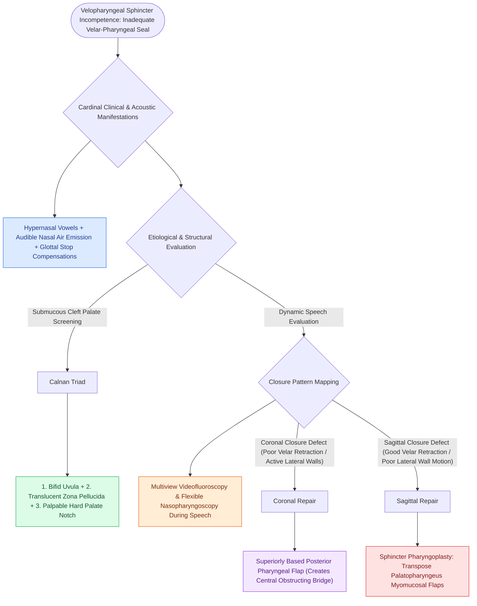

# Velopharyngeal insufficiency VPI causes hypernasal resonance and nasal air emission during speech

## Active Recall

> [!question]- What three physical examination findings constitute Calnan's triad of a submucous cleft palate?
> *Answer / Clinical Rationale*: A **bifid uvula**, **zona pellucida (translucent central palate)**, and a **palpable notch in the posterior hard palate**.

> [!question]- What are the three cardinal speech features of velopharyngeal insufficiency?
> *Answer / Clinical Rationale*: **Hypernasality**, **audible nasal air emission**, and **compensatory articulation errors (glottal stops)**.

## Core Clinical & Mechanistic Principles
**Velopharyngeal Insufficiency (VPI)** is the structural inability of the soft palate (velum) and lateral/posterior pharyngeal walls to completely close the velopharyngeal sphincter during speech:
- **Speech Pathophysiology**:
  - During production of oral pressure consonants (plosives: /p/, /b/, /t/, /d/; fricatives: /s/, /z/; affricates), the velum elevates against the posterior pharyngeal wall (Passavant's ridge) to seal the nasopharynx.
  - In VPI, the sphincter fails to close, allowing acoustic energy and air pressure to escape into the nasal cavity, producing:
    1. **Hypernasal Resonance (Hypernasality)**: Vowels sound muffled and nasalized.
    2. **Nasal Air Emission / Turbulence**: Audible escape of air through the nose during pressure consonants.
    3. **Compensatory Articulation Errors**: Glottal stops and pharyngeal fricatives used to substitute for oral pressure consonants.
- **Etiological Categories**:
  - [[Two-flap palatoplasty and Furlow double-reversing Z-plasty reconstruct the hard and soft palate musculature|Cleft palate / post-palatoplasty]] scarring ($20\text{–}30\%$ of repaired clefts).
  - **Submucous Cleft Palate (Calnan's Triad)**:
    1. **Bifid Uvula**.
    2. **Zona Pellucida** (thin, translucent midline soft palate).
    3. **Notch in the Posterior Hard Palate** (palpable V-shaped bony defect).
  - Post-adenoidectomy (unmasking occult submucous cleft or short palate).
  - 22q11.2 Deletion Syndrome (Velocardiofacial Syndrome).

### Surgical Technique & Critical Safety Checks
- **Diagnostic Modalities**: Multiview speech videofluoroscopy and **nasopharyngoscopy** during connected speech to determine closure pattern (coronal, sagittal, circular).

## Connected Concepts & Graph Traversal
- **Posterior Pharyngeal Flap (Coronal Gap)**: [[Superiorly based posterior pharyngeal flaps create a central tissue bridge for coronal velopharyngeal insufficiency|Posterior Pharyngeal Flap]]
- **Sphincter Pharyngoplasty (Sagittal Gap)**: [[Sphincter pharyngoplasties transpose bilateral palatopharyngeus flaps to narrow the lateral velopharyngeal port in sagittal insufficiency|Sphincter Pharyngoplasty]]
- **Palatoplasty Repairs**: [[Two-flap palatoplasty and Furlow double-reversing Z-plasty reconstruct the hard and soft palate musculature|Palatoplasty Techniques]]
- **Cleft Embryology**: [[Unilateral and bilateral cleft lip and palate result from failure of fusion of the maxillary and medial nasal prominences|Cleft Embryology]]
- **Robin Sequence Cleft**: [[Pierre Robin sequence manifests with micrognathia, glossoptosis, and secondary U-shaped cleft palate|Pierre Robin Sequence]]
- **Sialorrhea Management**: [[Pediatric sialorrhea is managed along a ladder from anticholinergics and botulinum toxin to duct surgery|Pediatric Sialorrhea]]
