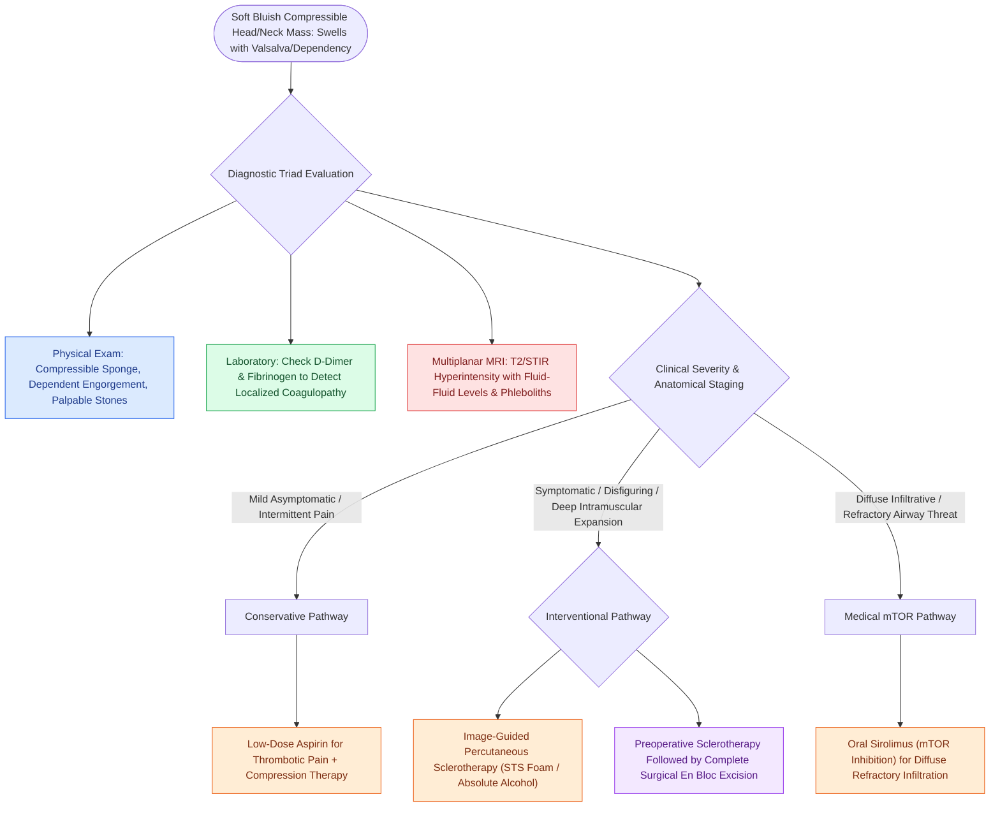

# Venous malformations are slow-flow vascular anomalies characterized by bluish compressible swelling, dependent engorgement, and pathognomonic phleboliths

## Active Recall

> [!question]- What pathognomonic physical examination and radiographic findings differentiate venous malformations from other vascular anomalies?
> *Answer / Clinical Rationale*: Physical examination demonstrates a **soft, bluish, compressible mass that expands with dependency or Valsalva maneuvers**, while plain radiography or CT pathognomonically reveals **phleboliths (calcified intraluminal thrombi)** within dysplastic, slow-flow venous channels.

> [!question]- What localized hematologic abnormality frequently complicates extensive head and neck venous malformations?
> *Answer / Clinical Rationale*: **Localized intravascular coagulopathy (LIC)**, characterized by ongoing local microthrombosis leading to **elevated D-dimer with normal or mildly decreased fibrinogen**, which can progress to disseminated intravascular coagulation (DIC) during surgical intervention or sclerotherapy.

## Core Clinical & Mechanistic Principles

Venous malformations (VMs) are the most common vascular malformations encountered in the head and neck, representing congenital, low-flow vascular anomalies composed of ectatic, tortuous, dysplastic post-capillary venules with deficient smooth muscle and variable media thickness:

### Biological Characteristics & ISSVA Classification
- **Classification**: Categorized under the International Society for the Study of Vascular Anomalies (ISSVA) as simple, low-flow vascular malformations. VMs are **GLUT-1 negative**, present at birth, grow commensurately with the child, and **never spontaneously involute**.
- **Molecular Genetics**: Driven predominantly by somatic activating mutations in **TEK** (encoding the endothelial cell tyrosine kinase receptor TIE2) in $>50\%$ of cases, or somatic mutations in **PIK3CA**, leading to dysregulated angiogenesis and uninhibited vascular remodeling.
- **Pathognomonic Thrombosis**: Stagnant, low-velocity blood flow through enlarged sinusoidal spaces leads to repeated episodes of spontaneous microthrombosis, chronic organization, and secondary dystrophic calcification forming **phleboliths**.

### Clinical Presentation & Anatomy
- **Appearance**: Soft, spongy, compressible, non-pulsatile masses with a bluish or purple discoloration beneath mucosal or cutaneous surfaces.
- **Dynamic Maneuvers**: Rapidly engorges and increases in volume when placed in a dependent position (head hanging down) or during the Valsalva maneuver (crying, straining); readily empties and flattens upon direct manual compression.
- **Anatomical Distribution**: Frequently cross facial fascial boundaries and deep anatomical planes, infiltrating the masseter muscle, buccal space, tongue, floor of mouth, and parapharyngeal corridors, presenting as deep neck swellings resembling lesions like a [[Plunging ranula is a sublingual mucus extravasation pseudocyst herniating around the mylohyoid free edge]].
- **Localized Intravascular Coagulopathy (LIC)**: Extensive or deep intramuscular VMs promote chronic local platelet consumption and fibrinolysis, evidenced by **elevated plasma D-dimer** and normal to low fibrinogen without systemic thrombocytopenia. Severe LIC can precipitate fatal intraoperative coagulopathy or surgical bleeding.

### Multimodality Diagnostic Evaluation
1. **Color Doppler Ultrasonography**:
   - Demonstrates compressible, heterogeneous, hypoechoic sinusoidal spaces with slow, monophasic venous flow or absent Doppler signals. Acoustic shadowing behind calcified phleboliths is diagnostic.
2. **Computed Tomography (CT)**:
   - Identifies multiple round, laminated, calcified density rings (**phleboliths**) within an ill-defined soft-tissue mass, alongside adjacent osseous remodeling or cortical demineralization.
3. **Magnetic Resonance Imaging (MRI — Gold Standard)**:
   - **T1-Weighted**: Isointense to hypointense relative to muscle; signal voids identify phleboliths.
   - **T2-Weighted / STIR**: Marked, bright hyperintensity with characteristic **fluid-fluid levels** representing layered stagnant red cells and serum.
   - **Contrast-Enhanced T1**: Demonstrates patchy, delayed, heterogeneous peripheral-to-central venous filling without enlarged high-flow feeding arteries (differentiating VMs from high-flow arteriovenous malformations).

### Management Protocol
- **Conservative Therapy**: Fitted compressive garments for extremities; low-dose aspirin ($81\text{–}100\text{ mg/day}$) to alleviate episodic localized thrombotic pain and prevent phlebolith propagation.
- **Percutaneous Sclerotherapy (First-Line)**:
  - Fluoroscopically and ultrasound-guided direct intralesional injection of sclerosing agents under general anesthesia.
  - **Agents**: Sodium tetradecyl sulfate (STS, 1–3% foam), polidocanol, or absolute ethanol (highest potency but carries risk of tissue necrosis and nerve injury). Sclerotherapy damages endothelial linings, precipitating controlled thrombosis and fibrotic obliteration.
- **Targeted Pharmacotherapy**: Oral **Sirolimus (mTOR inhibitor)** is indicated for extensive, diffusely infiltrative, or refractory VMs causing airway obstruction or severe chronic pain.
- **Surgical Excision**: Indicated for localized, well-circumscribed lesions, or following pre-operative sclerotherapy to consolidate lesion bulk and minimize intraoperative hemorrhage.

## Connected Concepts & Graph Traversal

- **Lymphatic Malformations**: [[Lymphatic malformations are slow-flow vascular anomalies classified into macrocystic and microcystic lesions]]
- **Hemangioma Biology**: [[Infantile hemangiomas exhibit rapid neonatal proliferation followed by slow involution driven by GLUT-1 positivity]]
- **Propranolol Therapy**: [[Oral propranolol is the first-line pharmacotherapy for proliferating infantile hemangiomas]]
- **Sclerotherapy Techniques**: [[Bleomycin and OK-432 picibanil sclerotherapy provide targeted ablation of macrocystic lymphatic malformations]]
- **Airway Hemangiomas**: [[Subglottic hemangiomas present as biphasic stridor in infants and respond to systemic oral propranolol]]
- **🔗 Fast-Flow Vascular Anomaly Differential (Head & Neck)**: [[Head and neck arteriovenous malformations are staged by the Schobinger classification to guide embolization and complete surgical nidus resection|AVM & Schobinger Staging]]
