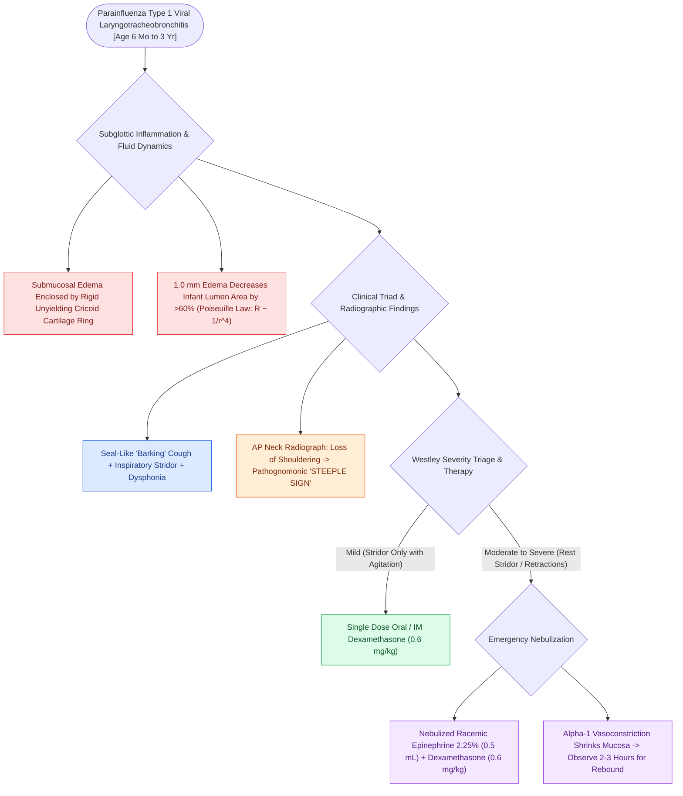

# Viral laryngotracheobronchitis croup presents with a barking cough and subglottic steeple sign on radiography

## Active Recall

> [!question]- What pathogen is the most common cause of viral croup?
> *Answer / Clinical Rationale*: **Parainfluenza virus Type 1**.

> [!question]- What classic radiographic finding is seen on the AP neck X-ray of a child with croup?
> *Answer / Clinical Rationale*: The **'Steeple sign' (pencil-tip sign)**, representing symmetrical subglottic mucosal narrowing.

## Core Clinical & Mechanistic Principles
**Croup (Viral Laryngotracheobronchitis)** is the most common cause of acute upper airway obstruction in children aged 6 months to 3 years:
- **Etiology & Pathophysiology**:
  - Caused primarily by **Parainfluenza virus Type 1** ($>65\text{–}70\%$), followed by Parainfluenza Types 2/3, RSV, and Adenovirus.
  - Viral infection causes mucosal erythema, inflammatory edema, and excessive secretions localized specifically to the **subglottic space and trachea**.
  - Because the cricoid cartilage is non-distensible, $1.0\text{ mm}$ of subglottic mucosal edema reduces the subglottic cross-sectional area by **$>60\%$ in an infant** ($R \propto 1/r^4$).
- **The Classic Clinical Triad**:
  1. **Seal-like "Barking" Cough**.
  2. **Inspiratory / Biphasic Stridor**.
  3. **Hoarseness**, often preceded by 1–2 days of viral rhinorrhea and low-grade fever.
- **Radiological Pathognomonic Sign**:
  - **"Steeple Sign" (Pencil-Tip Sign)** on AP neck radiography: Symmetrical subglottic mucosal tapering and loss of the normal shouldering of the subglottis.

### Surgical Technique & Critical Safety Checks
- **Differential Diagnosis**: Spasmodic croup, bacterial tracheitis (toxic appearance, purulent tracheal secretions), and [[Airway foreign body aspiration mandates rigid bronchoscopy despite normal radiographs|foreign body aspiration]].

## Connected Concepts & Graph Traversal
- **Croup Pharmacotherapy**: [[Nebulized racemic epinephrine and oral dexamethasone provide rapid treatment for acute croup|Croup Pharmacotherapy]]
- **Acute Epiglottitis**: [[Acute epiglottitis causes rapid supraglottic swelling with thumbprint sign and mandates controlled operating room intubation|Acute Epiglottitis]]
- **Stridor Localization**: [[Inspiratory, biphasic, and expiratory stridor localize pediatric airway obstruction to supraglottic, subglottic, and tracheobronchial subsites|Stridor Localization]]
- **Toxic Bacterial Mimic**: [[Bacterial tracheitis presents with toxic croup-like stridor, high fever, and thick subglottic mucopurulent pseudomembranes requiring urgent airway debridement|Bacterial Tracheitis]]
