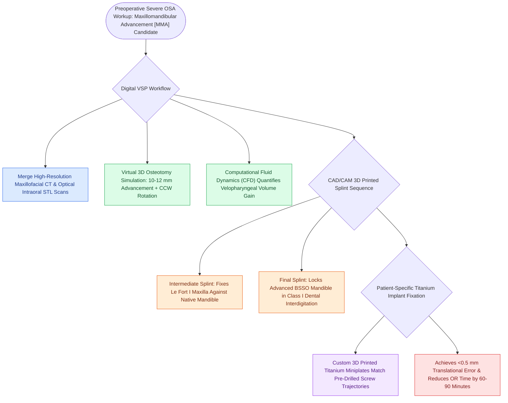

# Virtual surgical planning and splint-guided fixation optimize dental occlusion and airway expansion in MMA

## Active Recall

> [!question]- How do intermediate and final CAD/CAM surgical splints guide maxillomandibular advancement in the operating room?
> *Answer / Clinical Rationale*: The **intermediate splint guides the advanced maxilla** relative to the native mandible; the **final splint locks the advanced mandible** into Class I occlusion with the maxilla.

> [!question]- What is the surgical accuracy achieved by VSP and custom surgical cutting guides?
> *Answer / Clinical Rationale*: Sub-millimeter precision with **$<0.5\text{ to }1.0\text{ mm}$ of translational error**.

## Core Clinical & Mechanistic Principles
**Virtual Surgical Planning (VSP) and 3D CAD/CAM Splint-Guided Fixation** have replaced manual model surgery, ensuring sub-millimeter precision in skeletal advancement and occlusion:
- **The Modern Digital Workflow**:
  1. **High-Resolution Maxillofacial CT + Intraoral Digital Dental Scans**: Merged to create high-precision 3D composite skull/dental models.
  2. **Virtual Osteotomy & Skeletal Simulation**:
     - Perform virtual Le Fort I and BSSO cuts.
     - Simulate $10\text{–}12\text{ mm}$ advancement and counter-clockwise rotation.
     - Quantify simulated **3D pharyngeal airway volume expansion** using computational fluid dynamics (CFD).
  3. **3D Printing of Custom Surgical Splints**:
     - *Intermediate Splint*: Guides positioning and fixation of the advanced maxilla relative to the un-operated mandible.
     - *Final Splint*: Locks the advanced mandible into class I dental interdigitation with the advanced maxilla.
  4. **Custom Patient-Specific Titanium Plates (PSI)**: Pre-bent or 3D printed titanium plates with pre-drilled screw trajectories match the virtual plan with **$<0.5\text{-mm}$ surgical error**.

### Surgical Technique & Critical Safety Checks
- **Benefits**: Reduces total operative time by $>60\text{–}90\text{ minutes}$, eliminates unexpected malocclusion, and maximizes airway volume gains (see [[Maxillomandibular advancement MMA advances the skeletal framework by ten to twelve millimeters to expand the upper airway|MMA Advancement]]).

## Connected Concepts & Graph Traversal
- **MMA Advancement**: [[Maxillomandibular advancement MMA advances the skeletal framework by ten to twelve millimeters to expand the upper airway|MMA Advancement]]
- **Le Fort and BSSO**: [[Le Fort I osteotomy and bilateral sagittal split osteotomy BSSO achieve rigid skeletal advancement in MMA|Le Fort and BSSO]]
- **MMA Success Rates**: [[Maxillomandibular advancement achieves the highest surgical cure rate among all non-CPAP sleep apnea interventions|MMA Success Rates]]
- **Embryological & Sleep Foundation**: [[Second branchial cleft anomalies represent the most common branchial anomaly situated anterior to the sternocleidomastoid]]
- **Sleep Endoscopy & Airway Dynamics**: [[Drug-induced sleep endoscopy DISE evaluates dynamic multi-level upper airway collapse under sedation|Drug-Induced Sleep Endoscopy (DISE)]] [[Coblation lingual tonsillectomy debulks tongue base lymphoid tissue while preserving the lingual neurovascular bundles]]
- **Congenital Airway Pathology**: [[Viral laryngotracheobronchitis croup presents with a barking cough and subglottic steeple sign on radiography]]
- **Open Airway Reconstruction**: [[Postoperative chin-to-chest flexion stitch prevents catastrophic neck extension and tracheal anastomotic dehiscence]]
