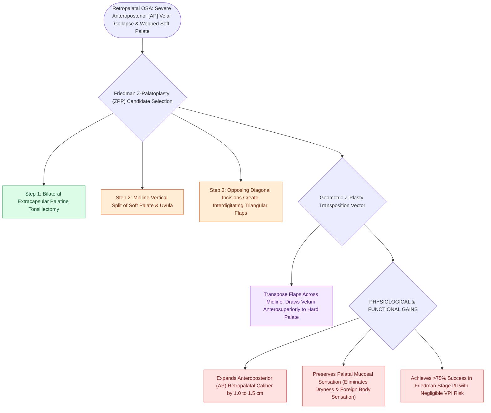

# Z-palatoplasty expands the anteroposterior velopharyngeal dimensions through geometric transposition

## Active Recall

> [!question]- By what physical mechanism does Z-palatoplasty expand the retropalatal airway?
> *Answer / Clinical Rationale*: Through **Z-plasty transposition of triangular palatal flaps**, pulling the soft palate anterosuperiorly to increase the anteroposterior airway distance.

> [!question]- What type of velopharyngeal collapse configuration on [[Drug-induced sleep endoscopy DISE evaluates dynamic multi-level upper airway collapse under sedation|DISE]] is best suited for Z-palatoplasty?
> *Answer / Clinical Rationale*: **Anteroposterior (AP) velopharyngeal collapse**.

## Core Clinical & Mechanistic Principles
**Z-Palatoplasty (ZPP)** (developed by Michael Friedman) is an alternative to standard UPPP that utilizes geometric Z-plasty tissue transposition to expand the anteroposterior retropalatal space:
- **Surgical Mechanism & Execution**:
  1. Complete bilateral palatine tonsillectomy.
  2. A vertical incision is made in the soft palate midline, splitting the uvula and soft palate into two halves.
  3. Opposing diagonal relaxing incisions are created to form **two interdigitating triangular myomucosal flaps**.
  4. The flaps are transposed across the midline in a **classic Z-plasty configuration**:
     - Pulls the soft palate **anteriorly and superiorly toward the hard palate**.
     - **Widens the anteroposterior (AP) retropalatal dimension by $1.0\text{ to }1.5\text{ cm}$**.
- **Indications & Outcomes**:
  - Indicated for patients with severe **anteroposterior (AP) velopharyngeal collapse** and a long, webbed, low-hanging soft palate.
  - Achieves $>75\%$ surgical success in Friedman Stage I and II patients with **minimal risk of persistent [[Velopharyngeal insufficiency VPI causes hypernasal resonance and nasal air emission during speech|velopharyngeal insufficiency]]**.

### Surgical Technique & Critical Safety Checks
- **Preservation of Sensation**: Unlike mucosal amputation, ZPP preserves sensory mucosal receptors on the palatal flaps, reducing foreign body sensation and dry throat.

## Connected Concepts & Graph Traversal
- **Modified UPPP**: [[Modified uvulopalatopharyngoplasty UPPP resects redundant palatal tissue while preserving muscular function|Modified UPPP]]
- **Expansion Pharyngoplasty**: [[Expansion sphincter pharyngoplasty ESP rotates the palatopharyngeus muscle to stabilize lateral pharyngeal wall collapse|Expansion Pharyngoplasty]]
- **VOTE Classification**: [[VOTE classification standardizes drug-induced sleep endoscopy findings across velum, oropharynx, tongue base, and epiglottis|VOTE Classification]]
- **Embryological & Sleep Foundation**: [[Second branchial cleft anomalies represent the most common branchial anomaly situated anterior to the sternocleidomastoid]]
- **Adenotonsillar & Endoscopic DISE**: [[Paradise criteria define evidence-based indications for pediatric tonsillectomy in recurrent throat infections]]
- **Congenital Airway Pathology**: [[Recurrent respiratory papillomatosis RRP is driven by HPV six and eleven causing recurrent laryngeal lesions]]
- **Open Airway Reconstruction**: [[Tracheomalacia causes dynamic expiratory tracheal collapse and is managed with posterior tracheobronchopexy]]
