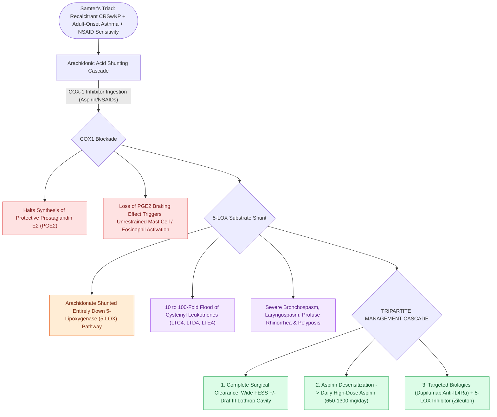

# AERD manifests with asthma, nasal polyps, and severe aspirin-induced respiratory reactions

## Active Recall

> [!question]- Why does ingestion of a selective COX-2 inhibitor (e.g., Celecoxib) NOT typically trigger a bronchospastic reaction in an AERD patient?
> *Answer / Clinical Rationale*: AERD reactions are specifically mediated by **COX-1 inhibition**, which halts protective $	ext{PGE}_2$ synthesis and shunts arachidonate to 5-LOX. Selective COX-2 inhibitors spare COX-1 and do not deplete basal $	ext{PGE}_2$.

> [!question]- What is the biochemical goal of high-dose daily aspirin therapy following aspirin desensitization?
> *Answer / Clinical Rationale*: Continued high-dose aspirin causes **progressive downregulation and internalization of leukotriene receptors** on target cells, depletes intracellular histamine stores, and reduces polyp recurrence.

## Core Clinical & Mechanistic Principles
**Aspirin-Exacerbated Respiratory Disease (AERD)**, historically known as **Samter’s Triad**, is a non-IgE-mediated, acquired pseudo-allergic metabolic disorder characterized by:
1. **Severe Recalcitrant [[Non-Type 2 CRS features neutrophilic inflammation associated with cystic fibrosis and ciliopathies|CRSwNP]]** (diffuse eosinophilic polyposis).
2. **Adult-Onset Bronchial Asthma**.
3. **Acute Bronchospasm & Upper Airway Reactions** following ingestion of cyclooxygenase-1 (COX-1) inhibitors (aspirin and nonsteroidal anti-inflammatory drugs / NSAIDs).

### Pathophysiological Cascade
- **COX-1 Blockade**: COX-1 inhibition shunts arachidonic acid entirely down the **5-lipoxygenase (5-LOX)** pathway.
- **PGE2 Depletion**: Patients have an intrinsic defect in prostaglandin E2 ($	ext{PGE}_2$) production. Because $	ext{PGE}_2$ normally acts as an endogenous "brake" on mast cells and eosinophils, its loss allows unrestrained mast cell degranulation.
- **Leukotriene Overproduction**: Cysteinyl leukotrienes ($	ext{LTC}_4, 	ext{LTD}_4, 	ext{LTE}_4$) are overproduced by **$10	ext{–}100	ext{ fold}$**, triggering severe laryngospasm, rhinorrhea, and extensive mucosal polypoid expansion.

## Comprehensive Management Strategy
1. **Complete Surgical Clearance**: Aggressive complete FESS (often requiring [[Draf III modified Lothrop unites both frontal sinuses into a common cavity|Draf III modified Lothrop]]) to remove polyp burden and open sinus cavities for topical delivery.
2. **Aspirin Desensitization & Daily Maintenance Therapy (Timing Protocol)**:
   - *Optimal Postoperative Window*: Aspirin desensitization is ideally performed **2 to 4 weeks following complete surgical polyp debulking (FESS)**, after mucosal re-epithelialization has begun but prior to recurrent polypoid regrowth. Performing desensitization with active massive polyposis or uncontrolled baseline asthma ($\	ext{FEV}_1 < 70\%$) markedly increases the risk of catastrophic lower airway bronchospasm.
   - *Escalation & Maintenance Protocol*: Conducted in a monitored clinical setting equipped with emergency resuscitation gear; starts with incremental oral aspirin dosing ($20.25	ext{ mg}$ up to $325	ext{ mg}$ over 24–48 hours) until provocative tolerance is established, transitioning to **long-term daily maintenance aspirin ($650–1300	ext{ mg/day}$ divided BID)**.
   - *Receptor Downregulation*: Chronic high-dose aspirin downregulates cysteinyl leukotriene receptors ($	ext{CysLT}_1$) on target inflammatory cells, significantly reducing polyp recurrence, asthma exacerbations, and systemic corticosteroid dependence.
   - Oral aspirin challenge followed by daily high-dose aspirin therapy ($650	ext{–}1300	ext{ mg/day}$).
   - Downregulates cysteinyl leukotriene receptors ($	ext{CysLT}_1$) and restores balance.
3. **Biologic & Anti-Leukotriene Adjuncts**:
   - **Dupilumab (Anti-IL-4R$\alpha$)**: Markedly suppresses T2 inflammation.
   - **Zileuton**: 5-lipoxygenase inhibitor; **Montelukast / Zafirlukast**: Leukotriene receptor antagonists.

## Connected Concepts & Graph Traversal
- **Parent Endotype**: [[Type 2 CRS exhibits eosinophilic inflammation responsive to targeted biologics|Type 2 CRS]]
- **Surgical Approach**: [[Draf III modified Lothrop unites both frontal sinuses into a common cavity|Draf III for AERD]]
- **Differential Pathology**: [[Allergic fungal rhinosinusitis presents with eosinophilic mucin and Charcot-Leyden crystals|Allergic Fungal Rhinosinusitis]]
- **Anatomical Foundation**: [[Nitric oxide produced in the paranasal sinuses provides host defense and ciliary stimulation|Sinonasal Nitric Oxide (nNO)]]
- **Eosinophilic Precursor Phenotype**: [[Nonallergic rhinitis with eosinophilia syndrome NARES features nasal eosinophilia without IgE sensitization and represents a precursor to Samter triad|NARES]]
