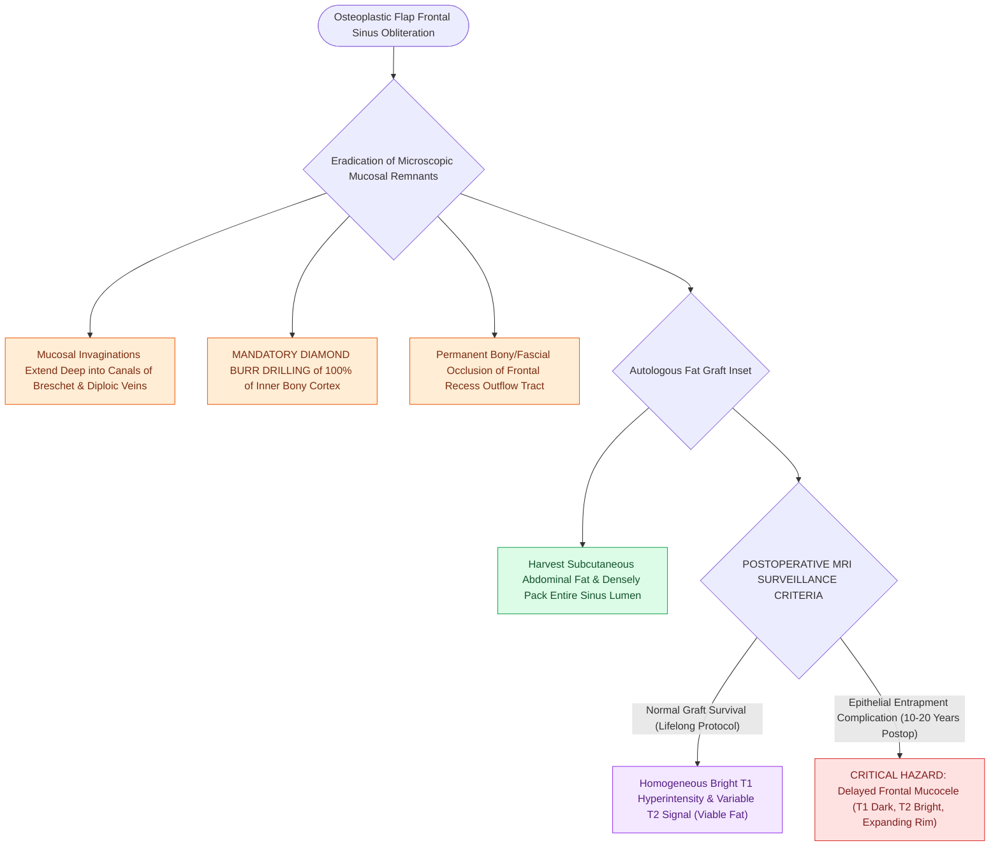

# Abdominal fat obliteration of the frontal sinus requires meticulous complete mucosal de-epithelialization

## Active Recall

> [!question]- Why must the entire inner cortical bone of the frontal sinus be drilled with a diamond burr prior to fat obliteration?
> *Answer / Clinical Rationale*: To eradicate microscopic invaginations of respiratory epithelium that extend into the **canals of Breschet and diploic venous channels**, which would otherwise form late entrapped mucoceles.

> [!question]- What is the expected signal characteristic of a successfully obliterated frontal sinus on follow-up T1-weighted MRI?
> *Answer / Clinical Rationale*: **Homogeneous bright T1 hyperintensity** corresponding to viable adipose tissue.

## Core Clinical & Mechanistic Principles
When obliterating the frontal sinus with autologous **subcutaneous abdominal fat**, the single most critical determinant of long-term success is **$100\%$ complete mechanical de-epithelialization of the entire sinus cavity**.

Leaving microscopic remnants of [[Respiratory epithelium drives mucociliary clearance toward natural ostia|respiratory epithelium]] entrapped beneath a vascularized fat graft results in **delayed mucocele formation (occurring 10 to 20 years postoperatively)**.

### Fat Graft Survival & MRI Monitoring
- The packed fat undergoes peripheral revascularization and central fibrous remodeling.
- **Postoperative MRI**: Fat maintains **hyperintense T1 signal** indefinitely. Loss of T1 hyperintensity or peripheral rim expansion indicates delayed infection or mucocele development.

## Connected Concepts & Graph Traversal
- **Open Procedure**: [[Osteoplastic flap with frontal sinus obliteration manages lateral frontal disease and osteomyelitis|Osteoplastic Flap]]
- **Mucocele Pathology**: [[Frontal sinus mucoceles cause bony erosion, proptosis, and intracranial extension|Frontal Mucoceles]]
- **Drill Safety**: [[Curved diamond and cutting burrs with continuous irrigation prevent frontal beak thermal osteonecrosis|Bone Drilling Technique]]
- **Diagnostic Evaluation**: [[Draf I frontal sinusotomy clears obstructing ethmoid cells without instrumenting the ostium|Draf I Frontal Sinusotomy]]
- **Surgical Craft**: [[Powered microdebrider blade selection and suction irrigation maintain clean surgical optics|Powered Microdebrider Craft]]
- **Anatomical Foundation**: [[CSF leak defect preparation requires circumferential bone de-mucosalization|CSF Defect Bed Preparation]]
- **Graft Source**: [[Osteoplastic flap elevation utilizes a six-foot Caldwell radiographic template and beveled osteotomies for complete frontal sinus fat obliteration|Osteoplastic Flap Elevation]]
