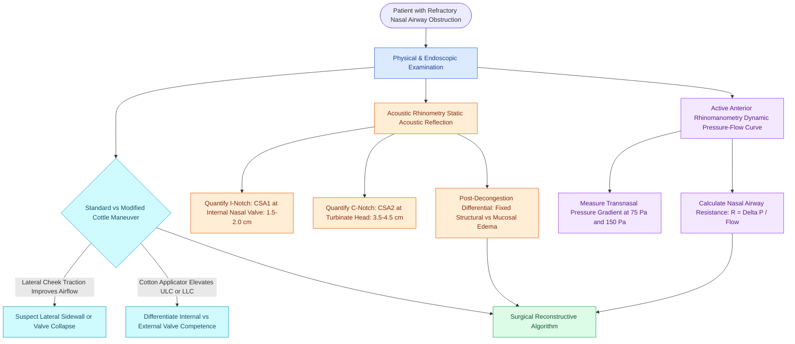

# Acoustic rhinometry and rhinomanometry evaluate internal nasal valve geometry and dynamic airflow resistance through cross-sectional area and transnasal pressure measurements

## Active Recall

> [!question]- What anatomical landmark corresponds to the I-notch (CSA1) in acoustic rhinometry, and what physical principle governs dynamic collapse at this narrowest site?
> *Answer / Clinical Rationale*: The **internal nasal valve (INV)**, representing the narrowest cross-sectional area of the human nasal airway ($0.5–0.7\text{ cm}^2$ at $1.5–2.0\text{ cm}$ from the nares). In accordance with **Bernoulli's principle** and the **Starling resistor model**, high-velocity airflow through this narrow segment causes a dramatic drop in intraluminal lateral pressure below atmospheric pressure, predisposing the compliant cartilaginous sidewall to dynamic inspiratory collapse.

> [!question]- Why does the presence of a nasal septal perforation invalidate active anterior rhinomanometry measurements?
> *Answer / Clinical Rationale*: Active anterior rhinomanometry requires placing a sealed pressure transducer in one nostril while the contralateral nostril undergoes active breathing to measure transnasal pressure gradients across the intact choana. A septal perforation permits **trans-septal air leakage and pressure equilibration** between sides, destroying unilateral resistance calculations.

## Core Clinical & Mechanistic Principles
The nasal cavity acts as a dynamic conduit conditioning inspired air through filtration, humidification, and temperature regulation. Transnasal airway resistance accounts for over $50\%$ of total respiratory resistance, with the majority generated at the **internal nasal valve (INV)**. The INV is bounded medially by the dorsal cartilaginous septum, laterally by the caudal margin of the upper lateral cartilage (ULC), inferiorly by the pyriform aperture floor, and posteriorly by the anterior head of the inferior turbinate. In Caucasian leptorrhine noses, the normal internal nasal valve angle is $10^\circ–15^\circ$.

Physiologically, the nasal valve acts as a **Starling resistor**, wherein a collapsible, compliant segment is situated between two rigid non-collapsible conduits (the external nasal vestibule and the bony cavum). During inspiration, airflow acceleration through the narrow valve orifice decreases intraluminal lateral hydrostatic pressure in accordance with **Bernoulli's principle** ($P + \frac{1}{2}\rho v^2 = \text{constant}$). Furthermore, by **Poiseuille's law**, airway resistance ($R$) is inversely proportional to the fourth power of the luminal radius ($R = \frac{8\eta L}{\pi r^4}$). Consequently, even a $10\%$ reduction in valve radius provokes an exponential increase in nasal airway resistance. Physiological mucosal congestion modulates baseline resistance through the **[[The nasal cycle provides alternating autonomic mucosal congestion and decongestion|nasal cycle]]**, while structural destabilization from a **[[Caudal septoplasty corrects caudal subluxation and external valve collapse through swinging-door relocation and L-strut preservation|caudal septal deflection]]** or weak upper lateral cartilages precipitates symptomatic dynamic obstruction.

### Physical Diagnostics: The Cottle vs. Modified Cottle Maneuver
- **Standard Cottle Maneuver**: The examiner applies lateral traction to the patient's cheek skin adjacent to the nasal sidewall to widen the internal nasal valve angle. A reported subjective improvement in nasal patency suggests nasal valve collapse, though false positives occur due to lateralization of the entire nasal sidewall.
- **Modified Cottle Maneuver**: Performed using the wooden shaft of a cotton-tipped applicator or small curette inserted intranasally. The instrument gently elevates and supports the caudal border of the ULC (testing the internal nasal valve) or the lateral crus of the lower lateral cartilage (testing the external nasal valve) without lateralizing adjacent facial soft tissues. Relief of obstruction specifically localizes the anatomical deficit.

### Acoustic Rhinometry Principles and Notches
Acoustic rhinometry employs sound impulse reflection to generate a two-dimensional profile of nasal cross-sectional area (y-axis) as a function of distance from the naris (x-axis):
1. **I-Notch (Cross-Sectional Area 1 / CSA1)**: Situated at $1.5–2.0\text{ cm}$ from the nostril margin; corresponds to the internal nasal valve and represents the **minimum cross-sectional area (MCA)** in normal anatomy ($0.5–0.7\text{ cm}^2$).
2. **C-Notch (Cross-Sectional Area 2 / CSA2)**: Situated at $3.5–4.5\text{ cm}$ from the naris; corresponds to the anterior head of the inferior and middle turbinates. Significant expansion following topical decongestion confirms reversible mucosal engorgement rather than fixed bony hypertrophy.
3. **CSA3 (Third Notch)**: Located at $5.5–7.0\text{ cm}$; demarcates the posterior nasal cavity and choana.
- *Clinical Limitation*: Acoustic rhinometry is a purely static physical measurement. Because it is obtained during breath-holding, it cannot capture dynamic inspiratory sidewall collapse.

### Rhinomanometry: Dynamic Flow-Pressure Metrics
Rhinomanometry directly measures dynamic transnasal airflow ($\dot{V}$) and driving pressure ($\Delta P$), calculating total nasal airway resistance ($R = \frac{\Delta P}{\dot{V}}$):
- **Active Anterior Rhinomanometry**: The international standard technique. A pressure-sensing nozzle is sealed airtight in one nostril while the patient breathes actively through the contralateral open nostril. The process is reversed to evaluate the opposite side, and values are combined via Ohm's law in parallel circuits.
- **Posterior Rhinomanometry**: Measures total airway resistance simultaneously by placing a pressure catheter into the oropharynx during bilateral nasal breathing, bypassing nostril occlusion.
- **Diagnostic Thresholds**: Nasal resistance is conventionally reported at fixed pressure gradients of $75\text{ Pa}$ or $150\text{ Pa}$. A baseline unilateral resistance exceeding $0.3\text{ Pa}/(\text{cm}^3/\text{s})$ indicates significant clinical obstruction.

## Connected Concepts & Graph Traversal
- **🔗 Internal Valve Reconstruction (FPRS)**: [[Spreader grafts restore internal nasal valve patency and prevent inverted-V deformity|Spreader Graft Reconstruction]]
- **🔗 External Valve Support (FPRS)**: [[Alar batten and lateral crural strut grafts prevent external nasal valve inspiratory collapse|Alar Batten Grafting]]
- **Turbinate Reduction Craft**: [[Inferior turbinate submucosal resection with outfracture provides durable volume reduction while preserving ciliated mucosal function|Submucosal Turbinate Resection]]
- **🔗 Surgical Rhinoplasty Context (FPRS)**: [[Auricular conchal cartilage grafts provide curved structural support for the alar and nasal valves|Conchal Cartilage Grafting]]
- **🔗 Pediatric Airway Parallels (Pediatrics)**: [[Rapid maxillary expansion widens the hard palate and nasal floor to improve pediatric nasal breathing and OSA|Rapid Maxillary Expansion]]
