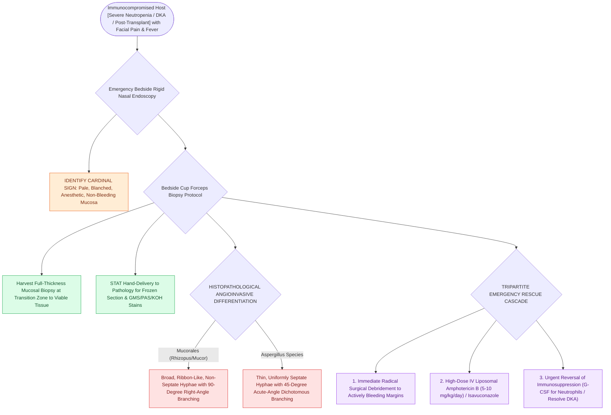

# Acute invasive fungal rhinosinusitis requires emergent surgical debridement and systemic amphotericin B

## Active Recall

> [!question]- How do Mucorales and Aspergillus differ histologically on GMS / fungal staining?
> *Answer / Clinical Rationale*: **Mucorales** (*Rhizopus, Mucor*) exhibit **broad, ribbon-like, non-septate hyphae with $90^\circ$ right-angle branching**. ***Aspergillus*** exhibits **thin, septate hyphae with $45^\circ$ acute-angle dichotomous branching**.

> [!question]- What is the hallmark endoscopic appearance of early acute invasive fungal sinusitis?
> *Answer / Clinical Rationale*: **Pale, blanched, anesthetic (non-bleeding) mucosa** over the turbinates or palate, which rapidly progresses to a black necrotic eschar.

## Core Clinical & Mechanistic Principles
**Acute Invasive Fungal Rhinosinusitis (AIFRS)** is a catastrophic, rapidly progressive, life-threatening angioinvasive infection occurring primarily in **immunocompromised hosts** (prolonged neutropenia from hematologic malignancy, solid organ transplant, or uncontrolled diabetic ketoacidosis).

Mortality exceeds **$50\text{–}80\%$** without immediate surgical and medical intervention.

### Pathogen-Specific Antifungal Pharmacotherapy
Systemic medical therapy must be initiated concurrently with emergency surgical debridement:
- **Empiric & Mucorales First-Line**: **Liposomal Amphotericin B ($5–10\text{ mg/kg/day IV}$)** is the mandatory empiric agent of choice, covering both *Mucorales* and *Aspergillus* pending definitive histopathology/culture. Isavuconazole or posaconazole serve as second-line or step-down oral options.
- **Aspergillus First-Line Targeted Therapy**: When invasive fungal sinusitis is confirmed to be caused by **Aspergillus species** (*Aspergillus fumigatus, A. flavus*), **intravenous Voriconazole ($6\text{ mg/kg}$ IV Q12H loading dose on day 1, followed by $4\text{ mg/kg}$ IV Q12H)** is the **first-line drug of choice** (demonstrating superior clinical survival and reduced nephrotoxicity compared to amphotericin B). Therapeutic drug monitoring (target trough $1.0–5.5\ \mu\text{g/mL}$) is required.

### Key Consultation Supplies
- Coaxial surgical headlight
- Rigid $0^\circ$ and $30^\circ$ Hopkins rod endoscopes ($4.0\text{ mm}$ and $2.7\text{ mm}$) with tower and video recording for middle turbinate and [[The uncinate process superior attachment dictates the frontal sinus drainage pathway|uncinate process]] inspection
- Nasal speculum and 9 Fr / 10 Fr Frazier suction tips
- Takahashi / Blakesley / through-cutting Weil-Blakesley cup forceps (for mucosal tissue biopsy)
- Sterile specimen containers with non-bacteriostatic saline (for immediate frozen section and fungal/bacterial cultures)
- Pathology notification requisition for STAT frozen section and GMS / PAS / KOH fungal staining
- Topical vasoconstriction / hemostatic pledgets (0.05% oxymetazoline, Surgicel®, Fibrillar™)

> [!example]- **Operative Note Template: Bedside rigid endoscopic sinonasal mucosal biopsy for suspected invasive fungal rhinosinusitis**
> **PROCEDURE**: Bedside rigid endoscopic sinonasal mucosal biopsy for suspected invasive fungal rhinosinusitis
> **PRE-PROCEDURAL DIAGNOSIS**: Suspected acute invasive fungal rhinosinusitis in an immunocompromised host
> **POST-PROCEDURAL DIAGNOSIS**: Sinonasal mucosal biopsy status-post frozen section pathology
> **SURGEON**: [Surgeon Name, MD]
> **ASSISTANT**: [Resident/Fellow Name, MD]
>
> **PROCEDURE IN DETAIL**:
> Informed consent was obtained. The patient is a severely neutropenic host presenting with persistent fevers and facial pressure. Under headlight illumination and rigid 0-degree endoscopic visualization, bilateral nasal passages were examined.
>
> The right nasal passage demonstrated normal pink, vascularized mucosa. The left nasal passage revealed blanched, pale, non-bleeding, insensate mucosa overlying the head of the middle turbinate and adjacent uncinate process without frank black eschar. Cup biopsy forceps were used to harvest a 4 x 3 mm full-thickness mucosal specimen at the transition margin between viable and pale mucosa. The specimen was placed immediately in sterile saline and personally hand-delivered to Pathology for STAT frozen section examination, calcofluor white, and GMS fungal stains.
>
> Biopsy bed hemostasis was secured with a small piece of Surgicel and oxymetazoline compression. The patient tolerated the procedure well. The operating room and Infectious Disease teams were placed on standby pending frozen section results.

## References
1. Adelson, R.T., Marple, B.F., Ryan, M.W. (2013). Fungal Rhinosinusitis. In Johnson, J.J., Rosen, C.A. (Eds.), *Bailey’s Head and Neck Surgery-Otolaryngology* 5e (pp. 557-572). Baltimore, MD: Lippincott Williams & Wilkins.
2. Benninger, M.S., Roxbury, C.R., Stokken, J.K. (2020). Acute Rhinosinusitis: Pathogenesis, Treatment, and Complications. In Flint, P.W., et al. (Eds.), *Cummings Otolaryngology Head and Neck Surgery* 7e (pp. 643-648). Philadelphia, PA: Elsevier.
3. Ergun, O., Tahir, E., Kuscu, O., et al. (2017). Acute invasive fungal rhinosinusitis: Presentation of 19 cases, review of the literature, and a new classification system. *J Oral Maxillofac Surg*, 75(4):767.e1-767.e9.

## Connected Concepts & Graph Traversal
- **Non-Invasive Fungi**: [[Allergic fungal rhinosinusitis presents with eosinophilic mucin and Charcot-Leyden crystals|Allergic Fungal Rhinosinusitis (AFRS)]]
- **Fungal Ball**: [[Chronic non-invasive fungal ball presents with dense maxillary mycetoma without tissue invasion|Sinonasal Fungal Ball]]
- **Complication Matrix**: [[High-stakes sinonasal complications require proactive landmarking and emergency rescue protocols|High-Stakes Sinonasal Matrix]]
- **High-Stakes Safety**: [[Intraoperative ICA injury requires two-surgeon suction and crushed muscle patch hemostasis|Internal Carotid Artery Crisis Protocol]]
- **Anatomical Foundation**: [[Retrobulbar hematoma requires emergent bedside lateral canthotomy and cantholysis|Retrobulbar Hematoma Protocol]]
- **Surgical Craft**: [[Pituitary apoplexy causes acute chiasmatic compression and life-threatening panhypopituitarism|Pituitary Apoplexy Emergency]]
