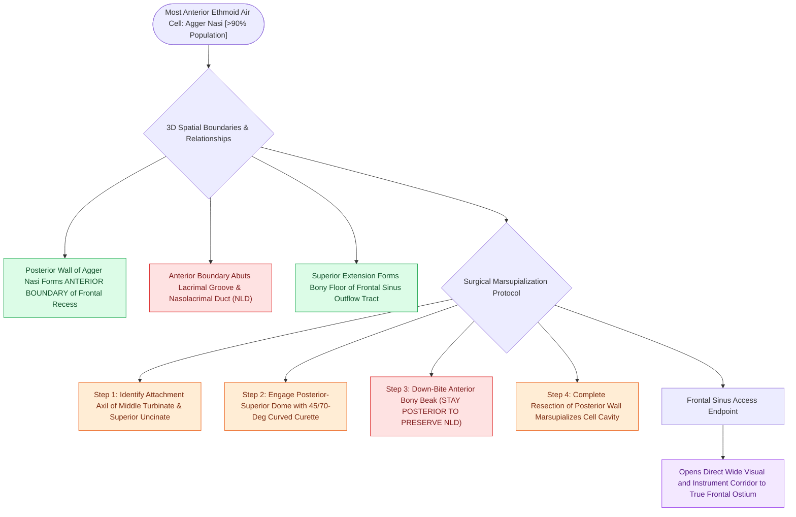

# Agger nasi cells form the anterior boundary of the frontal recess

## Active Recall

> [!question]- Why is complete unroofing of the agger nasi cell considered the essential first step in frontal sinus surgery?
> *Answer / Clinical Rationale*: Because the posterior wall of the agger nasi forms the **anterior boundary of the frontal recess**. Removing this cell opens the primary visual and surgical corridor to the frontal ostium.

> [!question]- What structure lies immediately anterior to the agger nasi cell that must be protected during aggressive uncapping?
> *Answer / Clinical Rationale*: The **nasolacrimal duct** and lacrimal sac, which sit immediately anterior in the lacrimal groove.

## Core Clinical & Mechanistic Principles
The **agger nasi cell** is the most anterior ethmoid air cell, present in **$>90\%$** of human skulls. It pneumatizes the lacrimal bone and the frontal process of the maxilla, sitting immediately anterior and superior to the anterior attachment of the **middle turbinate**.

### Anatomical Relationships & Significance
1. **Anterior Boundary of Frontal Recess**: The posterior wall of the agger nasi cell forms the **anterior wall of the frontal recess**.
2. **Surgical Key to Frontal Sinus**: Complete uncapping (marsupialization) of the agger nasi cell is the mandatory initial step to open the frontal sinus outflow tract in Draf I–III procedures.
3. **Obstruction Mechanism**: Hyper-pneumatization or chronic mucosal edema of the agger nasi cell compresses the frontal recess posteriorly against the skull base or bulla, causing frontal outflow obstruction and frontal sinusitis.

## Surgical Nuances & Marsupialization Protocol
- **Identification**: Located just superior to the uncinate process attachment and anterior to the middle turbinate axil.
- **Uncapping Technique**:
  - Enter the posterior-superior wall of the agger nasi cell using a 45° or 70° curette or curved [[Powered microdebrider blade selection and suction irrigation maintain clean surgical optics|microdebrider blade]].
  - Drill or punch down the dense anterior "beak" of the agger nasi without injuring the adjacent **nasolacrimal duct** anteriorly.

## Connected Concepts & Graph Traversal
- **Classification Anchor**: [[The Kuhn classification stages frontal recess and frontal sinus air cells|Kuhn Classification]]
- **Frontal Recess Space**: [[The frontal recess is bounded by the agger nasi, middle turbinate, and skull base|Frontal Recess Boundaries]]
- **Surgical Step**: [[Draf I frontal sinusotomy clears obstructing ethmoid cells without instrumenting the ostium|Draf I Sinusotomy]]
- **Uncinectomy Landmark**: [[Incisive uncinectomy exposes the ethmoid infundibulum while protecting the nasolacrimal duct|Incisive Uncinectomy]]
- **Diagnostic Imaging**: [[Frontoethmoidal cell classification by IFAC standardizes anterior and posterior frontal cells|IFAC Frontal Cell Classification]]
- **Anatomical Foundation**: [[Frontal recess cell dissection requires systematic uncapping of agger nasi and Kuhn cells along mucosal transition zones to preserve drainage patency|Frontal Recess Cell Dissection]]
