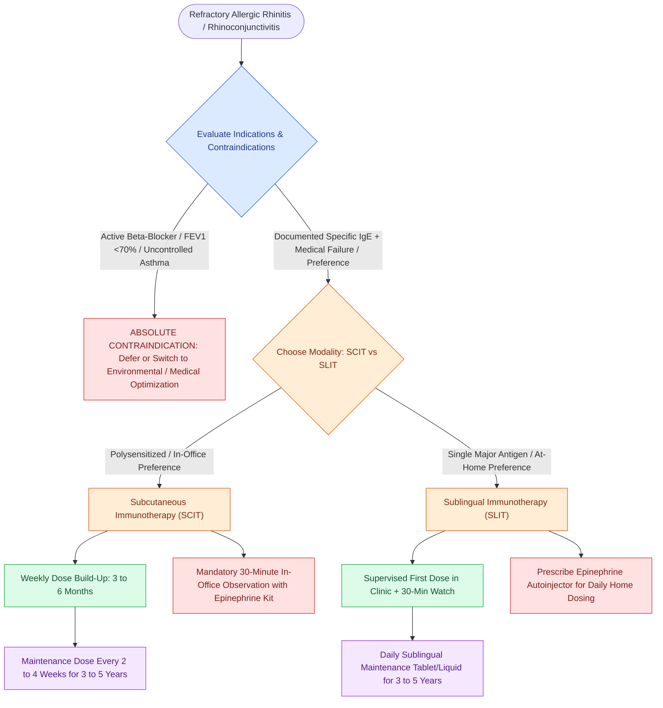

# Allergen immunotherapy induces regulatory T cells and IgG4 blocking antibodies to modulate allergic rhinitis and prevent asthma progression

## Active Recall

> [!question]- What are the primary immunologic mechanisms by which allergen immunotherapy induces long-term clinical tolerance?
> *Answer / Clinical Rationale*: Allergen immunotherapy drives immune deviation from a pathogenic **Th2 response toward a protective Th1 response**, induces **FoxP3+ regulatory T cells (Tregs)** and regulatory B cells (Bregs) producing immunosuppressive cytokines (**IL-10 and TGF-β**), and stimulates B-cell production of allergen-specific **IgG4 "blocking antibodies"** that outcompete IgE for allergen binding, preventing mast cell and basophil FcεRI cross-linking.
*(CummingsReview2017, Ch8, p.188–189)*

> [!question]- Why are concurrent beta-blockers an absolute contraindication to initiating allergen immunotherapy?
> *Answer / Clinical Rationale*: Beta-adrenergic receptor blockade impairs endogenous and exogenous catecholamine-mediated bronchodilation and cardiac inotropy, rendering anaphylaxis **refractory to standard rescue doses of intramuscular epinephrine**, and predisposes to **unopposed alpha-1-adrenergic vasoconstriction**, severe hypertensive crisis, and catastrophic cardiovascular collapse.
*(CummingsReview2017, Ch8, p.189)*

> [!question]- What is the standard therapeutic duration of allergen immunotherapy, and what disease-modifying benefits persist after cessation?
> *Answer / Clinical Rationale*: Maintenance immunotherapy is administered for **3 to 5 years**. Unlike pharmacotherapy which solely suppresses active symptoms, allergen immunotherapy induces durable immune tolerance that persists for years after discontinuation, **prevents the development of new allergen sensitizations**, and significantly **reduces the progression of allergic rhinitis to allergic asthma in children**.
*(CummingsReview2017, Ch8, p.188–189)*

## Core Clinical & Mechanistic Principles
**Allergen Immunotherapy (AIT)** represents the only disease-modifying therapeutic modality for IgE-mediated allergic disease. By systematically exposing the mucosal or cutaneous immune system to escalating doses of specific aeroallergens, AIT shifts the immune balance from inflammatory hypersensitivity to durable peripheral immune tolerance.

### Cellular & Molecular Mechanisms of Immune Tolerance
1. **Early Phase (Hours to Days)**:
   - Rapid desensitization of circulating basophils and mucosal mast cells.
   - Decreased release of preformed mediators (histamine, tryptase) and lipid mediators (leukotrienes, PGD2).
2. **Intermediate Phase (Weeks to Months)**:
   - Induction of **CD4+CD25+FoxP3+ regulatory T cells (Tregs)** and IL-10-producing type 1 regulatory T (Tr1) cells.
   - Secretion of **Interleukin-10 (IL-10)** and **Transforming Growth Factor-beta (TGF-β)**:
     - IL-10 suppresses mast cell, basophil, and eosinophil degranulation and cytokine release.
     - IL-10 downregulates major histocompatibility complex (MHC) class II and costimulatory molecules (CD80/CD86) on antigen-presenting dendritic cells.
     - Shifts the helper T-cell balance away from the allergic Th2 phenotype (decreased IL-4, IL-5, IL-13) toward the protective Th1 phenotype (increased IFN-γ).
3. **Humoral Tolerance & Blocking Antibodies**:
   - IL-10 instructs B lymphocytes to undergo class-switch recombination to **allergen-specific IgG4**.
   - **IgG4 acts as a non-inflammatory "blocking antibody"**:
     - Lacks complement-fixing ability.
     - Competitively binds soluble allergens before they can reach and cross-link membrane-bound IgE on mast cells and basophils.
     - Blunts the seasonal surge in allergen-specific IgE titers.
   - Induction of allergen-specific **secretory IgA (sIgA)** at mucosal barrier surfaces.
4. **Late Phase (Months to Years)**:
   - Significant reduction in tissue infiltration of eosinophils, basophils, and mast cells in the nasal mucosa.
   - Substantial decrease in late-phase mucosal inflammation, tissue remodeling, and nonspecific nasal hyperresponsiveness.

### Subcutaneous Immunotherapy (SCIT) vs Sublingual Immunotherapy (SLIT)
- **Subcutaneous Immunotherapy (SCIT)**:
  - *Administration*: Deep subcutaneous injection into the posterolateral mid-arm (avoiding intramuscular or intravenous penetration).
  - *Schedule*: Weekly escalating doses during the **build-up phase (3 to 6 months)** based on starting dilution (derived from quantitative IDT/MQT endpoint titration or skin prick testing), followed by the **maintenance phase (every 2 to 4 weeks)** for **3 to 5 years**.
  - *Clinical Scope*: Capable of compounding customized, multi-antigen extract mixtures addressing broad polysensitization.
  - *Risk Profile*: Carries a small but real risk of severe systemic anaphylaxis (~0.1% of injections); **mandatory 30-minute post-injection observation** in a physician-supervised facility equipped with oxygen, suction, and parenteral epinephrine.
- **Sublingual Immunotherapy (SLIT)**:
  - *Administration*: Fast-dissolving tablet or aqueous drop placed beneath the tongue, held for 1 to 2 minutes, then swallowed. Targets oral mucosal dendritic cells (Langerhans cells) that have high tolerogenic potential and low mast cell density.
  - *Schedule*: Initial dose administered under direct medical supervision in the office with a 30-minute observation period. Subsequent doses self-administered daily at home.
  - *Clinical Scope*: Primarily FDA-approved for monotherapy or single-class antigens (e.g., northern pasture grasses, ragweed, dust mites).
  - *Risk Profile*: Exceptional systemic safety profile; systemic anaphylaxis is exceedingly rare. Local adverse effects (oral pruritus, mild tongue/lip edema, throat irritation) occur in up to 70% during initiation but self-resolve over 1 to 2 weeks. Every patient must maintain an unexpired epinephrine autoinjector.

### Indications & Patient Selection Criteria
1. Demonstrated presence of allergen-specific IgE antibodies confirmed via cutaneous skin testing or serum specific IgE (FEIA / ImmunoCAP).
2. Allergic rhinitis, allergic rhinoconjunctivitis, or allergic asthma symptoms correlating temporally with exposure to the identified allergens.
3. Inadequate symptom control despite adherence to environmental allergen avoidance and first-line pharmacotherapy (intranasal corticosteroids, antihistamines).
4. Unacceptable pharmacotherapy adverse effects (e.g., severe drowsiness, dry eyes/mucosa, epistaxis, IOP elevation).
5. Patient preference for a curative, disease-modifying treatment rather than chronic, indefinite daily medication dependence.
6. Prevention of the "allergic march" in pediatric populations, mitigating future asthma onset.

### Contraindications & Safety Guardrails
- **Absolute Contraindications**:
  1. **Concurrent Beta-Blocker Therapy**: Includes systemic (oral/IV) and topical ophthalmic formulations. Beta-blockade induces refractoriness to epinephrine rescue, promotes unopposed alpha-adrenergic vasoconstriction, and potentiates lethal bronchospasm.
  2. **Severe or Poorly Controlled Asthma**: Baseline $\text{FEV}_1 < 70\%$ predicted or frequent acute exacerbations. Active bronchospasm at the time of injection is the single greatest risk factor for fatal AIT-induced anaphylaxis.
  3. **Severe Medical Instability**: Unstable angina, recent myocardial infarction, or severe end-stage renal/hepatic disease.
- **Relative Contraindications**:
  1. **Concurrent ACE Inhibitor Therapy**: Impairs endogenous bradykinin breakdown, potentially worsening the severity of anaphylactoid angioedema.
  2. **Autoimmune Diseases & Immunodeficiencies**: May flare systemic autoimmunity or exhibit blunted tolerogenic responses.
  3. **Active Malignancy**: Immunomodulation may interfere with immune surveillance or antineoplastic therapy.
  4. **Pregnancy**: AIT build-up must **never be initiated during pregnancy** due to the catastrophic risk of systemic anaphylaxis inducing uterine hypercontraction, placental hypoperfusion, and fetal hypoxia. However, well-tolerated **maintenance doses may be safely continued** during pregnancy without dose escalation.
  5. **Inability to Communicate / Severe Cognitive Impairment**: Inability to recognize or report early premonitory symptoms of anaphylaxis.

### Clinical Dosing Rules & Course Completion
- **Dose Adjustment Rules for SCIT**:
  - If a large local reaction ($>5\text{ cm}$ wheal/erythema) occurs, the next dose is repeated without escalation.
  - If a systemic reaction occurs, the dose is dropped by at least 1 to 2 dilution increments.
  - Injections must be withheld during acute febrile illnesses or active asthma flares.
  - Missed injections require step-down dose adjustments based on the elapsed interval (e.g., drop 1 dose step for 1–2 weeks overdue, drop 1 vial concentration for $>4\text{ weeks}$ overdue).
- **Duration of Therapy**:
  - Full clinical benefits typically manifest within **6 to 12 months** of achieving maintenance.
  - Treatment is maintained for **3 to 5 consecutive years**. Discontinuation after 3–5 years results in prolonged, persistent symptom remission in the vast majority of patients.

Comprehensive physiological and surgical principles connect these findings directly to [[The Gell and Coombs classification delineates four distinct immunologic hypersensitivity mechanisms underlying otolaryngic disease|hypersensitivity mechanisms]].

## Connected Concepts & Graph Traversal
- **Diagnostic Endpoint Mapping**: [[Intradermal dilutional testing IDT and modified quantitative testing MQT quantify allergic sensitization to guide safe immunotherapy escalation|IDT & MQT Testing Protocol]]
- **Phenotypic Rhinitis Spectrum**: [[Rhinitis subtypes are differentiated into allergic, vasomotor, gustatory, and rhinitis medicamentosa|Rhinitis Classification]]
- **Type 2 Effector Biology**: [[Type 2 CRS exhibits eosinophilic inflammation responsive to targeted biologics|Type 2 Eosinophilic Inflammation]]
- **Biologic Monoclonal Cross-Talk**: [[Biologic therapeutics in chronic rhinosinusitis target IgE, IL-4, IL-5, and IL-13 inflammatory pathways|Biologics in Type 2 Disease]]
- **Severe Comorbid Triad**: [[AERD manifests with asthma, nasal polyps, and severe aspirin-induced respiratory reactions|AERD Clinical Triad]]
