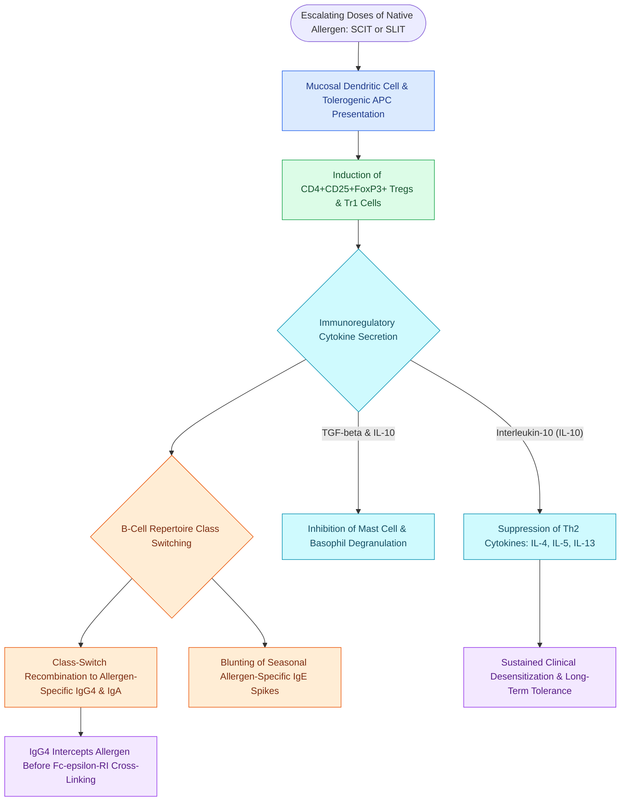

# Allergen immunotherapy via subcutaneous injections or sublingual dosing induces regulatory T cells and allergen-specific IgG4 blocking antibodies to restore immune tolerance

## Active Recall

> [!question]- What cellular and cytokine shifts mediate the transition from Th2 allergic inflammation to long-term immune tolerance during allergen immunotherapy?
> *Answer / Clinical Rationale*: Immunotherapy stimulates specialized dendritic cells to induce **CD4+CD25+FoxP3+ regulatory T cells (Tregs)** and Tr1 cells, which secrete **Interleukin-10 (IL-10)** and **Transforming Growth Factor-beta (TGF-$\beta$)**. These cytokines suppress Th2 effector cells (IL-4, IL-5, IL-13), inhibit mast cell degranulation, and induce B cells to class-switch toward allergen-specific **IgG4 blocking antibodies**.

> [!question]- Why do allergen-specific IgG4 antibodies prevent mast cell degranulation despite persistent allergen exposure?
> *Answer / Clinical Rationale*: IgG4 functions as a non-inflammatory **"blocking antibody"** with high affinity for the target allergen. It intercepts and binds the allergen before it can bridge adjacent cell-bound **IgE molecules on high-affinity Fc$\epsilon$RI receptors** on tissue mast cells and basophils, thereby mechanically preventing receptor cross-linking and intracellular degranulation.

## Core Clinical & Mechanistic Principles
Allergic rhinitis represents a classic Gell and Coombs **Type 1 IgE-mediated hypersensitivity reaction**. Sensitization occurs when inhaled airborne allergens (pollens, dust mites, animal danders, fungal spores) are captured by airway dendritic cells and presented to naive T cells, promoting differentiation into T-helper 2 (Th2) lymphocytes. Th2 cells secrete Interleukin-4 (IL-4) and Interleukin-13 (IL-13), driving B-cell immunoglobulin class-switching to allergen-specific IgE, which binds firmly to high-affinity Fc$\epsilon$RI receptors on submucosal mast cells. Re-exposure triggers the **early-phase response** within minutes, releasing preformed histamine, tryptase, and leukotrienes (LTC4, LTD4), followed at 4–8 hours by the **late-phase response** driven by eosinophil infiltration, major basic protein, and **[[Type 2 CRS exhibits eosinophilic inflammation responsive to targeted biologics|Type 2 eosinophilic inflammation]]**. In severe atopic airway phenotypes, persistent fungal colonization and heavy eosinophilic mucin manifest clinically as **[[Allergic fungal rhinosinusitis presents with eosinophilic mucin and Charcot-Leyden crystals|Allergic Fungal Rhinosinusitis (AFRS)]]**.

Allergen immunotherapy (AIT) is the only disease-modifying treatment for allergic rhinitis, capable of altering the underlying immunological trajectory and preventing new allergen sensitizations or the progression to allergic asthma. Administered via subcutaneous injections (SCIT) or sublingual drops/tablets (SLIT), AIT systematically re-educates the immune system through four tightly regulated immunological phases.

### Immunological Mechanism: The Four Tolerogenic Phases
1. **Early Effector Cell Desensitization (Hours to Days)**: Rapid down-regulation of high-affinity Fc$\epsilon$RI signaling on circulating basophils and mucosal mast cells, decreasing immediate mediator release and blunting end-organ reactivity.
2. **Induction of Regulatory T Cells (Weeks)**: Repeated allergen exposure stimulates tolerogenic dendritic cells to generate **CD4+CD25+FoxP3+ regulatory T cells (Tregs)** and Interleukin-10-producing Type 1 regulatory (Tr1) cells.
3. **Suppressive Cytokine Release & Th2 Repression (Months)**: Tregs secrete high levels of **IL-10** and **TGF-$\beta$**. IL-10 selectively suppresses Th2 proliferation, down-regulates IL-4 and IL-13 synthesis, and inhibits eosinophil survival factor IL-5. Simultaneously, it induces apoptosis in allergen-specific effector T cells.
4. **B-Cell Class-Switching & IgG4 Blocking Antibodies (Months to Years)**: Under IL-10 stimulation, allergen-specific B lymphocytes class-switch from producing IgE to synthesizing **IgG4** and secretory **IgA**. Allergen-specific IgG4 acts as a non-inflammatory antibody that competitively binds the allergen, preventing it from cross-linking IgE on mast cells. Serum IgG4 titers rise several hundred-fold during maintenance therapy and correlate with durable clinical remission.

### Comparison of Delivery Platforms: SCIT vs. SLIT
- **Subcutaneous Immunotherapy (SCIT)**:
  - *Administration*: Weekly subcutaneous dose escalation over 3–6 months followed by monthly maintenance injections for 3–5 years.
  - *Efficacy*: High clinical efficacy across polysensitized patients; robust allergen-specific IgG4 induction.
  - *Safety Profile*: Carries a systemic anaphylaxis risk of $0.1\%\text{--}0.2\%$ of injections. Must be administered in a medically supervised clinic equipped with resuscitation equipment and epinephrine, followed by a mandatory **30-minute post-injection observation period**.
- **Sublingual Immunotherapy (SLIT)**:
  - *Administration*: Dissolvable tablets or liquid drops held beneath the tongue for 1–2 minutes before swallowing, administered daily for 3 years.
  - *Mechanism*: Allergen is captured by oral mucosal dendritic Langerhans cells that naturally promote tolerance without encountering mast cells.
  - *Safety Profile*: Exceptional safety record with near-zero fatal anaphylaxis risk, permitting unmonitored home administration after the initial office dose. Adverse events are predominantly local (transient oral pruritus, sublingual edema, throat irritation).

## Connected Concepts & Graph Traversal
- **Phenotypic Classification**: [[Rhinitis subtypes are differentiated into allergic, vasomotor, gustatory, and rhinitis medicamentosa|Rhinitis Subtypes]]
- **Diagnostic Sensitization**: [[Intradermal dilutional testing IDT and modified quantitative testing MQT quantify allergic sensitization to guide safe immunotherapy escalation|Intradermal Dilutional Testing]]
- **Surgical Autonomic Alternative**: [[Transnasal endoscopic vidian neurectomy treats refractory non-allergic cholinergic rhinitis|Vidian Neurectomy]]
- **Chemosensory Impact**: [[Olfactory neuroepithelium contains bipolar sensory neurons and basal stem cells|Olfactory Neuroepithelium]]
- **Clinical Management**: [[Allergen immunotherapy induces regulatory T cells and IgG4 blocking antibodies to modulate allergic rhinitis and prevent asthma progression|Allergen Immunotherapy]]
