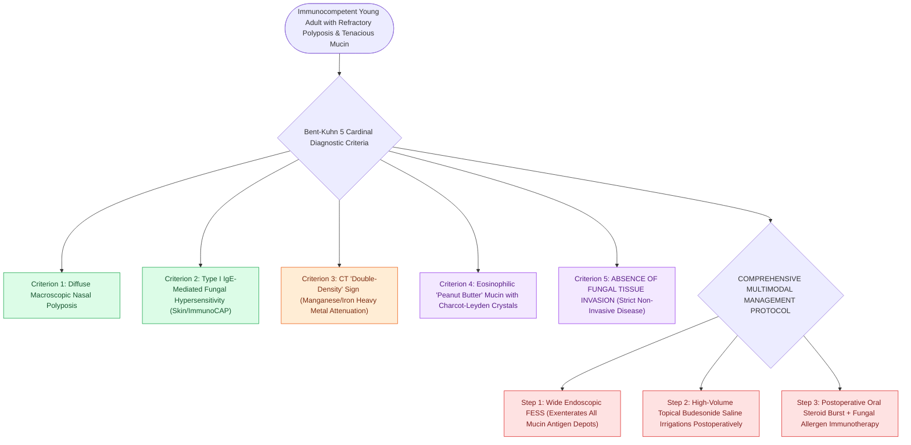

# Allergic fungal rhinosinusitis presents with eosinophilic mucin and Charcot-Leyden crystals

## Active Recall

> [!question]- What causes the classic 'double-density' sign on non-contrast CT in allergic fungal rhinosinusitis?
> *Answer / Clinical Rationale*: The accumulation of **dense fungal metabolic byproducts (manganese, iron, calcium salts)** within thick, inspissated allergic mucin, which appears radiodense relative to the surrounding inflamed soft-tissue mucosal lining.

> [!question]- Is tissue invasion by fungal hyphae present in allergic fungal rhinosinusitis?
> *Answer / Clinical Rationale*: **NO**. AFRS is strictly a non-invasive hypersensitivity reaction. The identification of fungal hyphae invading through the basement membrane or vascular walls defines [[Acute invasive fungal rhinosinusitis requires emergent surgical debridement and systemic amphotericin B|invasive fungal sinusitis]] (acute or chronic), a completely different pathology.

## Core Clinical & Mechanistic Principles
**Allergic Fungal Rhinosinusitis (AFRS)** is a distinct, non-invasive, IgE-mediated hypersensitivity reaction to ubiquitous dematiaceous environmental fungi (*Bipolaris*, *Curvularia*, *Alternaria*, *Aspergillus*). It typically affects immunocompetent adolescents and young adults.

### Pathognomonic Features & CT "Double-Density" Sign
- **"Peanut Butter" Mucin**: Sinuses are filled with thick, tenacious, dark green/brown, highly viscous "allergic mucin" resembling peanut butter or clay.
- **CT Double-Density Sign**: High-attenuation (hyperdense) areas within the sinus cavity on non-contrast CT, caused by concentrated **heavy metals (manganese, iron)** and calcium phosphate precipitated by fungal metabolism, surrounded by hypodense mucosal edema.
- **Bony Remodeling**: Expansile pressure causes extensive bone erosion and remodeling of the [[Lamina papyracea dehiscence predisposes to orbital fat herniation and medial rectus injury|lamina papyracea]] and skull base without direct fungal tissue invasion.

## Surgical & Medical Management
- **Meticulous Debridement**: Complete surgical evacuation of all allergic mucin and unroofing of all involved sinuses is mandatory (residual mucin acts as an ongoing antigen depot driving rapid recurrence).
- **Postoperative Steroid Delivery**: High-volume [[Postoperative FESS debridement timing and technique prevent crusting and synechiae formation|budesonide irrigations]] to suppress local eosinophilic inflammation; systemic steroids during acute flares. Antifungals play a minimal role because the pathology is immunological, not infectious.

## Connected Concepts & Graph Traversal
- **Parent Endotype**: [[Type 2 CRS exhibits eosinophilic inflammation responsive to targeted biologics|Type 2 CRS]]
- **Radiological Check**: [[The CLOSE checklist systematically evaluates critical radiological danger zones|CLOSE Checklist (Bone Expansion)]]
- **Differential Pathology**: [[AERD manifests with asthma, nasal polyps, and severe aspirin-induced respiratory reactions|AERD]]
- **Anatomical Foundation**: [[Chronic non-invasive fungal ball presents with dense maxillary mycetoma without tissue invasion|Sinonasal Fungal Ball]]
- **Non-IgE Eosinophilic Differential**: [[Nonallergic rhinitis with eosinophilia syndrome NARES features nasal eosinophilia without IgE sensitization and represents a precursor to Samter triad|NARES]]
- **Disease Mechanism**: [[The Gell and Coombs classification delineates four distinct immunologic hypersensitivity mechanisms underlying otolaryngic disease|Mixed Type I/III Hypersensitivity]]
