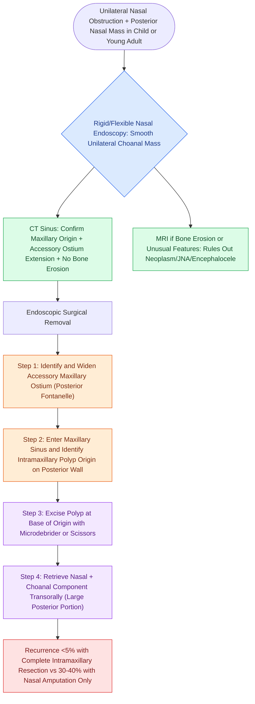

# Antrochoanal polyps originate in the posterior maxillary sinus and extend through the accessory ostium into the choana requiring endoscopic surgical removal

## Active Recall

> [!question]- Why do antrochoanal polyps not respond to systemic or topical corticosteroids, distinguishing them from CRSwNP?
> *Answer / Clinical Rationale*: Antrochoanal polyps are **non-inflammatory stromal polyps** arising from the posterior wall or floor of the maxillary sinus, with an edematous fibromyxoid stroma rather than eosinophilic mucin. They lack the Type 2 inflammatory cytokine milieu (IL-4/IL-5/IL-13/IgE) driving CRSwNP, so **steroids have no role** and primary treatment is always **surgical endoscopic removal**.

> [!question]- What is the mandatory intraoperative step that prevents antrochoanal polyp recurrence during FESS?
> *Answer / Clinical Rationale*: **Complete removal of the intramaxillary portion of the polyp** through a wide inferior meatal antrostomy or middle meatal antrostomy — simply amputating the nasal/choanal portion while leaving the maxillary origin intact causes near-universal recurrence. The polyp must be traced to its intrasinus origin and excised at the base of origin from the posterior maxillary wall.

## Core Clinical & Mechanistic Principles

An **antrochoanal polyp (ACP)** — also called a **Killian polyp** — is a distinct, unilateral, benign sinonasal mass that originates within the **maxillary sinus** and grows to extend through the **accessory maxillary ostium (posterior fontanelle)** into the posterior nasal cavity and nasopharynx/choana. It is fundamentally different from the bilateral inflammatory polyps of [[Type 2 CRS exhibits eosinophilic inflammation responsive to targeted biologics|CRSwNP]].

### Key Distinguishing Features vs. CRSwNP

| Feature | Antrochoanal Polyp | CRSwNP |
|---|---|---|
| **Laterality** | **Unilateral** (virtually always) | Bilateral in >95% |
| **Sinus of origin** | **Posterior maxillary wall** or floor | Middle meatus, ethmoid |
| **Histology** | Edematous fibromyxoid stroma; few eosinophils | Eosinophilic mucin, Charcot-Leyden crystals |
| **IgE/allergy** | No association | Strong Type 2 association |
| **Medical therapy** | **None effective** | Topical/systemic steroids, biologics |
| **Recurrence after partial removal** | Near-universal | Moderate |
| **Pediatric predilection** | More common in children/young adults | All ages |

### Pathogenesis
The exact etiology of ACPs is unknown. Proposed mechanisms include:
1. **Mucosal prolapse theory**: Normal maxillary sinus mucosa prolapses through the accessory maxillary ostium due to differential pressure gradients during sneezing/nose-blowing
2. **Retention cyst rupture theory**: A mucous retention cyst within the maxillary sinus ruptures and prolapses its contents through the accessory ostium, forming the pedunculated stalk of the ACP
3. **Inflammation-independent edema**: Local stromal edema causes progressive intrasinus expansion, eventually herniating through the path of least resistance (accessory ostium, which is larger than the natural ostium)

### Clinical Presentation
- **Symptoms**: Unilateral nasal obstruction progressing to bilateral as the choanal component enlarges; mouth breathing and snoring from nasopharyngeal component; rarely epistaxis
- **Endoscopic appearance**: Glistening, smooth-surfaced, pale mass visible in the posterior nasal cavity and nasopharynx on posterior rhinoscopy (flexible scope through the nose or rigid scope retroflexed); the nasal component appears as a pedunculated stalk traceable to the middle or inferior meatus
- **Imaging**: CT reveals complete opacification of the maxillary sinus with a soft-tissue mass extending through the accessory ostium into the nasal cavity; **no bone erosion** (distinguishes from neoplasm); MRI characteristically shows intermediate T1 and high T2 signal (edematous stroma)

### Surgical Technique Details
1. **Posterior fontanelle approach** (preferred): The accessory ostium in the posterior inferior fontanelle (between the natural ostium anteriorly and the posterior wall) is the natural exit route of the ACP stalk. This is widened endoscopically to allow visualization and microdebrider access into the maxillary sinus
2. **Middle meatal antrostomy**: If the posterior fontanelle approach does not provide adequate access to the intramaxillary origin, a middle meatal antrostomy is added to allow 70° angled endoscope and curved instrument access to the posterior maxillary wall
3. **Transoral removal**: The large choanal/nasopharyngeal portion of the polyp is amputated transorally with curved scissors (wide-mouth gag retraction) to avoid traumatizing the posterior choana mucosa
4. **Key principle**: The natural ostium must NOT be separated from the accessory ostium (posterior fontanelle) by residual mucosa bridge — any residual mucosal bridge between the two ostia creates a recirculation pathway for mucus and promotes polyp recurrence

## Critical Failure Modes & Error Traps
- **Amputating at the nasal stalk only**: Leaves the intramaxillary polyp base intact → near-universal recurrence within 1–2 years
- **Confusing with JNA**: Juvenile nasopharyngeal angiofibroma (JNA) also presents as unilateral nasal mass in adolescent males — JNA bleeds profusely with any manipulation, requires MRI pre-biopsy, and originates at the sphenopalatine foramen, NOT in the maxillary sinus
- **Missing the intrasinus component**: Failure to examine the posterior maxillary wall through the widened antrostomy leaves the origin unaddressed

## Connected Concepts & Graph Traversal
- **CRSwNP Contrast**: [[Non-Type 2 CRS features neutrophilic inflammation associated with cystic fibrosis and ciliopathies|Inflammatory Endotype Distinction]]
- **Maxillary Sinus Access**: [[Controlled middle meatal antrostomy enlargement preserves the anterior inferior fontanelle|Middle Meatal Antrostomy Technique]]
- **Unilateral Mass DDx**: [[Sinonasal inverting papilloma requires subperiosteal excision and hyperostotic bone drill-out|Inverting Papilloma Differential]]
- **JNA Vascular Differential**: [[Sinonasal juvenile angiofibroma staging by Radkowski and Fisch guides surgical approach|Juvenile Nasopharyngeal Angiofibroma]]
- **Posterior Nasal Anatomy**: [[Separate inferior antrostomies cause recirculating mucus and recalcitrant sinusitis|Antrostomy and Recirculation Artifact]]
- **Nasal Mass Imaging**: [[MRI T1, T2, and contrast protocols differentiate sinonasal neoplasms from inspissated secretions|Sinonasal MRI Protocol]]
